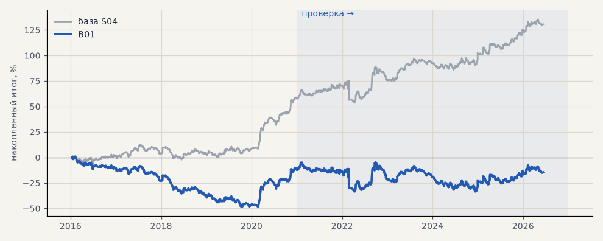

# B01. База — все неизбежные издержки

**Семейство:** стратегия без ML (импульс) · **база:** S04 · **гипотеза:** H02 · **вердикт:** база

**Что проверяли.** База для всех сравнений: сделки S03 (цены акций скорректированы на дивиденды, стоп исполняется по гэпу, комиссия 0.04%) плюс проскальзывание 0.05% на сторону и своп за каждый перенос позиции через ночь по условиям Альфа-Форекс на 06.10.2026: акции −0.068% в обе стороны, серебро лонг −0.073% и шорт −0.020% (шаг цены 0.001), золото лонг −0.011%, эфир −0.042%. Выходные — тройной перенос.

**Зачем.** Доработки нужно сравнивать с версией, где учтено всё, без чего результат завышен, — иначе «улучшение» может оказаться непосчитанной издержкой. Сделка держится в среднем около 5 дней, это 5–6 переносов.

**Итог простыми словами.** Портфель 4 около нуля на проверке и в минусе на выборе: свопы акций съедают весь доход. В плюсе остаются металлы — серебро и золото (срез «металлы»). Через CFD имеет смысл торговать только их; акции — на бирже, где у лонга нет свопа (гипотеза H04).

**Издержки:** профиль `base` (спред и свопы брокера)

Подробности: [results/costs.md](../../results/costs.md)

Проверка — сделки, открытые с 1 января 2021 года; выбор — до 2021. В скобках — база на тех же инструментах.

| срез | период | сделок | итог % | выигрышей | ожидание на сделку | PF | без 2 лучших | просадка | t | лет в плюсе |
|---|---|---|---|---|---|---|---|---|---|---|
| все инструменты | проверка | 1924 (1924) | -18.9 (+46.1) | 41% (45%) | -0.078% (+0.192%) | 0.95 (1.14) | -27.9 (+36.9) | -32.5 (-17.9) | -0.70 (1.69) | 1/6 (5/6) |
| все инструменты | выбор | 1196 (1196) | -41.1 (+11.6) | 39% (44%) | -0.275% (+0.077%) | 0.79 (1.07) | -45.8 (+6.8) | -59.1 (-19.8) | -3.02 (0.84) | 1/5 (1/5) |
| портфель 4 | проверка | 896 (896) | -2.3 (+72.9) | 42% (47%) | -0.010% (+0.325%) | 0.99 (1.27) | -17.7 (+57.2) | -28.9 (-21.7) | -0.07 (2.05) | 3/6 (6/6) |
| портфель 4 | выбор | 665 (665) | -12.3 (+57.8) | 41% (47%) | -0.074% (+0.348%) | 0.94 (1.32) | -21.8 (+48.2) | -49.1 (-14.3) | -0.55 (2.54) | 1/5 (4/5) |
| металлы (серебро + золото) | проверка | 506 (506) | +41.3 (+78.8) | 44% (46%) | +0.163% (+0.311%) | 1.17 (1.35) | +23.2 (+60.2) | -28.5 (-16.4) | 1.18 (2.21) | 5/6 (5/6) |
| металлы (серебро + золото) | выбор | 461 (461) | -11.5 (+19.2) | 38% (41%) | -0.050% (+0.083%) | 0.94 (1.10) | -30.4 (+0.1) | -55.8 (-35.1) | -0.41 (0.67) | 1/5 (3/5) |
| серебро | проверка | 243 (243) | +58.1 (+124.7) | 46% (48%) | +0.239% (+0.513%) | 1.18 (1.43) | +21.9 (+87.5) | -51.2 (-29.7) | 0.94 (1.99) | 5/6 (5/6) |
| серебро | выбор | 218 (218) | +25.4 (+79.7) | 37% (43%) | +0.117% (+0.366%) | 1.11 (1.41) | -12.4 (+41.4) | -66.8 (-42.4) | 0.52 (1.59) | 2/5 (3/5) |
| золото | проверка | 263 (263) | +24.5 (+32.8) | 42% (44%) | +0.093% (+0.125%) | 1.15 (1.20) | -2.2 (+6.0) | -39.2 (-35.2) | 0.73 (0.98) | 2/6 (3/6) |
| золото | выбор | 243 (243) | -48.4 (-41.3) | 40% (40%) | -0.199% (-0.170%) | 0.73 (0.77) | -63.4 (-56.3) | -69.1 (-63.2) | -1.80 (-1.53) | 2/5 (2/5) |
| LKOH | проверка | 214 (214) | -59.3 (+21.8) | 40% (46%) | -0.277% (+0.102%) | 0.80 (1.09) | -80.9 (-1.0) | -89.9 (-57.0) | -1.23 (0.44) | 1/6 (3/6) |
| LKOH | выбор | 132 (132) | -2.6 (+67.0) | 45% (52%) | -0.020% (+0.507%) | 0.99 (1.46) | -28.8 (+39.4) | -48.4 (-31.4) | -0.06 (1.65) | 2/5 (3/5) |
| GAZP | проверка | 219 (219) | -23.3 (+55.4) | 42% (51%) | -0.106% (+0.253%) | 0.94 (1.17) | -83.4 (-5.4) | -112.1 (-82.1) | -0.22 (0.52) | 3/6 (4/6) |
| GAZP | выбор | 154 (154) | -14.2 (+66.3) | 40% (47%) | -0.092% (+0.431%) | 0.93 (1.41) | -41.0 (+38.5) | -52.8 (-19.3) | -0.34 (1.57) | 3/5 (4/5) |
| SBER | проверка | 220 (220) | +15.2 (+89.6) | 37% (44%) | +0.069% (+0.407%) | 1.06 (1.43) | -12.0 (+61.2) | -45.1 (-29.6) | 0.30 (1.74) | 2/6 (3/6) |
| SBER | выбор | 161 (161) | -57.8 (+18.3) | 45% (48%) | -0.359% (+0.113%) | 0.79 (1.08) | -82.3 (-7.0) | -89.8 (-46.4) | -1.21 (0.38) | 2/5 (3/5) |
| MOEX | проверка | 227 (227) | -93.7 (-11.4) | 37% (41%) | -0.413% (-0.050%) | 0.71 (0.96) | -117.4 (-36.7) | -93.7 (-37.7) | -1.93 (-0.23) | 1/6 (2/6) |
| MOEX | выбор | 153 (153) | -75.4 (-7.3) | 39% (44%) | -0.493% (-0.048%) | 0.70 (0.97) | -93.1 (-26.5) | -102.6 (-64.4) | -1.79 (-0.17) | 1/5 (1/5) |
| MTSS | проверка | 196 (196) | -48.1 (+26.0) | 39% (43%) | -0.245% (+0.133%) | 0.83 (1.11) | -86.9 (-12.9) | -54.5 (-28.6) | -0.93 (0.50) | 2/6 (3/6) |
| MTSS | выбор | 135 (135) | -155.9 (-90.1) | 32% (39%) | -1.155% (-0.667%) | 0.39 (0.58) | -171.3 (-106.7) | -155.9 (-92.2) | -4.42 (-2.52) | 0/5 (1/5) |
| ETH | проверка | 342 (342) | -24.2 (+29.7) | 44% (44%) | -0.071% (+0.087%) | 0.98 (1.03) | -82.2 (-28.8) | -115.3 (-106.6) | -0.17 (0.20) | 4/6 (4/6) |

Журнал сделок: `trades.csv.gz` (инструмент, прогон, сторона, вход, выход, цены, результат после издержек, причина выхода).
