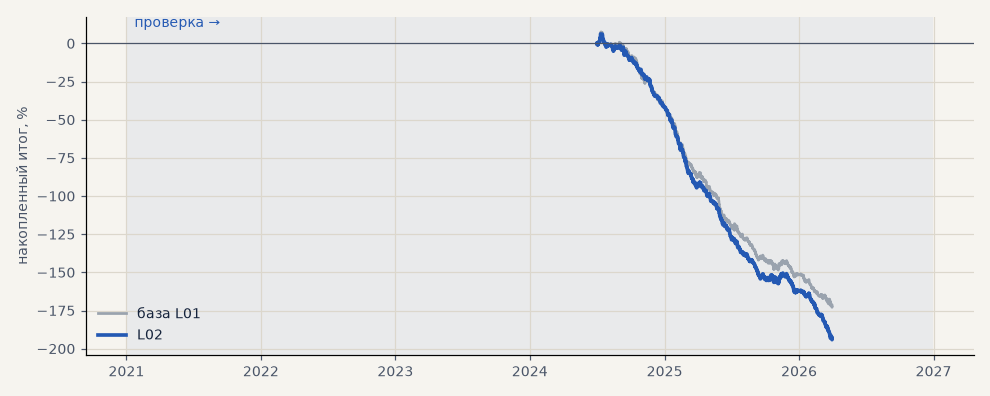

# L02. CatBoost LKOH с признаками ленты сделок

**Семейство:** модель CatBoost · **база:** L01 · **гипотеза:** — · **вердикт:** не помогло

**Что проверяли.** К признакам добавлена лента обезличенных сделок ALGOPACK — дельта агрессора (покупки минус продажи) за час и окна, нетто-дельта крупных сделок, профиль объёма (уровень максимального объёма и зона стоимости).

**Зачем.** Лента — информация, которой нет в ценах; лучший одиночный признак проекта был из неё.

**Итог простыми словами.** Хуже базы — внутри модели признаки ленты не помогают.

**Издержки:** профиль `base` (спред и свопы брокера)

Подробности: [results/model_changelog.md](../../results/model_changelog.md)

Проверка — сделки, открытые с 1 января 2021 года; выбор — до 2021. В скобках — база на тех же инструментах.

| срез | период | сделок | итог % | выигрышей | ожидание на сделку | PF | без 2 лучших | просадка | t | лет в плюсе |
|---|---|---|---|---|---|---|---|---|---|---|
| все инструменты | проверка | 1369 (1383) | -193.3 (-171.9) | 30% (31%) | -0.141% (-0.124%) | 0.49 (0.55) | -195.8 (-174.8) | -200.3 (-180.4) | -10.06 (-8.34) | 0/3 (0/3) |
| LKOH | проверка | 1369 (1383) | -193.3 (-171.9) | 30% (31%) | -0.141% (-0.124%) | 0.49 (0.55) | -195.8 (-174.8) | -200.3 (-180.4) | -10.06 (-8.34) | 0/3 (0/3) |

Журнал сделок: `trades.csv.gz` (инструмент, прогон, сторона, вход, выход, цены, результат после издержек, причина выхода).
