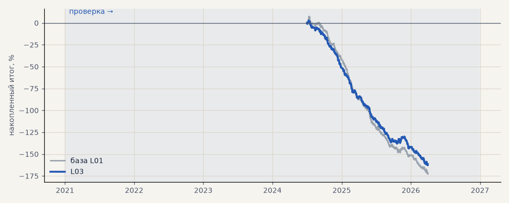

# L03. Лента + история с 2016 года

**Семейство:** модель CatBoost · **база:** L01 · **гипотеза:** — · **вердикт:** не помогло

**Что проверяли.** Лента плюс обучение на всей истории с 2016 года (где ленты нет — пропуски).

**Зачем.** Больше данных для обучения.

**Итог простыми словами.** На уровне базы.

**Издержки:** профиль `base` (спред и свопы брокера)

Подробности: [results/model_changelog.md](../../results/model_changelog.md)

Проверка — сделки, открытые с 1 января 2021 года; выбор — до 2021. В скобках — база на тех же инструментах.

| срез | период | сделок | итог % | выигрышей | ожидание на сделку | PF | без 2 лучших | просадка | t | лет в плюсе |
|---|---|---|---|---|---|---|---|---|---|---|
| все инструменты | проверка | 1242 (1383) | -161.6 (-171.9) | 30% (31%) | -0.130% (-0.124%) | 0.52 (0.55) | -164.0 (-174.8) | -165.7 (-180.4) | -9.07 (-8.34) | 0/3 (0/3) |
| LKOH | проверка | 1242 (1383) | -161.6 (-171.9) | 30% (31%) | -0.130% (-0.124%) | 0.52 (0.55) | -164.0 (-174.8) | -165.7 (-180.4) | -9.07 (-8.34) | 0/3 (0/3) |

Журнал сделок: `trades.csv.gz` (инструмент, прогон, сторона, вход, выход, цены, результат после издержек, причина выхода).
