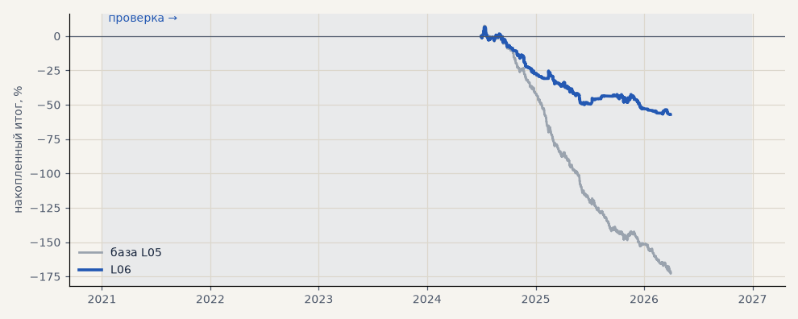

# L06. LKOH — торговать только при ATR ≥ медианы

**Семейство:** модель CatBoost · **база:** L05 · **гипотеза:** — · **вердикт:** слабый плюс

**Что проверяли.** Торговать только если ATR сигнального часа не ниже медианы обучающего периода.

**Зачем.** Проверить на втором инструменте эффект, найденный на серебре (M11).

**Итог простыми словами.** Из минуса около нуля на всех seed — направление эффекта то же, что у серебра, но преимущества нет.

**Издержки:** профиль `base` (спред и свопы брокера)

Подробности: [results/volatility_and_tokdit.md](../../results/volatility_and_tokdit.md)

Проверка — сделки, открытые с 1 января 2021 года; выбор — до 2021. В скобках — база на тех же инструментах.

| срез | период | сделок | итог % | выигрышей | ожидание на сделку | PF | без 2 лучших | просадка | t | лет в плюсе |
|---|---|---|---|---|---|---|---|---|---|---|
| все инструменты | проверка | 586 (1383) | -56.9 (-171.9) | 36% (31%) | -0.097% (-0.124%) | 0.69 (0.55) | -60.5 (-174.8) | -63.6 (-180.4) | -3.28 (-8.34) | 0/3 (0/3) |
| LKOH | проверка | 586 (1383) | -56.9 (-171.9) | 36% (31%) | -0.097% (-0.124%) | 0.69 (0.55) | -60.5 (-174.8) | -63.6 (-180.4) | -3.28 (-8.34) | 0/3 (0/3) |

Журнал сделок: `trades.csv.gz` (инструмент, прогон, сторона, вход, выход, цены, результат после издержек, причина выхода).
