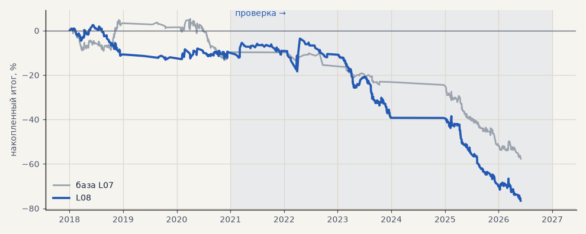

# L08. LKOH — обучение только внутри гейта

**Семейство:** модель CatBoost · **база:** L07 · **гипотеза:** — · **вердикт:** кандидат, не подтверждён

**Что проверяли.** То же, но обучение только внутри гейта (как M02 у серебра).

**Зачем.** Повторить эффект серебра на Лукойле.

**Итог простыми словами.** Больше прибыльных лет, но по средней сделке преимущества нет.

**Издержки:** профиль `base` (спред и свопы брокера)

Подробности: [results/model_changelog.md](../../results/model_changelog.md)

Проверка — сделки, открытые с 1 января 2021 года; выбор — до 2021. В скобках — база на тех же инструментах.

| срез | период | сделок | итог % | выигрышей | ожидание на сделку | PF | без 2 лучших | просадка | t | лет в плюсе |
|---|---|---|---|---|---|---|---|---|---|---|
| все инструменты | проверка | 538 (377) | -66.7 (-47.9) | 30% (31%) | -0.124% (-0.127%) | 0.61 (0.58) | -79.8 (-55.3) | -73.0 (-48.0) | -3.50 (-3.57) | 1/6 (0/5) |
| все инструменты | выбор | 208 (302) | -9.8 (-9.7) | 38% (40%) | -0.047% (-0.032%) | 0.85 (0.90) | -15.2 (-16.9) | -15.6 (-18.7) | -0.89 (-0.65) | 1/3 (1/3) |
| LKOH | проверка | 538 (377) | -66.7 (-47.9) | 30% (31%) | -0.124% (-0.127%) | 0.61 (0.58) | -79.8 (-55.3) | -73.0 (-48.0) | -3.50 (-3.57) | 1/6 (0/5) |
| LKOH | выбор | 208 (302) | -9.8 (-9.7) | 38% (40%) | -0.047% (-0.032%) | 0.85 (0.90) | -15.2 (-16.9) | -15.6 (-18.7) | -0.89 (-0.65) | 1/3 (1/3) |

Журнал сделок: `trades.csv.gz` (инструмент, прогон, сторона, вход, выход, цены, результат после издержек, причина выхода).
