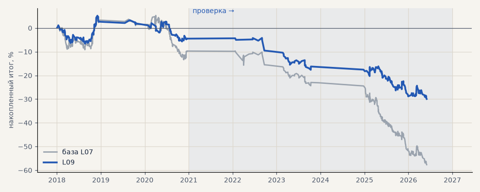

# L09. LKOH — сделки модели, которые пропускает трёхслойный фильтр

**Семейство:** модель CatBoost · **база:** L07 · **гипотеза:** H58 · **вердикт:** лучше L07 в обоих периодах (PF 0.90 → 0.92 и 0.58 → 0.64), но модель остаётся в минусе

**Что проверяли.** Сделки модели CatBoost на LKOH (L07) без изменений; берётся только сделка по направлению трёхслойного фильтра на последнем закрытом часе до входа.

**Зачем.** Созвон 18.10: тренд-фильтр к текущей модели (гипотеза H58), вторая модель.

**Итог простыми словами.** Как и на серебре: лучше в обоих периодах, но в минусе.

**Издержки:** профиль `base` (спред и свопы брокера)

Подробности: [results/trend_model_gate.md](../../results/trend_model_gate.md)

Проверка — сделки, открытые с 1 января 2021 года; выбор — до 2021. В скобках — база на тех же инструментах.

| срез | период | сделок | итог % | выигрышей | ожидание на сделку | PF | без 2 лучших | просадка | t | лет в плюсе |
|---|---|---|---|---|---|---|---|---|---|---|
| все инструменты | проверка | 241 (377) | -25.5 (-47.9) | 33% (31%) | -0.106% (-0.127%) | 0.64 (0.58) | -32.4 (-55.3) | -25.8 (-48.0) | -2.35 (-3.57) | 0/5 (0/5) |
| все инструменты | выбор | 177 (302) | -4.5 (-9.7) | 41% (40%) | -0.025% (-0.032%) | 0.92 (0.90) | -11.3 (-16.9) | -10.9 (-18.7) | -0.42 (-0.65) | 1/3 (1/3) |
| LKOH | проверка | 241 (377) | -25.5 (-47.9) | 33% (31%) | -0.106% (-0.127%) | 0.64 (0.58) | -32.4 (-55.3) | -25.8 (-48.0) | -2.35 (-3.57) | 0/5 (0/5) |
| LKOH | выбор | 177 (302) | -4.5 (-9.7) | 41% (40%) | -0.025% (-0.032%) | 0.92 (0.90) | -11.3 (-16.9) | -10.9 (-18.7) | -0.42 (-0.65) | 1/3 (1/3) |

Журнал сделок: `trades.csv.gz` (инструмент, прогон, сторона, вход, выход, цены, результат после издержек, причина выхода).
