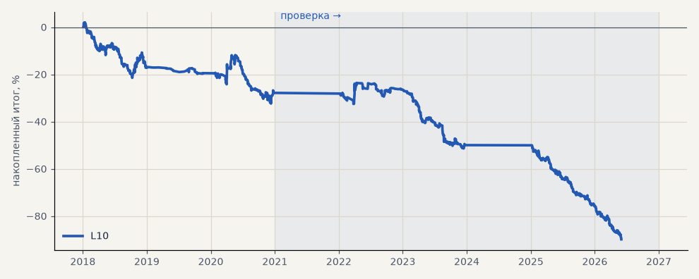

# L10. LKOH, модель на 3 класса — база сравнения H63 (3 seed)

**Семейство:** модель CatBoost · **база:** — · **гипотеза:** H63 · **вердикт:** база: в минусе (PF 0.77 на выборе, 0.56 на проверке)

**Что проверяли.** Модель CatBoost на LKOH в нынешней постановке — три класса (вверх, ничего, вниз), тренд-гейт C, 3 seed — пересчитана заново как база для сравнения с парой моделей.

**Зачем.** Гипотеза H63: честное A/B при одинаковых настройках, разметке и издержках.

**Итог простыми словами.** Модель в минусе в обоих периодах, как и прежние L-прогоны: направление она угадывает в 46–47% сделок.

**Издержки:** профиль `exchange` (спред и свопы брокера)

Подробности: [results/h63_binary.md](../../results/h63_binary.md)

Проверка — сделки, открытые с 1 января 2021 года; выбор — до 2021. В скобках — база на тех же инструментах.

| срез | период | сделок | итог % | выигрышей | ожидание на сделку | PF | без 2 лучших | просадка | t | лет в плюсе |
|---|---|---|---|---|---|---|---|---|---|---|
| все инструменты | проверка | 451 | -62.0 | 30% | -0.137% | 0.57 | -66.3 | -66.3 | -3.97 | 1/4 |
| все инструменты | выбор | 321 | -27.8 | 36% | -0.087% | 0.77 | -32.4 | -34.3 | -1.72 | 0/3 |
| LKOH | проверка | 451 | -62.0 | 30% | -0.137% | 0.57 | -66.3 | -66.3 | -3.97 | 1/4 |
| LKOH | выбор | 321 | -27.8 | 36% | -0.087% | 0.77 | -32.4 | -34.3 | -1.72 | 0/3 |

Журнал сделок: `trades.csv.gz` (инструмент, прогон, сторона, вход, выход, цены, результат после издержек, причина выхода).
