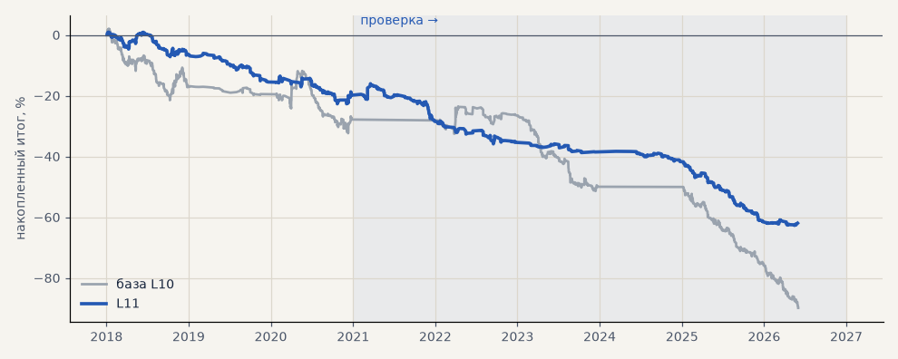

# L11. LKOH, пара бинарных моделей «вверх» и «вниз» вместо 3 классов (3 seed)

**Семейство:** модель CatBoost · **база:** L10 · **гипотеза:** H63 · **вердикт:** хуже L10 в обоих периодах: PF 0.70 против 0.77 и 0.48 против 0.56, верных направлений не больше

**Что проверяли.** Вместо одной модели на три класса — две: «вырастет ли цена дальше барьера» и «упадёт ли»; их ответы собираются в те же три вероятности.

**Зачем.** Гипотеза H63 (Тимур): одна модель хорошо видит волатильность, но плохо — направление; отдельные модели на каждое направление могут помочь.

**Итог простыми словами.** Хуже модели на три класса в обоих периодах (PF 0.70 против 0.77 и 0.48 против 0.56); сделок меньше, но на сделку они хуже. Постановка задачи не главная причина слабости модели — ей не хватает информации в признаках.

**Издержки:** профиль `exchange` (спред и свопы брокера)

Подробности: [results/h63_binary.md](../../results/h63_binary.md)

Проверка — сделки, открытые с 1 января 2021 года; выбор — до 2021. В скобках — база на тех же инструментах.

| срез | период | сделок | итог % | выигрышей | ожидание на сделку | PF | без 2 лучших | просадка | t | лет в плюсе |
|---|---|---|---|---|---|---|---|---|---|---|
| все инструменты | проверка | 222 (451) | -42.1 (-62.0) | 28% (30%) | -0.190% (-0.137%) | 0.48 (0.57) | -44.7 (-66.3) | -46.6 (-66.3) | -4.04 (-3.97) | 0/6 (1/4) |
| все инструменты | выбор | 199 (321) | -19.8 (-27.8) | 37% (36%) | -0.100% (-0.087%) | 0.70 (0.77) | -22.6 (-32.4) | -23.6 (-34.3) | -1.89 (-1.72) | 0/3 (0/3) |
| LKOH | проверка | 222 (451) | -42.1 (-62.0) | 28% (30%) | -0.190% (-0.137%) | 0.48 (0.57) | -44.7 (-66.3) | -46.6 (-66.3) | -4.04 (-3.97) | 0/6 (1/4) |
| LKOH | выбор | 199 (321) | -19.8 (-27.8) | 37% (36%) | -0.100% (-0.087%) | 0.70 (0.77) | -22.6 (-32.4) | -23.6 (-34.3) | -1.89 (-1.72) | 0/3 (0/3) |

Журнал сделок: `trades.csv.gz` (инструмент, прогон, сторона, вход, выход, цены, результат после издержек, причина выхода).
