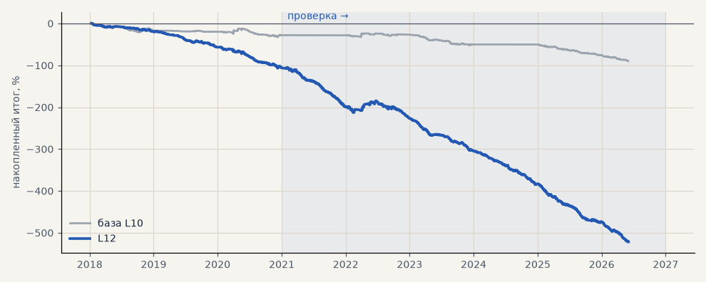

# L12. LKOH, нейросеть CNN-BiLSTM вместо CatBoost (3 seed)

**Семейство:** модель CatBoost · **база:** L10 · **гипотеза:** H64 · **вердикт:** хуже L10 в обоих периодах: PF 0.52 против 0.77 и 0.46 против 0.56; сделок в 1.7–5 раз больше, средняя до издержек в 3–16 раз меньше

**Что проверяли.** Вместо CatBoost сигнал даёт нейросеть конвейера (свёртка + двунаправленный LSTM по окну 20 часов) на тех же признаках и разметке.

**Зачем.** Гипотеза H64 (Тимур): в его опыте нейросеть превосходила CatBoost по результатам и «адаптивности».

**Итог простыми словами.** Хуже CatBoost в обоих периодах (PF 0.52 против 0.77 и 0.46 против 0.56): сеть торгует в разы чаще, а средняя сделка даже до издержек в разы меньше. Модели не хватает информации в данных, а не алгоритма.

**Издержки:** профиль `exchange` (спред и свопы брокера)

Подробности: [results/h64_nn.md](../../results/h64_nn.md)

Проверка — сделки, открытые с 1 января 2021 года; выбор — до 2021. В скобках — база на тех же инструментах.

| срез | период | сделок | итог % | выигрышей | ожидание на сделку | PF | без 2 лучших | просадка | t | лет в плюсе |
|---|---|---|---|---|---|---|---|---|---|---|
| все инструменты | проверка | 2318 (451) | -415.2 (-62.0) | 27% (30%) | -0.179% (-0.137%) | 0.46 (0.57) | -419.9 (-66.3) | -416.9 (-66.3) | -13.38 (-3.97) | 0/6 (1/4) |
| все инструменты | выбор | 548 (321) | -106.3 (-27.8) | 29% (36%) | -0.194% (-0.087%) | 0.51 (0.77) | -109.9 (-32.4) | -107.0 (-34.3) | -5.92 (-1.72) | 0/3 (0/3) |
| LKOH | проверка | 2318 (451) | -415.2 (-62.0) | 27% (30%) | -0.179% (-0.137%) | 0.46 (0.57) | -419.9 (-66.3) | -416.9 (-66.3) | -13.38 (-3.97) | 0/6 (1/4) |
| LKOH | выбор | 548 (321) | -106.3 (-27.8) | 29% (36%) | -0.194% (-0.087%) | 0.51 (0.77) | -109.9 (-32.4) | -107.0 (-34.3) | -5.92 (-1.72) | 0/3 (0/3) |

Журнал сделок: `trades.csv.gz` (инструмент, прогон, сторона, вход, выход, цены, результат после издержек, причина выхода).
