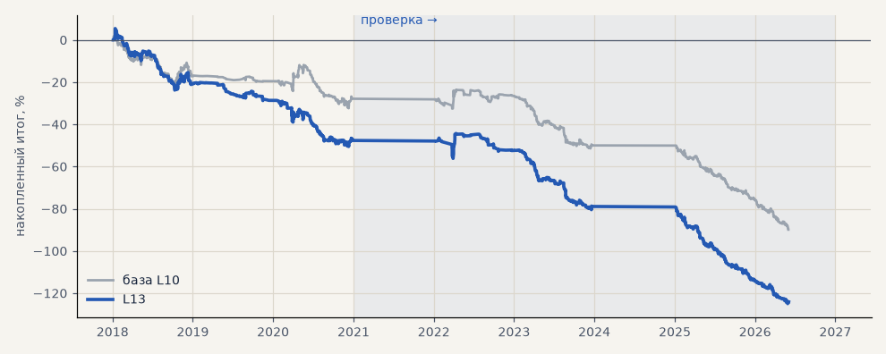

# L13. LKOH, CatBoost + наклон тренда за 24 / 72 / 168 ч и sin / cos угла (3 seed)

**Семейство:** модель CatBoost · **база:** L10 · **гипотеза:** H41 · **вердикт:** хуже L10 в обоих периодах: PF 0.66 против 0.77 и 0.47 против 0.56

**Что проверяли.** К признакам модели LKOH добавлен наклон тренда: насколько поднялась линия регрессии цены за сутки, три дня и неделю (в ATR), и синус / косинус угла этого наклона.

**Зачем.** Гипотеза H41 (Тимур): мерить не наклон одной свечи, а наклон тренда за период — через угол.

**Итог простыми словами.** Хуже модели без наклона в обоих периодах (PF 0.66 против 0.77 и 0.47 против 0.56). Направление наклон не предсказывает; косинус недельного угла связан только с размером следующего хода.

**Издержки:** профиль `exchange` (спред и свопы брокера)

Подробности: [results/h41_slope.md](../../results/h41_slope.md)

Проверка — сделки, открытые с 1 января 2021 года; выбор — до 2021. В скобках — база на тех же инструментах.

| срез | период | сделок | итог % | выигрышей | ожидание на сделку | PF | без 2 лучших | просадка | t | лет в плюсе |
|---|---|---|---|---|---|---|---|---|---|---|
| все инструменты | проверка | 436 (451) | -76.5 (-62.0) | 29% (30%) | -0.176% (-0.137%) | 0.47 (0.57) | -80.8 (-66.3) | -80.7 (-66.3) | -5.04 (-3.97) | 0/4 (1/4) |
| все инструменты | выбор | 354 (321) | -47.6 (-27.8) | 34% (36%) | -0.135% (-0.087%) | 0.67 (0.77) | -50.8 (-32.4) | -55.9 (-34.3) | -2.84 (-1.72) | 0/3 (0/3) |
| LKOH | проверка | 436 (451) | -76.5 (-62.0) | 29% (30%) | -0.176% (-0.137%) | 0.47 (0.57) | -80.8 (-66.3) | -80.7 (-66.3) | -5.04 (-3.97) | 0/4 (1/4) |
| LKOH | выбор | 354 (321) | -47.6 (-27.8) | 34% (36%) | -0.135% (-0.087%) | 0.67 (0.77) | -50.8 (-32.4) | -55.9 (-34.3) | -2.84 (-1.72) | 0/3 (0/3) |

Журнал сделок: `trades.csv.gz` (инструмент, прогон, сторона, вход, выход, цены, результат после издержек, причина выхода).
