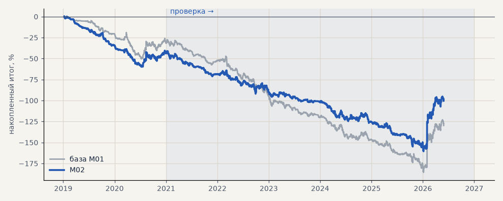

# M02. Обучение только внутри тренд-гейта

**Семейство:** модель CatBoost · **база:** M01 · **гипотеза:** H31 · **вердикт:** со всеми издержками B01 обе версии в минусе; на проверке M02 лучше M01 на 3 из 3 seed (PF 0.83 → 0.89, t −2.19 → −1.29), на выборе 2019–2020 хуже; 5 seed в одном прогоне не сделано (проверка 19.10)

**Что проверяли.** Та же модель, но обучающая выборка — только часы, где гейт C разрешает вход; остальные часы (около двух третей) из обучения убраны. Торговля та же. Четыре прогона с разными seed.

**Зачем.** Модель тратила силы на нейтральные часы, где сделок всё равно не бывает.

**Итог простыми словами.** На проверке 2021–2026 лучше базы, но разница сравнима с разбросом между базовыми прогонами — перепроверяем (гипотеза H31).

**Издержки:** профиль `base` (спред и свопы брокера)

Подробности: [results/h31_check.md](../../results/h31_check.md)

Проверка — сделки, открытые с 1 января 2021 года; выбор — до 2021. В скобках — база на тех же инструментах.

| срез | период | сделок | итог % | выигрышей | ожидание на сделку | PF | без 2 лучших | просадка | t | лет в плюсе |
|---|---|---|---|---|---|---|---|---|---|---|
| все инструменты | проверка | 1375 (1488) | -56.2 (-98.0) | 41% (40%) | -0.041% (-0.066%) | 0.90 (0.84) | -68.0 (-113.7) | -119.5 (-158.0) | -1.18 (-2.06) | 1/6 (1/6) |
| все инструменты | выбор | 492 (405) | -43.9 (-31.7) | 39% (40%) | -0.089% (-0.078%) | 0.74 (0.80) | -48.9 (-38.5) | -60.3 (-50.6) | -2.08 (-1.46) | 0/2 (0/2) |
| серебро | проверка | 1375 (1488) | -56.2 (-98.0) | 41% (40%) | -0.041% (-0.066%) | 0.90 (0.84) | -68.0 (-113.7) | -119.5 (-158.0) | -1.18 (-2.06) | 1/6 (1/6) |
| серебро | выбор | 492 (405) | -43.9 (-31.7) | 39% (40%) | -0.089% (-0.078%) | 0.74 (0.80) | -48.9 (-38.5) | -60.3 (-50.6) | -2.08 (-1.46) | 0/2 (0/2) |

Журнал сделок: `trades.csv.gz` (инструмент, прогон, сторона, вход, выход, цены, результат после издержек, причина выхода).
