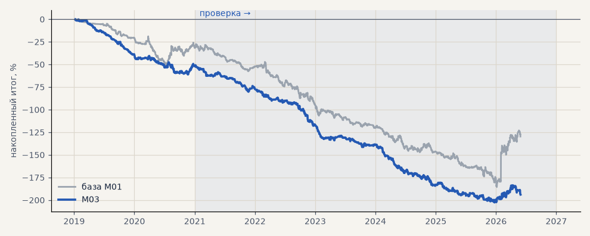

# M03. Разметка по направлению (h4 / 0.3 ATR)

**Семейство:** модель CatBoost · **база:** M01 · **гипотеза:** — · **вердикт:** не помогло

**Что проверяли.** Вместо трёх классов по барьерам — класс по знаку хода за 4 часа, если ход больше 0.3 ATR, иначе «ничего». Остальное как в базе. Один прогон.

**Зачем.** Барьеры могли учить модель волатильности, а не направлению.

**Итог простыми словами.** Хуже базы — модель всё равно опирается на волатильность, прибыльна в 3 годах из 8.

**Издержки:** профиль `base` (спред и свопы брокера)

Подробности: [results/model_improvements.md](../../results/model_improvements.md)

Проверка — сделки, открытые с 1 января 2021 года; выбор — до 2021. В скобках — база на тех же инструментах.

| срез | период | сделок | итог % | выигрышей | ожидание на сделку | PF | без 2 лучших | просадка | t | лет в плюсе |
|---|---|---|---|---|---|---|---|---|---|---|
| все инструменты | проверка | 1300 (1488) | -142.6 (-98.0) | 40% (40%) | -0.110% (-0.066%) | 0.68 (0.84) | -151.1 (-113.7) | -151.7 (-158.0) | -5.17 (-2.06) | 1/6 (1/6) |
| все инструменты | выбор | 479 (405) | -51.3 (-31.7) | 38% (40%) | -0.107% (-0.078%) | 0.64 (0.80) | -57.1 (-38.5) | -61.1 (-50.6) | -3.57 (-1.46) | 0/2 (0/2) |
| серебро | проверка | 1300 (1488) | -142.6 (-98.0) | 40% (40%) | -0.110% (-0.066%) | 0.68 (0.84) | -151.1 (-113.7) | -151.7 (-158.0) | -5.17 (-2.06) | 1/6 (1/6) |
| серебро | выбор | 479 (405) | -51.3 (-31.7) | 38% (40%) | -0.107% (-0.078%) | 0.64 (0.80) | -57.1 (-38.5) | -61.1 (-50.6) | -3.57 (-1.46) | 0/2 (0/2) |

Журнал сделок: `trades.csv.gz` (инструмент, прогон, сторона, вход, выход, цены, результат после издержек, причина выхода).
