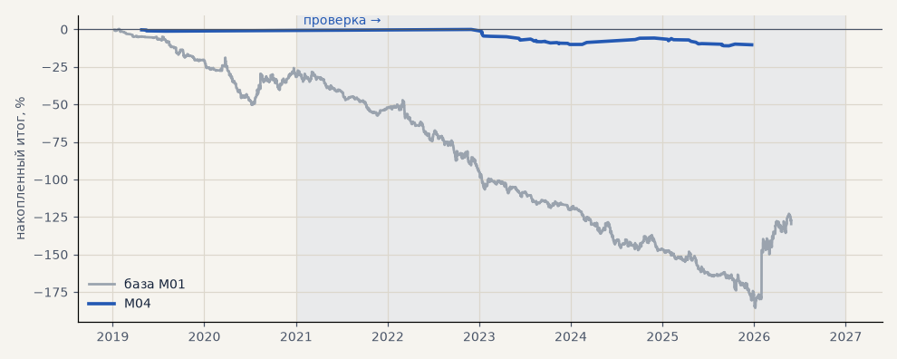

# M04. Регрессия величины хода вместо классов

**Семейство:** модель CatBoost · **база:** M01 · **гипотеза:** — · **вердикт:** не помогло

**Что проверяли.** Регрессия — модель предсказывает величину хода через 4 часа в ATR; сделка, если прогноз больше 0.3 ATR в одну из сторон.

**Зачем.** Спросить модель напрямую «куда и на сколько».

**Итог простыми словами.** Ранняя остановка оставляет 1–4 дерева, прогноз почти никогда не выходит за порог — сигнала нет, сделок единицы.

**Издержки:** профиль `base` (спред и свопы брокера)

Подробности: [results/model_changelog.md](../../results/model_changelog.md)

Проверка — сделки, открытые с 1 января 2021 года; выбор — до 2021. В скобках — база на тех же инструментах.

| срез | период | сделок | итог % | выигрышей | ожидание на сделку | PF | без 2 лучших | просадка | t | лет в плюсе |
|---|---|---|---|---|---|---|---|---|---|---|
| все инструменты | проверка | 52 (1488) | -9.1 (-98.0) | 33% (40%) | -0.175% (-0.066%) | 0.53 (0.84) | -12.4 (-113.7) | -10.9 (-158.0) | -1.81 (-2.06) | 2/4 (1/6) |
| все инструменты | выбор | 4 (405) | -1.2 (-31.7) | 0% (40%) | -0.304% (-0.078%) | 0.00 (0.80) | -0.9 (-38.5) | -1.2 (-50.6) | -3.65 (-1.46) | 0/1 (0/2) |
| серебро | проверка | 52 (1488) | -9.1 (-98.0) | 33% (40%) | -0.175% (-0.066%) | 0.53 (0.84) | -12.4 (-113.7) | -10.9 (-158.0) | -1.81 (-2.06) | 2/4 (1/6) |
| серебро | выбор | 4 (405) | -1.2 (-31.7) | 0% (40%) | -0.304% (-0.078%) | 0.00 (0.80) | -0.9 (-38.5) | -1.2 (-50.6) | -3.65 (-1.46) | 0/1 (0/2) |

Журнал сделок: `trades.csv.gz` (инструмент, прогон, сторона, вход, выход, цены, результат после издержек, причина выхода).
