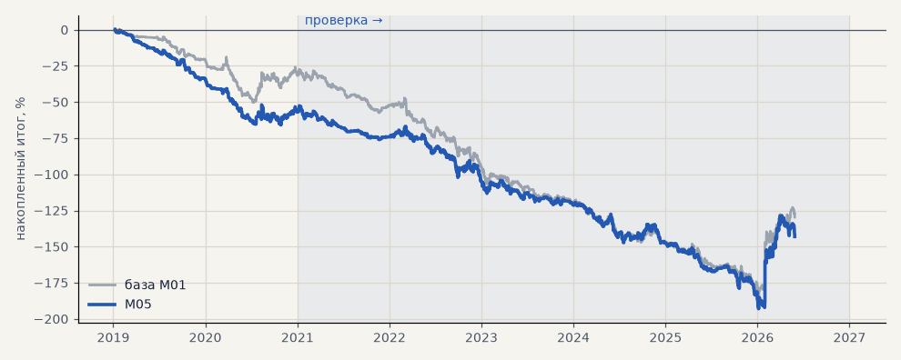

# M05. Сильнее регуляризованная модель

**Семейство:** модель CatBoost · **база:** M01 · **гипотеза:** — · **вердикт:** стабильнее, но хуже

**Что проверяли.** Те же признаки и разметка, но более осторожное обучение — шаг 0.02, глубина деревьев 4, регуляризация L2 10, терпение ранней остановки 300, до 3000 деревьев. Три seed.

**Зачем.** С обычными настройками модель останавливалась на 20–240 деревьях и сильно зависела от seed.

**Итог простыми словами.** Стабильнее между seed, но не лучше базы.

**Издержки:** профиль `base` (спред и свопы брокера)

Подробности: [results/model_changelog.md](../../results/model_changelog.md)

Проверка — сделки, открытые с 1 января 2021 года; выбор — до 2021. В скобках — база на тех же инструментах.

| срез | период | сделок | итог % | выигрышей | ожидание на сделку | PF | без 2 лучших | просадка | t | лет в плюсе |
|---|---|---|---|---|---|---|---|---|---|---|
| все инструменты | проверка | 1411 (1488) | -86.1 (-98.0) | 40% (40%) | -0.061% (-0.066%) | 0.85 (0.84) | -101.8 (-113.7) | -140.5 (-158.0) | -1.86 (-2.06) | 1/6 (1/6) |
| все инструменты | выбор | 445 (405) | -57.0 (-31.7) | 36% (40%) | -0.128% (-0.078%) | 0.66 (0.80) | -63.8 (-38.5) | -66.4 (-50.6) | -2.76 (-1.46) | 0/2 (0/2) |
| серебро | проверка | 1411 (1488) | -86.1 (-98.0) | 40% (40%) | -0.061% (-0.066%) | 0.85 (0.84) | -101.8 (-113.7) | -140.5 (-158.0) | -1.86 (-2.06) | 1/6 (1/6) |
| серебро | выбор | 445 (405) | -57.0 (-31.7) | 36% (40%) | -0.128% (-0.078%) | 0.66 (0.80) | -63.8 (-38.5) | -66.4 (-50.6) | -2.76 (-1.46) | 0/2 (0/2) |

Журнал сделок: `trades.csv.gz` (инструмент, прогон, сторона, вход, выход, цены, результат после издержек, причина выхода).
