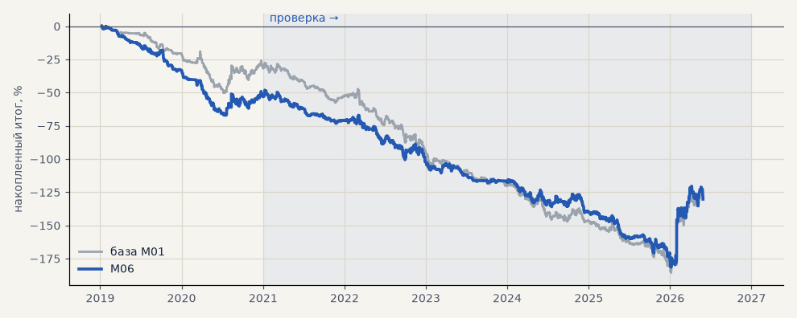

# M06. Ансамбль 3 моделей с разными seed

**Семейство:** модель CatBoost · **база:** M01 · **гипотеза:** — · **вердикт:** не помогло

**Что проверяли.** Три модели с разными seed обучаются на одном окне, их вероятности усредняются. Три таких ансамбля.

**Зачем.** Усреднение должно погасить случайность одной модели.

**Итог простыми словами.** Разброс результатов не уменьшился — он идёт от последовательности сделок (одна сдвинутая сделка меняет все следующие), а не от модели.

**Издержки:** профиль `base` (спред и свопы брокера)

Подробности: [results/model_changelog.md](../../results/model_changelog.md)

Проверка — сделки, открытые с 1 января 2021 года; выбор — до 2021. В скобках — база на тех же инструментах.

| срез | период | сделок | итог % | выигрышей | ожидание на сделку | PF | без 2 лучших | просадка | t | лет в плюсе |
|---|---|---|---|---|---|---|---|---|---|---|
| все инструменты | проверка | 1346 (1488) | -77.1 (-98.0) | 40% (40%) | -0.057% (-0.066%) | 0.86 (0.84) | -92.9 (-113.7) | -133.6 (-158.0) | -1.66 (-2.06) | 1/6 (1/6) |
| все инструменты | выбор | 470 (405) | -53.0 (-31.7) | 38% (40%) | -0.113% (-0.078%) | 0.69 (0.80) | -59.8 (-38.5) | -67.5 (-50.6) | -2.55 (-1.46) | 0/2 (0/2) |
| серебро | проверка | 1346 (1488) | -77.1 (-98.0) | 40% (40%) | -0.057% (-0.066%) | 0.86 (0.84) | -92.9 (-113.7) | -133.6 (-158.0) | -1.66 (-2.06) | 1/6 (1/6) |
| серебро | выбор | 470 (405) | -53.0 (-31.7) | 38% (40%) | -0.113% (-0.078%) | 0.69 (0.80) | -59.8 (-38.5) | -67.5 (-50.6) | -2.55 (-1.46) | 0/2 (0/2) |

Журнал сделок: `trades.csv.gz` (инструмент, прогон, сторона, вход, выход, цены, результат после издержек, причина выхода).
