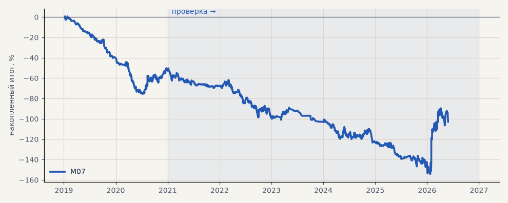

# M07. CatBoost (прогон для мета-модели, seed 42)

**Семейство:** модель CatBoost · **база:** — · **гипотеза:** — · **вердикт:** база

**Что проверяли.** Один прогон (seed 42), в котором дополнительно обучалась мета-модель; здесь — сделки основной модели без мета-фильтра.

**Зачем.** База для M08 — тот же прогон, чтобы сравнивать только эффект мета-модели.

**Итог простыми словами.** База.

**Издержки:** профиль `base` (спред и свопы брокера)

Подробности: [results/model_changelog.md](../../results/model_changelog.md)

Проверка — сделки, открытые с 1 января 2021 года; выбор — до 2021. В скобках — база на тех же инструментах.

| срез | период | сделок | итог % | выигрышей | ожидание на сделку | PF | без 2 лучших | просадка | t | лет в плюсе |
|---|---|---|---|---|---|---|---|---|---|---|
| все инструменты | проверка | 1232 | -50.1 | 40% | -0.041% | 0.90 | -82.0 | -103.9 | -1.06 | 1/6 |
| все инструменты | выбор | 537 | -52.7 | 39% | -0.098% | 0.72 | -67.6 | -76.1 | -2.41 | 0/2 |
| серебро | проверка | 1232 | -50.1 | 40% | -0.041% | 0.90 | -82.0 | -103.9 | -1.06 | 1/6 |
| серебро | выбор | 537 | -52.7 | 39% | -0.098% | 0.72 | -67.6 | -76.1 | -2.41 | 0/2 |

Журнал сделок: `trades.csv.gz` (инструмент, прогон, сторона, вход, выход, цены, результат после издержек, причина выхода).
