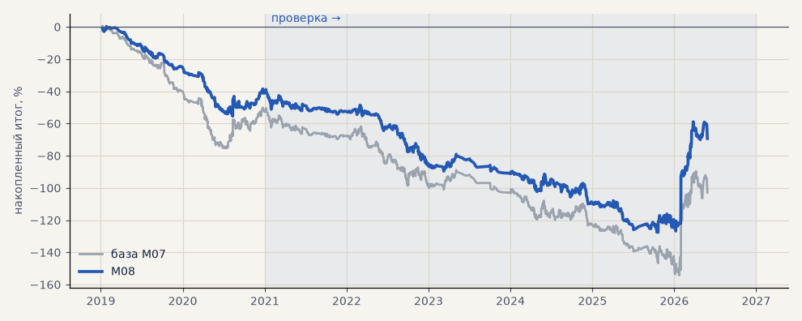

# M08. Мета-модель с контекстом, порог 0.50

**Семейство:** модель CatBoost · **база:** M07 · **гипотеза:** — · **вердикт:** не помогло (AUC ≈ 0.5)

**Что проверяли.** Вторая модель (мета-модель) решает, брать ли сделку основной модели. Её признаки — ход и свеча относительно стороны сделки, класс входа (продолжение, плоско, откат, «нож»), результаты последних 10 и 30 сделок, режим рынка. Сделка — если вероятность успеха не ниже 0.50.

**Зачем.** Отсеять плохие сделки основной модели по контексту, которого у неё нет.

**Итог простыми словами.** AUC мета-модели 0.47–0.53 во всех годах — она не отличает удачные сделки от неудачных; итог как у базы.

**Издержки:** профиль `base` (спред и свопы брокера)

Подробности: [results/model_changelog.md](../../results/model_changelog.md)

Проверка — сделки, открытые с 1 января 2021 года; выбор — до 2021. В скобках — база на тех же инструментах.

| срез | период | сделок | итог % | выигрышей | ожидание на сделку | PF | без 2 лучших | просадка | t | лет в плюсе |
|---|---|---|---|---|---|---|---|---|---|---|
| все инструменты | проверка | 995 (1232) | -28.1 (-50.1) | 40% (40%) | -0.028% (-0.041%) | 0.93 (0.90) | -55.8 (-82.0) | -88.7 (-103.9) | -0.69 (-1.06) | 1/6 (1/6) |
| все инструменты | выбор | 365 (537) | -41.2 (-52.7) | 39% (39%) | -0.113% (-0.098%) | 0.66 (0.72) | -54.1 (-67.6) | -55.7 (-76.1) | -2.39 (-2.41) | 0/2 (0/2) |
| серебро | проверка | 995 (1232) | -28.1 (-50.1) | 40% (40%) | -0.028% (-0.041%) | 0.93 (0.90) | -55.8 (-82.0) | -88.7 (-103.9) | -0.69 (-1.06) | 1/6 (1/6) |
| серебро | выбор | 365 (537) | -41.2 (-52.7) | 39% (39%) | -0.113% (-0.098%) | 0.66 (0.72) | -54.1 (-67.6) | -55.7 (-76.1) | -2.39 (-2.41) | 0/2 (0/2) |

Журнал сделок: `trades.csv.gz` (инструмент, прогон, сторона, вход, выход, цены, результат после издержек, причина выхода).
