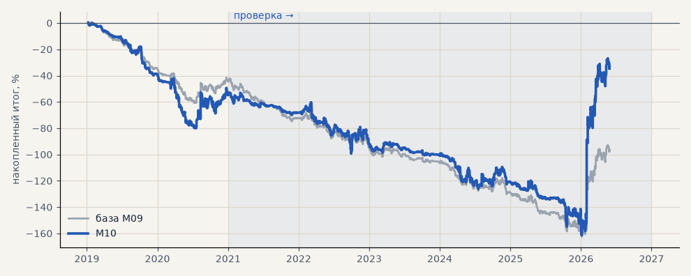

# M10. Размер позиции пропорционален ATR

**Семейство:** модель CatBoost · **база:** M09 · **гипотеза:** H21 · **вердикт:** слабый плюс (итог в % выше и за счёт большего среднего размера — сравнивать по t и PF)

**Что проверяли.** Размер позиции = ATR сигнального часа / медиана ATR обучающего периода (не больше 2). Комиссия масштабируется размером. Сделки те же, что в M09.

**Зачем.** Преимущество в процентах растёт с волатильностью, а комиссия — нет; значит, в активном рынке стоит торговать больше.

**Итог простыми словами.** t и профит-фактор лучше базы на всех seed — единственное устойчивое улучшение модели. Итог в процентах выше и за счёт большего среднего размера позиции.

**Издержки:** профиль `base` (спред и свопы брокера)

Подробности: [results/volatility_and_tokdit.md](../../results/volatility_and_tokdit.md)

Проверка — сделки, открытые с 1 января 2021 года; выбор — до 2021. В скобках — база на тех же инструментах.

| срез | период | сделок | итог % | выигрышей | ожидание на сделку | PF | без 2 лучших | просадка | t | лет в плюсе |
|---|---|---|---|---|---|---|---|---|---|---|
| все инструменты | проверка | 1364 (1364) | +20.2 (-53.1) | 41% (41%) | +0.015% (-0.039%) | 1.03 (0.91) | -11.2 (-68.8) | -108.4 (-120.3) | 0.25 (-1.11) | 1/6 (1/6) |
| все инструменты | выбор | 494 (494) | -54.8 (-44.5) | 39% (39%) | -0.111% (-0.090%) | 0.78 (0.74) | -68.4 (-51.3) | -80.5 (-61.4) | -1.47 (-2.11) | 0/2 (0/2) |
| серебро | проверка | 1364 (1364) | +20.2 (-53.1) | 41% (41%) | +0.015% (-0.039%) | 1.03 (0.91) | -11.2 (-68.8) | -108.4 (-120.3) | 0.25 (-1.11) | 1/6 (1/6) |
| серебро | выбор | 494 (494) | -54.8 (-44.5) | 39% (39%) | -0.111% (-0.090%) | 0.78 (0.74) | -68.4 (-51.3) | -80.5 (-61.4) | -1.47 (-2.11) | 0/2 (0/2) |

Журнал сделок: `trades.csv.gz` (инструмент, прогон, сторона, вход, выход, цены, результат после издержек, причина выхода).
