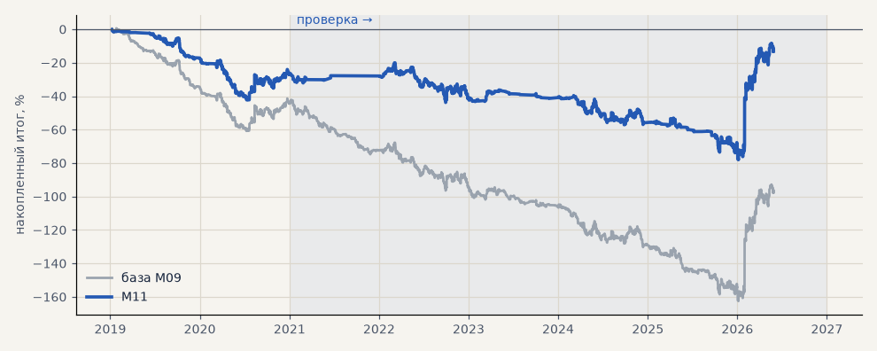

# M11. Торговать только при ATR ≥ медианы

**Семейство:** модель CatBoost · **база:** M09 · **гипотеза:** — · **вердикт:** слабый плюс

**Что проверяли.** Торговать только если ATR сигнального часа не ниже медианы обучающего периода; размер 1.

**Зачем.** Тот же эффект, но без увеличения позиции.

**Итог простыми словами.** Сделок меньше, ожидание на сделку выше вдвое; t выше базы.

**Издержки:** профиль `base` (спред и свопы брокера)

Подробности: [results/volatility_and_tokdit.md](../../results/volatility_and_tokdit.md)

Проверка — сделки, открытые с 1 января 2021 года; выбор — до 2021. В скобках — база на тех же инструментах.

| срез | период | сделок | итог % | выигрышей | ожидание на сделку | PF | без 2 лучших | просадка | t | лет в плюсе |
|---|---|---|---|---|---|---|---|---|---|---|
| все инструменты | проверка | 808 (1364) | +14.0 (-53.1) | 42% (41%) | +0.017% (-0.039%) | 1.04 (0.91) | -1.7 (-68.8) | -58.0 (-120.3) | 0.32 (-1.11) | 2/6 (1/6) |
| все инструменты | выбор | 350 (494) | -27.1 (-44.5) | 40% (39%) | -0.077% (-0.090%) | 0.80 (0.74) | -33.9 (-51.3) | -42.2 (-61.4) | -1.32 (-2.11) | 0/2 (0/2) |
| серебро | проверка | 808 (1364) | +14.0 (-53.1) | 42% (41%) | +0.017% (-0.039%) | 1.04 (0.91) | -1.7 (-68.8) | -58.0 (-120.3) | 0.32 (-1.11) | 2/6 (1/6) |
| серебро | выбор | 350 (494) | -27.1 (-44.5) | 40% (39%) | -0.077% (-0.090%) | 0.80 (0.74) | -33.9 (-51.3) | -42.2 (-61.4) | -1.32 (-2.11) | 0/2 (0/2) |

Журнал сделок: `trades.csv.gz` (инструмент, прогон, сторона, вход, выход, цены, результат после издержек, причина выхода).
