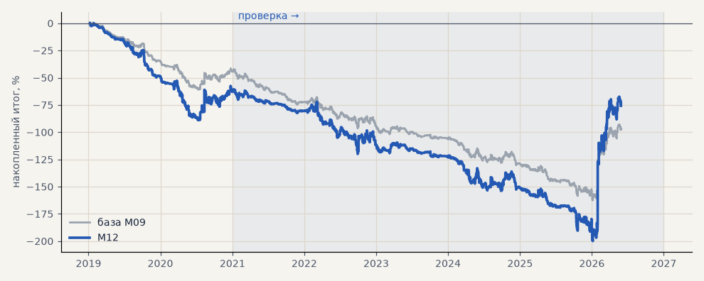

# M12. Размер по прогнозу волатильности моделью

**Семейство:** модель CatBoost · **база:** M09 · **гипотеза:** H21 · **вердикт:** хуже наивного ATR (итог в % завышен размером позиции)

**Что проверяли.** Размер позиции по прогнозу волатильности отдельной моделью CatBoost (средний размах на 10 часов вперёд) вместо текущего ATR.

**Зачем.** Прогноз волатильности точнее текущего ATR.

**Итог простыми словами.** Прогноз действительно точнее (корреляция с фактом 0.76 против 0.40), но для размера хуже наивного ATR — модель ловит час суток, а преимущество связано с уровнем волатильности периода.

**Издержки:** профиль `base` (спред и свопы брокера)

Подробности: [results/volatility_and_tokdit.md](../../results/volatility_and_tokdit.md)

Проверка — сделки, открытые с 1 января 2021 года; выбор — до 2021. В скобках — база на тех же инструментах.

| срез | период | сделок | итог % | выигрышей | ожидание на сделку | PF | без 2 лучших | просадка | t | лет в плюсе |
|---|---|---|---|---|---|---|---|---|---|---|
| все инструменты | проверка | 1364 (1364) | -12.8 (-53.1) | 41% (41%) | -0.009% (-0.039%) | 0.98 (0.91) | -44.2 (-68.8) | -139.3 (-120.3) | -0.16 (-1.11) | 1/6 (1/6) |
| все инструменты | выбор | 494 (494) | -62.9 (-44.5) | 39% (39%) | -0.127% (-0.090%) | 0.77 (0.74) | -76.5 (-51.3) | -89.4 (-61.4) | -1.68 (-2.11) | 0/2 (0/2) |
| серебро | проверка | 1364 (1364) | -12.8 (-53.1) | 41% (41%) | -0.009% (-0.039%) | 0.98 (0.91) | -44.2 (-68.8) | -139.3 (-120.3) | -0.16 (-1.11) | 1/6 (1/6) |
| серебро | выбор | 494 (494) | -62.9 (-44.5) | 39% (39%) | -0.127% (-0.090%) | 0.77 (0.74) | -76.5 (-51.3) | -89.4 (-61.4) | -1.68 (-2.11) | 0/2 (0/2) |

Журнал сделок: `trades.csv.gz` (инструмент, прогон, сторона, вход, выход, цены, результат после издержек, причина выхода).
