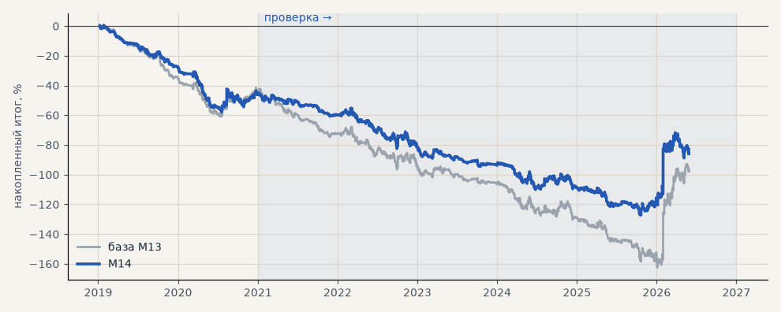

# M14. Сброс тренда по EMA5 4-часовых свечей

**Семейство:** модель CatBoost · **база:** M13 · **гипотеза:** — · **вердикт:** не помогло

**Что проверяли.** Гейт входа — гейт C со сбросом по EMA5 4-часовых свечей — тренд не считается «вверх», пока 4-часовая свеча закрывается ниже EMA5 (и наоборот). Идея из ноутбука S_TrendFiter.

**Зачем.** Убрать входы в «слабой зоне» тренда, которые видны на графике.

**Итог простыми словами.** Сделок меньше, результат сделки тот же, итог ниже.

**Издержки:** профиль `base` (спред и свопы брокера)

Подробности: [results/trend_filter_ema.md](../../results/trend_filter_ema.md)

Проверка — сделки, открытые с 1 января 2021 года; выбор — до 2021. В скобках — база на тех же инструментах.

| срез | период | сделок | итог % | выигрышей | ожидание на сделку | PF | без 2 лучших | просадка | t | лет в плюсе |
|---|---|---|---|---|---|---|---|---|---|---|
| все инструменты | проверка | 1050 (1364) | -39.9 (-53.1) | 41% (41%) | -0.038% (-0.039%) | 0.91 (0.91) | -55.6 (-68.8) | -82.2 (-120.3) | -0.91 (-1.11) | 1/6 (1/6) |
| все инструменты | выбор | 387 (494) | -46.1 (-44.5) | 37% (39%) | -0.119% (-0.090%) | 0.69 (0.74) | -52.9 (-51.3) | -58.4 (-61.4) | -2.26 (-2.11) | 0/2 (0/2) |
| серебро | проверка | 1050 (1364) | -39.9 (-53.1) | 41% (41%) | -0.038% (-0.039%) | 0.91 (0.91) | -55.6 (-68.8) | -82.2 (-120.3) | -0.91 (-1.11) | 1/6 (1/6) |
| серебро | выбор | 387 (494) | -46.1 (-44.5) | 37% (39%) | -0.119% (-0.090%) | 0.69 (0.74) | -52.9 (-51.3) | -58.4 (-61.4) | -2.26 (-2.11) | 0/2 (0/2) |

Журнал сделок: `trades.csv.gz` (инструмент, прогон, сторона, вход, выход, цены, результат после издержек, причина выхода).
