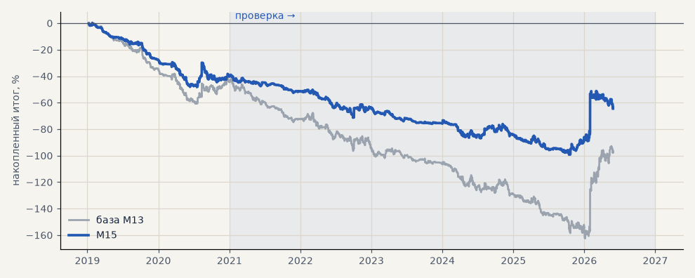

# M15. Сброс тренда по EMA5 часовых свечей

**Семейство:** модель CatBoost · **база:** M13 · **гипотеза:** H29 · **вердикт:** не помогло

**Что проверяли.** То же со сбросом по EMA5 часовых свечей.

**Зачем.** Более быстрый сброс.

**Итог простыми словами.** Сделок вдвое меньше, итог ниже — нарушения по часовой EMA5 обычно просто откаты внутри тренда.

**Издержки:** профиль `base` (спред и свопы брокера)

Подробности: [results/trend_filter_ema.md](../../results/trend_filter_ema.md)

Проверка — сделки, открытые с 1 января 2021 года; выбор — до 2021. В скобках — база на тех же инструментах.

| срез | период | сделок | итог % | выигрышей | ожидание на сделку | PF | без 2 лучших | просадка | t | лет в плюсе |
|---|---|---|---|---|---|---|---|---|---|---|
| все инструменты | проверка | 757 (1364) | -24.2 (-53.1) | 41% (41%) | -0.032% (-0.039%) | 0.93 (0.91) | -39.9 (-68.8) | -60.3 (-120.3) | -0.61 (-1.11) | 1/6 (1/6) |
| все инструменты | выбор | 304 (494) | -40.3 (-44.5) | 35% (39%) | -0.132% (-0.090%) | 0.67 (0.74) | -47.1 (-51.3) | -48.4 (-61.4) | -2.17 (-2.11) | 0/2 (0/2) |
| серебро | проверка | 757 (1364) | -24.2 (-53.1) | 41% (41%) | -0.032% (-0.039%) | 0.93 (0.91) | -39.9 (-68.8) | -60.3 (-120.3) | -0.61 (-1.11) | 1/6 (1/6) |
| серебро | выбор | 304 (494) | -40.3 (-44.5) | 35% (39%) | -0.132% (-0.090%) | 0.67 (0.74) | -47.1 (-51.3) | -48.4 (-61.4) | -2.17 (-2.11) | 0/2 (0/2) |

Журнал сделок: `trades.csv.gz` (инструмент, прогон, сторона, вход, выход, цены, результат после издержек, причина выхода).
