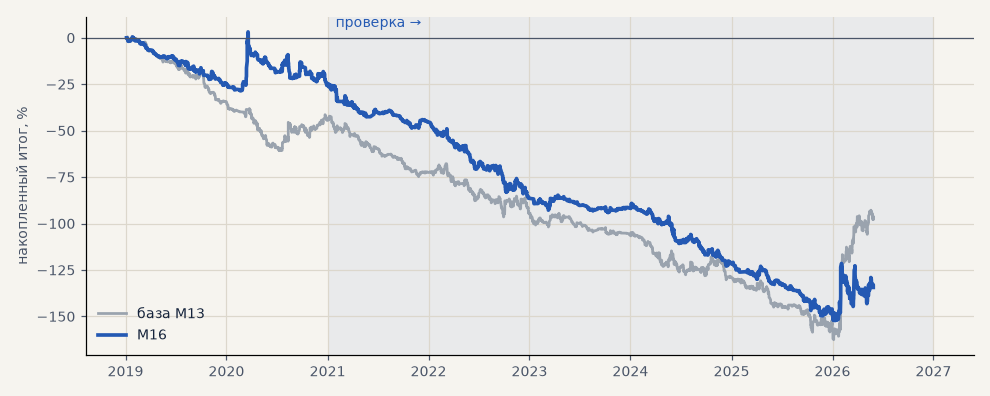

# M16. Тренд-фильтр «плато» из нового подбора

**Семейство:** модель CatBoost · **база:** M13 · **гипотеза:** — · **вердикт:** хуже как гейт входа

**Что проверяли.** Гейт входа — набор параметров тренд-фильтра «плато» из нового подбора (подтверждение 6 часов, гистерезис, шок-слой, сброс по EMA13), лучший по следованию тренду.

**Зачем.** Лучшая разметка тренда должна давать лучшие входы.

**Итог простыми словами.** Как метка тренда он лучше, как фильтр входа — модель уходит в ноль. Подбирать фильтр нужно под применение.

**Издержки:** профиль `base` (спред и свопы брокера)

Подробности: [results/trend_filter_ema.md](../../results/trend_filter_ema.md)

Проверка — сделки, открытые с 1 января 2021 года; выбор — до 2021. В скобках — база на тех же инструментах.

| срез | период | сделок | итог % | выигрышей | ожидание на сделку | PF | без 2 лучших | просадка | t | лет в плюсе |
|---|---|---|---|---|---|---|---|---|---|---|
| все инструменты | проверка | 1087 (1364) | -108.6 (-53.1) | 40% (41%) | -0.100% (-0.039%) | 0.79 (0.91) | -124.4 (-68.8) | -127.1 (-120.3) | -2.40 (-1.11) | 1/6 (1/6) |
| все инструменты | выбор | 386 (494) | -25.7 (-44.5) | 42% (39%) | -0.067% (-0.090%) | 0.83 (0.74) | -33.0 (-51.3) | -29.1 (-61.4) | -1.08 (-2.11) | 0/2 (0/2) |
| серебро | проверка | 1087 (1364) | -108.6 (-53.1) | 40% (41%) | -0.100% (-0.039%) | 0.79 (0.91) | -124.4 (-68.8) | -127.1 (-120.3) | -2.40 (-1.11) | 1/6 (1/6) |
| серебро | выбор | 386 (494) | -25.7 (-44.5) | 42% (39%) | -0.067% (-0.090%) | 0.83 (0.74) | -33.0 (-51.3) | -29.1 (-61.4) | -1.08 (-2.11) | 0/2 (0/2) |

Журнал сделок: `trades.csv.gz` (инструмент, прогон, сторона, вход, выход, цены, результат после издержек, причина выхода).
