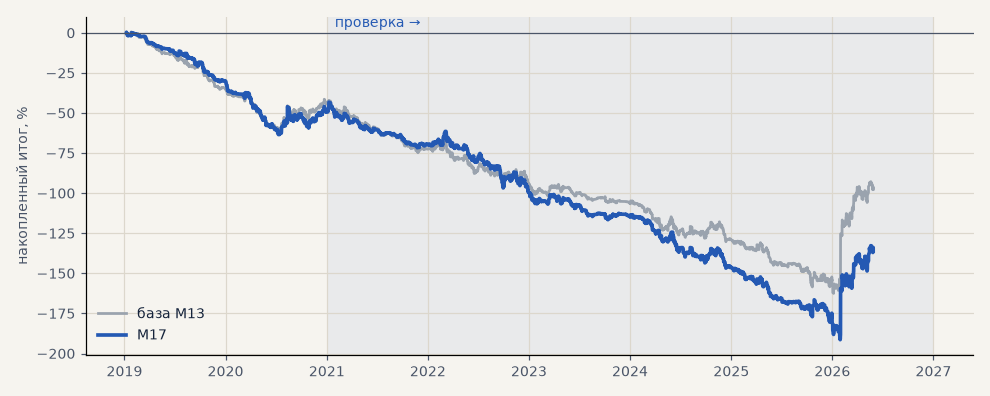

# M17. Признаки «слабой зоны» по EMA5

**Семейство:** модель CatBoost · **база:** M13 · **гипотеза:** — · **вердикт:** не помогло

**Что проверяли.** В модель добавлены признаки «слабой зоны» — расстояние до EMA5 часа и 4 часов в ATR и сторона закрытия относительно EMA5 по направлению гейта.

**Зачем.** Пусть модель сама решит, когда слабая зона важна.

**Итог простыми словами.** Хуже базы на всех seed; признаки почти не используются (около 1% прогноза).

**Издержки:** профиль `base` (спред и свопы брокера)

Подробности: [results/trend_filter_ema.md](../../results/trend_filter_ema.md)

Проверка — сделки, открытые с 1 января 2021 года; выбор — до 2021. В скобках — база на тех же инструментах.

| срез | период | сделок | итог % | выигрышей | ожидание на сделку | PF | без 2 лучших | просадка | t | лет в плюсе |
|---|---|---|---|---|---|---|---|---|---|---|
| все инструменты | проверка | 1361 (1364) | -86.3 (-53.1) | 40% (41%) | -0.063% (-0.039%) | 0.85 (0.91) | -102.1 (-68.8) | -148.1 (-120.3) | -1.82 (-1.11) | 1/6 (1/6) |
| все инструменты | выбор | 424 (494) | -49.5 (-44.5) | 37% (39%) | -0.117% (-0.090%) | 0.70 (0.74) | -56.3 (-51.3) | -63.8 (-61.4) | -2.41 (-2.11) | 0/2 (0/2) |
| серебро | проверка | 1361 (1364) | -86.3 (-53.1) | 40% (41%) | -0.063% (-0.039%) | 0.85 (0.91) | -102.1 (-68.8) | -148.1 (-120.3) | -1.82 (-1.11) | 1/6 (1/6) |
| серебро | выбор | 424 (494) | -49.5 (-44.5) | 37% (39%) | -0.117% (-0.090%) | 0.70 (0.74) | -56.3 (-51.3) | -63.8 (-61.4) | -2.41 (-2.11) | 0/2 (0/2) |

Журнал сделок: `trades.csv.gz` (инструмент, прогон, сторона, вход, выход, цены, результат после издержек, причина выхода).
