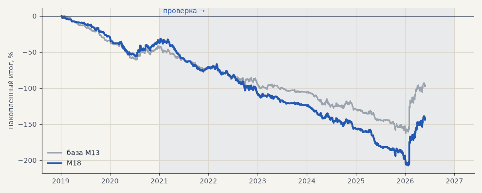

# M18. Признаки трёхслойного фильтра и уровней

**Семейство:** модель CatBoost · **база:** M13 · **гипотеза:** H48 · **вердикт:** хуже базы на всех 3 seed

**Что проверяли.** К 81 признаку CatBoost серебра добавлены 14 признаков из ТЗ 15.10: компоненты трёхслойного фильтра (быстрый скор пар EMA, режим по EMA200, флаг шока, ER Кауфмана, итоговый скор) и нормированные уровни (расстояние до максимума и минимума 20 дней в ATR, положение в 20-дневном диапазоне, часов с экстремума, сила пробоя вчерашнего дня, вчера NR7 и inside bar). Те же seed и настройки, что у M13.

**Зачем.** ТЗ советует подавать компоненты тренда модели как признаки, а не жёсткий фильтр: модель сама найдёт, когда им доверять.

**Итог простыми словами.** Хуже базы на всех трёх seed: итог +76 / +34 / +49% против +77 / +95 / +105%, t сделки до комиссии 2.8 / 2.1 / 2.4 против 2.8 / 3.2 / 3.6. Как и признаки слабой зоны EMA5 (M17), новые колонки только добавляют разброс обучения.

**Издержки:** профиль `base` (спред и свопы брокера)

Подробности: [results/trend_filter_tz.md](../../results/trend_filter_tz.md)

Проверка — сделки, открытые с 1 января 2021 года; выбор — до 2021. В скобках — база на тех же инструментах.

| срез | период | сделок | итог % | выигрышей | ожидание на сделку | PF | без 2 лучших | просадка | t | лет в плюсе |
|---|---|---|---|---|---|---|---|---|---|---|
| все инструменты | проверка | 1467 (1364) | -106.2 (-53.1) | 40% (41%) | -0.072% (-0.039%) | 0.83 (0.91) | -121.9 (-68.8) | -175.6 (-120.3) | -2.21 (-1.11) | 1/6 (1/6) |
| все инструменты | выбор | 457 (494) | -37.3 (-44.5) | 40% (39%) | -0.082% (-0.090%) | 0.78 (0.74) | -44.1 (-51.3) | -56.4 (-61.4) | -1.72 (-2.11) | 0/2 (0/2) |
| серебро | проверка | 1467 (1364) | -106.2 (-53.1) | 40% (41%) | -0.072% (-0.039%) | 0.83 (0.91) | -121.9 (-68.8) | -175.6 (-120.3) | -2.21 (-1.11) | 1/6 (1/6) |
| серебро | выбор | 457 (494) | -37.3 (-44.5) | 40% (39%) | -0.082% (-0.090%) | 0.78 (0.74) | -44.1 (-51.3) | -56.4 (-61.4) | -1.72 (-2.11) | 0/2 (0/2) |

Журнал сделок: `trades.csv.gz` (инструмент, прогон, сторона, вход, выход, цены, результат после издержек, причина выхода).
