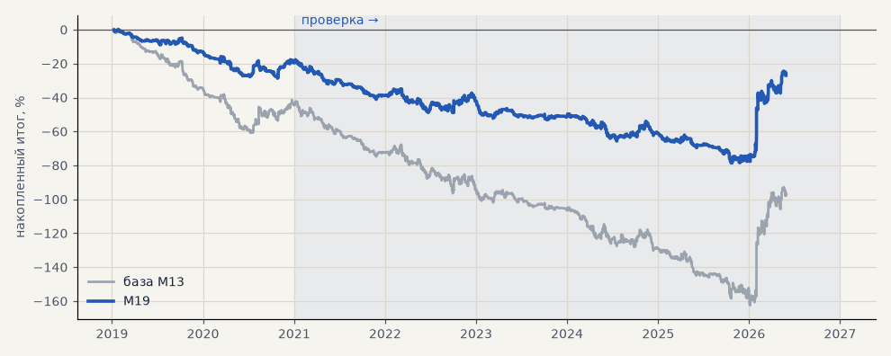

# M19. Сделки модели, которые пропускает трёхслойный фильтр

**Семейство:** модель CatBoost · **база:** M13 · **гипотеза:** H58 · **вердикт:** лучше M13 в обоих периодах (PF 0.74 → 0.78 и 0.91 → 0.98), но модель остаётся в минусе

**Что проверяли.** Сделки модели CatBoost на серебре (M13, 3 seed) без изменений; берётся только сделка по направлению трёхслойного фильтра на последнем закрытом часе до входа: лонг — фильтр вверх, шорт — вниз.

**Зачем.** Созвон 18.10: находки по тренд-фильтру применить к текущей модели — брать её сделки только по направлению лучшего фильтра (гипотеза H58).

**Итог простыми словами.** Фильтр улучшает модель в обоих периодах, но она остаётся в минусе: остаётся около 60% сделок.

**Издержки:** профиль `base` (спред и свопы брокера)

Подробности: [results/trend_model_gate.md](../../results/trend_model_gate.md)

Проверка — сделки, открытые с 1 января 2021 года; выбор — до 2021. В скобках — база на тех же инструментах.

| срез | период | сделок | итог % | выигрышей | ожидание на сделку | PF | без 2 лучших | просадка | t | лет в плюсе |
|---|---|---|---|---|---|---|---|---|---|---|
| все инструменты | проверка | 814 (1364) | -7.3 (-53.1) | 41% (41%) | -0.009% (-0.039%) | 0.98 (0.91) | -23.1 (-68.8) | -60.9 (-120.3) | -0.18 (-1.11) | 1/6 (1/6) |
| все инструменты | выбор | 267 (494) | -19.6 (-44.5) | 42% (39%) | -0.073% (-0.090%) | 0.78 (0.74) | -21.6 (-51.3) | -28.8 (-61.4) | -1.41 (-2.11) | 0/2 (0/2) |
| серебро | проверка | 814 (1364) | -7.3 (-53.1) | 41% (41%) | -0.009% (-0.039%) | 0.98 (0.91) | -23.1 (-68.8) | -60.9 (-120.3) | -0.18 (-1.11) | 1/6 (1/6) |
| серебро | выбор | 267 (494) | -19.6 (-44.5) | 42% (39%) | -0.073% (-0.090%) | 0.78 (0.74) | -21.6 (-51.3) | -28.8 (-61.4) | -1.41 (-2.11) | 0/2 (0/2) |

Журнал сделок: `trades.csv.gz` (инструмент, прогон, сторона, вход, выход, цены, результат после издержек, причина выхода).
