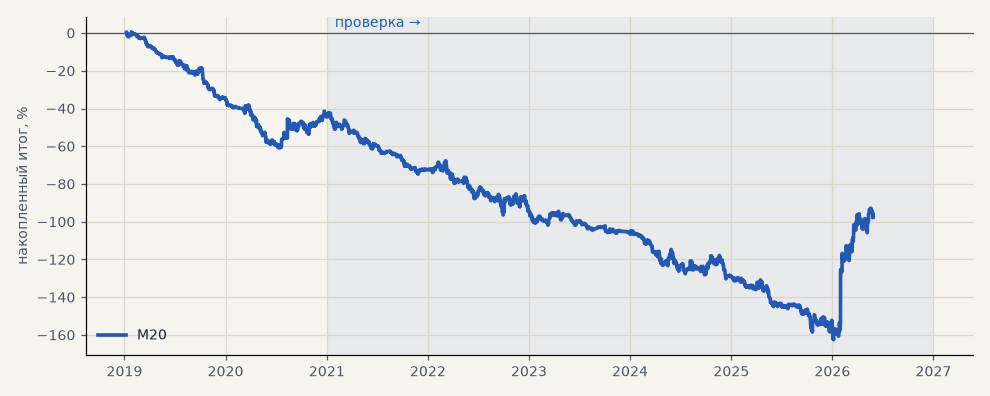

# M20. CatBoost серебра — база сравнения H41 (3 seed)

**Семейство:** модель CatBoost · **база:** — · **гипотеза:** H41 · **вердикт:** база: в минусе (PF 0.74 на выборе, 0.91 на проверке)

**Что проверяли.** Модель CatBoost серебра на текущих настройках — база для сравнения с признаками наклона.

**Зачем.** Гипотеза H41: сравнение «с наклоном / без» на одинаковых настройках и seed.

**Итог простыми словами.** В минусе после издержек (PF 0.74 на выборе, 0.91 на проверке) — как и прежние базы серебра.

**Издержки:** профиль `base` (спред и свопы брокера)

Подробности: [results/h41_slope.md](../../results/h41_slope.md)

Проверка — сделки, открытые с 1 января 2021 года; выбор — до 2021. В скобках — база на тех же инструментах.

| срез | период | сделок | итог % | выигрышей | ожидание на сделку | PF | без 2 лучших | просадка | t | лет в плюсе |
|---|---|---|---|---|---|---|---|---|---|---|
| все инструменты | проверка | 1364 | -53.1 | 41% | -0.039% | 0.91 | -68.8 | -120.3 | -1.11 | 1/6 |
| все инструменты | выбор | 494 | -44.5 | 39% | -0.090% | 0.74 | -51.3 | -61.4 | -2.11 | 0/2 |
| серебро | проверка | 1364 | -53.1 | 41% | -0.039% | 0.91 | -68.8 | -120.3 | -1.11 | 1/6 |
| серебро | выбор | 494 | -44.5 | 39% | -0.090% | 0.74 | -51.3 | -61.4 | -2.11 | 0/2 |

Журнал сделок: `trades.csv.gz` (инструмент, прогон, сторона, вход, выход, цены, результат после издержек, причина выхода).
