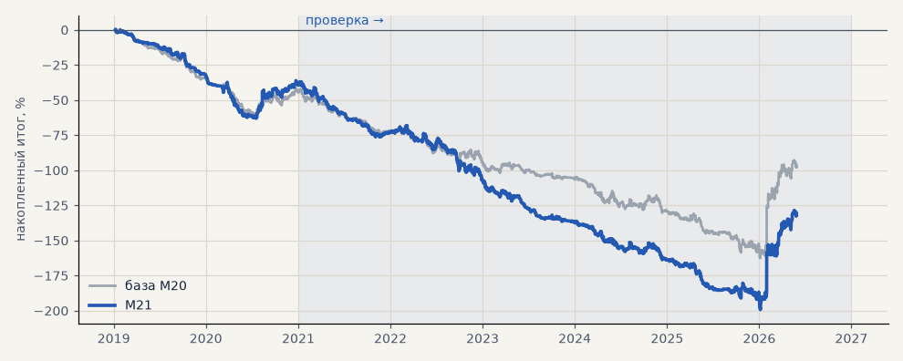

# M21. CatBoost серебра + наклон тренда за 24 / 72 / 168 ч и sin / cos угла

**Семейство:** модель CatBoost · **база:** M20 · **гипотеза:** H41 · **вердикт:** на выборе на уровне M20 (PF 0.76 против 0.74), на проверке хуже (0.84 против 0.91)

**Что проверяли.** Та же модель серебра, что M20, плюс наклон тренда за сутки, три дня и неделю и синус / косинус его угла.

**Зачем.** Гипотеза H41 (Тимур).

**Итог простыми словами.** На выборе на уровне базы (PF 0.76 против 0.74), на проверке хуже (0.84 против 0.91).

**Издержки:** профиль `base` (спред и свопы брокера)

Подробности: [results/h41_slope.md](../../results/h41_slope.md)

Проверка — сделки, открытые с 1 января 2021 года; выбор — до 2021. В скобках — база на тех же инструментах.

| срез | период | сделок | итог % | выигрышей | ожидание на сделку | PF | без 2 лучших | просадка | t | лет в плюсе |
|---|---|---|---|---|---|---|---|---|---|---|
| все инструменты | проверка | 1364 (1364) | -92.5 (-53.1) | 40% (41%) | -0.068% (-0.039%) | 0.84 (0.91) | -108.2 (-68.8) | -162.4 (-120.3) | -1.96 (-1.11) | 1/6 (1/6) |
| все инструменты | выбор | 432 (494) | -39.3 (-44.5) | 38% (39%) | -0.091% (-0.090%) | 0.76 (0.74) | -46.1 (-51.3) | -63.5 (-61.4) | -1.82 (-2.11) | 0/2 (0/2) |
| серебро | проверка | 1364 (1364) | -92.5 (-53.1) | 40% (41%) | -0.068% (-0.039%) | 0.84 (0.91) | -108.2 (-68.8) | -162.4 (-120.3) | -1.96 (-1.11) | 1/6 (1/6) |
| серебро | выбор | 432 (494) | -39.3 (-44.5) | 38% (39%) | -0.091% (-0.090%) | 0.76 (0.74) | -46.1 (-51.3) | -63.5 (-61.4) | -1.82 (-2.11) | 0/2 (0/2) |

Журнал сделок: `trades.csv.gz` (инструмент, прогон, сторона, вход, выход, цены, результат после издержек, причина выхода).
