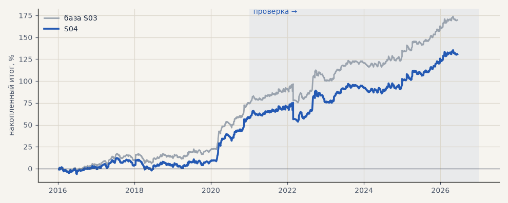

# S04. Проскальзывание 0.05% на входе и выходе

**Семейство:** стратегия без ML (импульс) · **база:** S03 · **гипотеза:** — · **вердикт:** учтено в базе

**Что проверяли.** Сделки S03, но исполнение хуже на 0.05% цены при входе и при любом выходе — по стопу, трейлингу и по времени. Считается по готовым сделкам: из результата каждой вычитается 0.1%.

**Зачем.** Вход в следующую минуту после сигнала частично уже несёт проскальзывание, но, чтобы не обманывать себя, 0.05% на сторону закладываем всегда (0.1% — перебор, договорённость 11.10).

**Итог простыми словами.** Небольшая потеря, значимость сохраняется. Это поправка, а не эксперимент — она входит в базу B01.

**Издержки:** профиль `base` (спред и свопы брокера)

Подробности: [results/audit.md](../../results/audit.md)

Проверка — сделки, открытые с 1 января 2021 года; выбор — до 2021. В скобках — база на тех же инструментах.

| срез | период | сделок | итог % | выигрышей | ожидание на сделку | PF | без 2 лучших | просадка | t | лет в плюсе |
|---|---|---|---|---|---|---|---|---|---|---|
| все инструменты | проверка | 1924 (1924) | +46.1 (+70.1) | 45% (47%) | +0.192% (+0.292%) | 1.14 (1.21) | +36.9 (+61.0) | -17.9 (-12.4) | 1.69 (2.57) | 5/6 (5/6) |
| все инструменты | выбор | 1196 (1196) | +11.6 (+26.5) | 44% (46%) | +0.077% (+0.177%) | 1.07 (1.17) | +6.8 (+21.7) | -19.8 (-11.7) | 0.84 (1.92) | 1/5 (3/5) |
| портфель 4 | проверка | 896 (896) | +72.9 (+95.3) | 47% (49%) | +0.325% (+0.425%) | 1.27 (1.37) | +57.2 (+79.6) | -21.7 (-21.5) | 2.05 (2.68) | 6/6 (6/6) |
| портфель 4 | выбор | 665 (665) | +57.8 (+74.4) | 47% (48%) | +0.348% (+0.448%) | 1.32 (1.43) | +48.2 (+64.8) | -14.3 (-11.0) | 2.54 (3.28) | 4/5 (5/5) |
| металлы (серебро + золото) | проверка | 506 (506) | +78.8 (+104.1) | 46% (47%) | +0.311% (+0.411%) | 1.35 (1.49) | +60.2 (+85.4) | -16.4 (-12.1) | 2.21 (2.93) | 5/6 (6/6) |
| металлы (серебро + золото) | выбор | 461 (461) | +19.2 (+42.3) | 41% (43%) | +0.083% (+0.183%) | 1.10 (1.25) | +0.1 (+23.0) | -35.1 (-22.8) | 0.67 (1.48) | 3/5 (3/5) |
| серебро | проверка | 243 (243) | +124.7 (+149.0) | 48% (49%) | +0.513% (+0.613%) | 1.43 (1.54) | +87.5 (+111.6) | -29.7 (-25.4) | 1.99 (2.38) | 5/6 (5/6) |
| серебро | выбор | 218 (218) | +79.7 (+101.5) | 43% (44%) | +0.366% (+0.466%) | 1.41 (1.56) | +41.4 (+63.0) | -42.4 (-32.3) | 1.59 (2.03) | 3/5 (4/5) |
| золото | проверка | 263 (263) | +32.8 (+59.1) | 44% (46%) | +0.125% (+0.225%) | 1.20 (1.40) | +6.0 (+32.1) | -35.2 (-26.2) | 0.98 (1.76) | 3/6 (4/6) |
| золото | выбор | 243 (243) | -41.3 (-17.0) | 40% (43%) | -0.170% (-0.070%) | 0.77 (0.90) | -56.3 (-32.2) | -63.2 (-43.3) | -1.53 (-0.63) | 2/5 (2/5) |
| LKOH | проверка | 214 (214) | +21.8 (+43.2) | 46% (50%) | +0.102% (+0.202%) | 1.09 (1.18) | -1.0 (+20.2) | -57.0 (-48.2) | 0.44 (0.88) | 3/6 (5/6) |
| LKOH | выбор | 132 (132) | +67.0 (+80.2) | 52% (54%) | +0.507% (+0.607%) | 1.46 (1.58) | +39.4 (+52.4) | -31.4 (-28.7) | 1.65 (1.98) | 3/5 (3/5) |
| GAZP | проверка | 219 (219) | +55.4 (+77.3) | 51% (51%) | +0.253% (+0.353%) | 1.17 (1.24) | -5.4 (+16.3) | -82.1 (-80.3) | 0.52 (0.73) | 4/6 (4/6) |
| GAZP | выбор | 154 (154) | +66.3 (+81.7) | 47% (48%) | +0.431% (+0.531%) | 1.41 (1.54) | +38.5 (+53.7) | -19.3 (-18.2) | 1.57 (1.93) | 4/5 (4/5) |
| SBER | проверка | 220 (220) | +89.6 (+111.6) | 44% (46%) | +0.407% (+0.507%) | 1.43 (1.56) | +61.2 (+83.0) | -29.6 (-23.5) | 1.74 (2.17) | 3/6 (4/6) |
| SBER | выбор | 161 (161) | +18.3 (+34.4) | 48% (48%) | +0.113% (+0.213%) | 1.08 (1.15) | -7.0 (+8.9) | -46.4 (-42.4) | 0.38 (0.71) | 3/5 (3/5) |
| MOEX | проверка | 227 (227) | -11.4 (+11.3) | 41% (45%) | -0.050% (+0.050%) | 0.96 (1.04) | -36.7 (-14.2) | -37.7 (-32.7) | -0.23 (0.23) | 2/6 (2/6) |
| MOEX | выбор | 153 (153) | -7.3 (+8.0) | 44% (46%) | -0.048% (+0.052%) | 0.97 (1.04) | -26.5 (-11.4) | -64.4 (-55.8) | -0.17 (0.18) | 1/5 (3/5) |
| MTSS | проверка | 196 (196) | +26.0 (+45.6) | 43% (43%) | +0.133% (+0.233%) | 1.11 (1.20) | -12.9 (+6.5) | -28.6 (-25.0) | 0.50 (0.87) | 3/6 (3/6) |
| MTSS | выбор | 135 (135) | -90.1 (-76.6) | 39% (39%) | -0.667% (-0.567%) | 0.58 (0.63) | -106.7 (-93.4) | -92.2 (-85.4) | -2.52 (-2.15) | 1/5 (1/5) |
| ETH | проверка | 342 (342) | +29.7 (+63.9) | 44% (44%) | +0.087% (+0.187%) | 1.03 (1.07) | -28.8 (+5.2) | -106.6 (-100.7) | 0.20 (0.44) | 4/6 (4/6) |

Журнал сделок: `trades.csv.gz` (инструмент, прогон, сторона, вход, выход, цены, результат после издержек, причина выхода).
