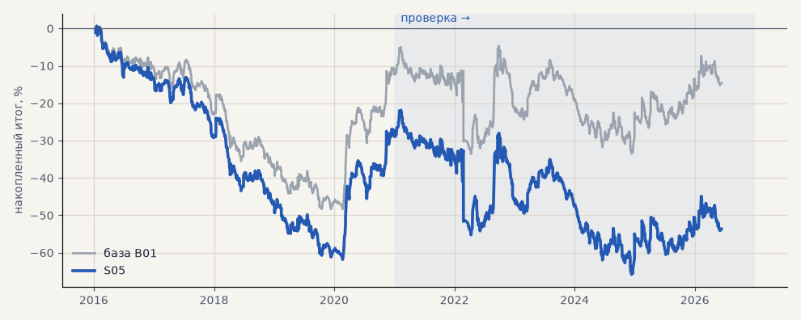

# S05. Проскальзывание 0.1% вместо 0.05%

**Семейство:** стратегия без ML (импульс) · **база:** B01 · **гипотеза:** — · **вердикт:** запаса нет: портфель в минусе, металлы +16%

**Что проверяли.** Проскальзывание 0.1% на входе и на выходе вместо 0.05%, остальное как в базе.

**Зачем.** Запас прочности: сколько ухудшения исполнения выдерживает стратегия.

**Итог простыми словами.** Портфель 4 в минусе, металлы в слабом плюсе. Запаса почти нет: при свопах брокера стратегия держится на грани.

**Издержки:** профиль `base` (спред и свопы брокера)

Подробности: [results/audit.md](../../results/audit.md)

Проверка — сделки, открытые с 1 января 2021 года; выбор — до 2021. В скобках — база на тех же инструментах.

| срез | период | сделок | итог % | выигрышей | ожидание на сделку | PF | без 2 лучших | просадка | t | лет в плюсе |
|---|---|---|---|---|---|---|---|---|---|---|
| все инструменты | проверка | 1924 (1924) | -42.9 (-18.9) | 40% (41%) | -0.178% (-0.078%) | 0.89 (0.95) | -52.0 (-27.9) | -48.6 (-32.5) | -1.59 (-0.70) | 0/6 (1/6) |
| все инструменты | выбор | 1196 (1196) | -56.1 (-41.1) | 39% (39%) | -0.375% (-0.275%) | 0.73 (0.79) | -60.8 (-45.8) | -71.1 (-59.1) | -4.12 (-3.02) | 1/5 (1/5) |
| портфель 4 | проверка | 896 (896) | -24.7 (-2.3) | 40% (42%) | -0.110% (-0.010%) | 0.92 (0.99) | -40.1 (-17.7) | -44.0 (-28.9) | -0.70 (-0.07) | 1/6 (3/6) |
| портфель 4 | выбор | 665 (665) | -28.9 (-12.3) | 40% (41%) | -0.174% (-0.074%) | 0.87 (0.94) | -38.3 (-21.8) | -62.5 (-49.1) | -1.29 (-0.55) | 1/5 (1/5) |
| металлы (серебро + золото) | проверка | 506 (506) | +16.0 (+41.3) | 42% (44%) | +0.063% (+0.163%) | 1.06 (1.17) | -2.0 (+23.2) | -41.6 (-28.5) | 0.46 (1.18) | 3/6 (5/6) |
| металлы (серебро + золото) | выбор | 461 (461) | -34.5 (-11.5) | 37% (38%) | -0.150% (-0.050%) | 0.84 (0.94) | -53.4 (-30.4) | -75.1 (-55.8) | -1.23 (-0.41) | 1/5 (1/5) |
| серебро | проверка | 243 (243) | +33.8 (+58.1) | 44% (46%) | +0.139% (+0.239%) | 1.10 (1.18) | -2.2 (+21.9) | -60.3 (-51.2) | 0.55 (0.94) | 5/6 (5/6) |
| серебро | выбор | 218 (218) | +3.6 (+25.4) | 36% (37%) | +0.017% (+0.117%) | 1.02 (1.11) | -34.0 (-12.4) | -81.7 (-66.8) | 0.07 (0.52) | 2/5 (2/5) |
| золото | проверка | 263 (263) | -1.8 (+24.5) | 39% (42%) | -0.007% (+0.093%) | 0.99 (1.15) | -28.3 (-2.2) | -52.7 (-39.2) | -0.05 (0.73) | 2/6 (2/6) |
| золото | выбор | 243 (243) | -72.7 (-48.4) | 38% (40%) | -0.299% (-0.199%) | 0.63 (0.73) | -87.5 (-63.4) | -90.9 (-69.1) | -2.71 (-1.80) | 1/5 (2/5) |
| LKOH | проверка | 214 (214) | -80.7 (-59.3) | 38% (40%) | -0.377% (-0.277%) | 0.74 (0.80) | -102.1 (-80.9) | -103.3 (-89.9) | -1.67 (-1.23) | 1/6 (1/6) |
| LKOH | выбор | 132 (132) | -15.8 (-2.6) | 45% (45%) | -0.120% (-0.020%) | 0.91 (0.99) | -41.8 (-28.8) | -57.9 (-48.4) | -0.40 (-0.06) | 2/5 (2/5) |
| GAZP | проверка | 219 (219) | -45.2 (-23.3) | 42% (42%) | -0.206% (-0.106%) | 0.88 (0.94) | -105.1 (-83.4) | -122.0 (-112.1) | -0.43 (-0.22) | 3/6 (3/6) |
| GAZP | выбор | 154 (154) | -29.6 (-14.2) | 38% (40%) | -0.192% (-0.092%) | 0.86 (0.93) | -56.2 (-41.0) | -62.8 (-52.8) | -0.72 (-0.34) | 2/5 (3/5) |
| SBER | проверка | 220 (220) | -6.8 (+15.2) | 36% (37%) | -0.031% (+0.069%) | 0.97 (1.06) | -33.8 (-12.0) | -52.0 (-45.1) | -0.13 (0.30) | 2/6 (2/6) |
| SBER | выбор | 161 (161) | -73.9 (-57.8) | 45% (45%) | -0.459% (-0.359%) | 0.74 (0.79) | -98.2 (-82.3) | -104.8 (-89.8) | -1.55 (-1.21) | 2/5 (2/5) |
| MOEX | проверка | 227 (227) | -116.4 (-93.7) | 36% (37%) | -0.513% (-0.413%) | 0.66 (0.71) | -139.9 (-117.4) | -116.4 (-93.7) | -2.40 (-1.93) | 1/6 (1/6) |
| MOEX | выбор | 153 (153) | -90.7 (-75.4) | 39% (39%) | -0.593% (-0.493%) | 0.65 (0.70) | -108.2 (-93.1) | -112.3 (-102.6) | -2.15 (-1.79) | 1/5 (1/5) |
| MTSS | проверка | 196 (196) | -67.7 (-48.1) | 38% (39%) | -0.345% (-0.245%) | 0.77 (0.83) | -106.3 (-86.9) | -68.3 (-54.5) | -1.31 (-0.93) | 2/6 (2/6) |
| MTSS | выбор | 135 (135) | -169.4 (-155.9) | 32% (32%) | -1.255% (-1.155%) | 0.36 (0.39) | -184.6 (-171.3) | -169.4 (-155.9) | -4.80 (-4.42) | 0/5 (0/5) |
| ETH | проверка | 342 (342) | -58.4 (-24.2) | 43% (44%) | -0.171% (-0.071%) | 0.94 (0.98) | -116.2 (-82.2) | -121.2 (-115.3) | -0.40 (-0.17) | 3/6 (4/6) |

Журнал сделок: `trades.csv.gz` (инструмент, прогон, сторона, вход, выход, цены, результат после издержек, причина выхода).
