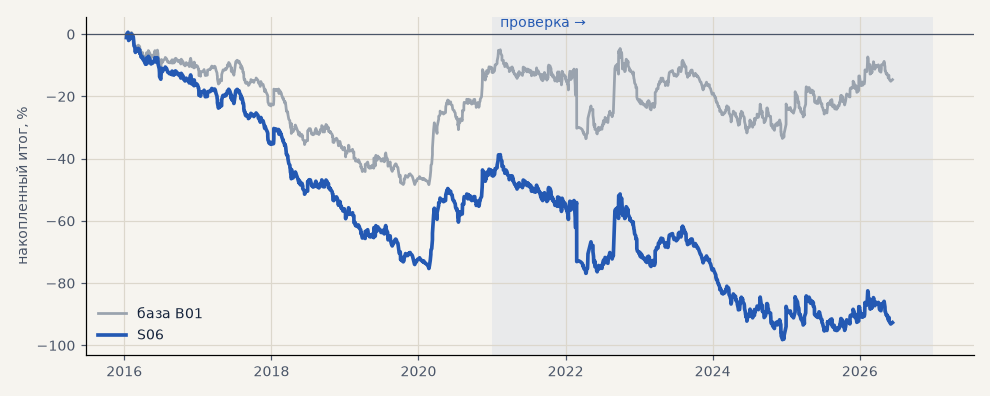

# S06. Проскальзывание 0.15% вместо 0.05%

**Семейство:** стратегия без ML (импульс) · **база:** B01 · **гипотеза:** — · **вердикт:** убыточно (безубыток металлов ≈ 0.13%)

**Что проверяли.** Проскальзывание 0.15% на входе и на выходе.

**Зачем.** Найти точку безубытка металлов.

**Итог простыми словами.** Металлы уходят в минус — безубыток около 0.13% на сторону.

**Издержки:** профиль `base` (спред и свопы брокера)

Подробности: [results/audit.md](../../results/audit.md)

Проверка — сделки, открытые с 1 января 2021 года; выбор — до 2021. В скобках — база на тех же инструментах.

| срез | период | сделок | итог % | выигрышей | ожидание на сделку | PF | без 2 лучших | просадка | t | лет в плюсе |
|---|---|---|---|---|---|---|---|---|---|---|
| все инструменты | проверка | 1924 (1924) | -67.0 (-18.9) | 38% (41%) | -0.278% (-0.078%) | 0.83 (0.95) | -76.0 (-27.9) | -69.5 (-32.5) | -2.48 (-0.70) | 0/6 (1/6) |
| все инструменты | выбор | 1196 (1196) | -71.0 (-41.1) | 36% (39%) | -0.475% (-0.275%) | 0.67 (0.79) | -75.7 (-45.8) | -83.3 (-59.1) | -5.22 (-3.02) | 1/5 (1/5) |
| портфель 4 | проверка | 896 (896) | -47.1 (-2.3) | 39% (42%) | -0.210% (-0.010%) | 0.86 (0.99) | -62.4 (-17.7) | -59.5 (-28.9) | -1.34 (-0.07) | 0/6 (3/6) |
| портфель 4 | выбор | 665 (665) | -45.5 (-12.3) | 39% (41%) | -0.274% (-0.074%) | 0.81 (0.94) | -54.9 (-21.8) | -75.9 (-49.1) | -2.04 (-0.55) | 1/5 (1/5) |
| металлы (серебро + золото) | проверка | 506 (506) | -9.3 (+41.3) | 40% (44%) | -0.037% (+0.163%) | 0.97 (1.17) | -27.2 (+23.2) | -58.7 (-28.5) | -0.27 (1.18) | 2/6 (5/6) |
| металлы (серебро + золото) | выбор | 461 (461) | -57.6 (-11.5) | 33% (38%) | -0.250% (-0.050%) | 0.75 (0.94) | -76.3 (-30.4) | -94.4 (-55.8) | -2.05 (-0.41) | 1/5 (1/5) |
| серебро | проверка | 243 (243) | +9.5 (+58.1) | 44% (46%) | +0.039% (+0.239%) | 1.03 (1.18) | -26.3 (+21.9) | -69.4 (-51.2) | 0.15 (0.94) | 5/6 (5/6) |
| серебро | выбор | 218 (218) | -18.2 (+25.4) | 34% (37%) | -0.083% (+0.117%) | 0.93 (1.11) | -55.6 (-12.4) | -96.6 (-66.8) | -0.37 (0.52) | 2/5 (2/5) |
| золото | проверка | 263 (263) | -28.1 (+24.5) | 37% (42%) | -0.107% (+0.093%) | 0.86 (1.15) | -54.4 (-2.2) | -71.9 (-39.2) | -0.84 (0.73) | 2/6 (2/6) |
| золото | выбор | 243 (243) | -97.0 (-48.4) | 32% (40%) | -0.399% (-0.199%) | 0.54 (0.73) | -111.6 (-63.4) | -112.7 (-69.1) | -3.61 (-1.80) | 0/5 (2/5) |
| LKOH | проверка | 214 (214) | -102.1 (-59.3) | 36% (40%) | -0.477% (-0.277%) | 0.68 (0.80) | -123.3 (-80.9) | -118.3 (-89.9) | -2.12 (-1.23) | 1/6 (1/6) |
| LKOH | выбор | 132 (132) | -29.0 (-2.6) | 43% (45%) | -0.220% (-0.020%) | 0.85 (0.99) | -54.8 (-28.8) | -67.4 (-48.4) | -0.73 (-0.06) | 2/5 (2/5) |
| GAZP | проверка | 219 (219) | -67.1 (-23.3) | 40% (42%) | -0.306% (-0.106%) | 0.83 (0.94) | -126.8 (-83.4) | -132.3 (-112.1) | -0.64 (-0.22) | 3/6 (3/6) |
| GAZP | выбор | 154 (154) | -45.0 (-14.2) | 38% (40%) | -0.292% (-0.092%) | 0.80 (0.93) | -71.4 (-41.0) | -72.8 (-52.8) | -1.09 (-0.34) | 2/5 (3/5) |
| SBER | проверка | 220 (220) | -28.8 (+15.2) | 35% (37%) | -0.131% (+0.069%) | 0.89 (1.06) | -55.6 (-12.0) | -65.0 (-45.1) | -0.57 (0.30) | 2/6 (2/6) |
| SBER | выбор | 161 (161) | -90.0 (-57.8) | 43% (45%) | -0.559% (-0.359%) | 0.69 (0.79) | -114.1 (-82.3) | -119.8 (-89.8) | -1.89 (-1.21) | 1/5 (2/5) |
| MOEX | проверка | 227 (227) | -139.1 (-93.7) | 34% (37%) | -0.613% (-0.413%) | 0.61 (0.71) | -162.4 (-117.4) | -139.1 (-93.7) | -2.87 (-1.93) | 1/6 (1/6) |
| MOEX | выбор | 153 (153) | -106.0 (-75.4) | 37% (39%) | -0.693% (-0.493%) | 0.61 (0.70) | -123.3 (-93.1) | -122.1 (-102.6) | -2.52 (-1.79) | 1/5 (1/5) |
| MTSS | проверка | 196 (196) | -87.3 (-48.1) | 35% (39%) | -0.445% (-0.245%) | 0.71 (0.83) | -125.7 (-86.9) | -87.3 (-54.5) | -1.69 (-0.93) | 1/6 (2/6) |
| MTSS | выбор | 135 (135) | -182.9 (-155.9) | 31% (32%) | -1.355% (-1.155%) | 0.33 (0.39) | -197.9 (-171.3) | -182.9 (-155.9) | -5.19 (-4.42) | 0/5 (0/5) |
| ETH | проверка | 342 (342) | -92.6 (-24.2) | 42% (44%) | -0.271% (-0.071%) | 0.91 (0.98) | -150.2 (-82.2) | -132.8 (-115.3) | -0.64 (-0.17) | 2/6 (4/6) |

Журнал сделок: `trades.csv.gz` (инструмент, прогон, сторона, вход, выход, цены, результат после издержек, причина выхода).
