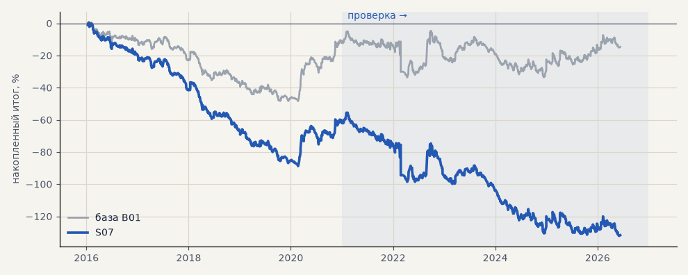

# S07. Проскальзывание 0.2% вместо 0.05%

**Семейство:** стратегия без ML (импульс) · **база:** B01 · **гипотеза:** H51 · **вердикт:** убыточно

**Что проверяли.** Проскальзывание 0.2% на входе и на выходе.

**Зачем.** Стресс-тест исполнения.

**Итог простыми словами.** Убыток на всех срезах.

**Издержки:** профиль `base` (спред и свопы брокера)

Подробности: [results/audit.md](../../results/audit.md)

Проверка — сделки, открытые с 1 января 2021 года; выбор — до 2021. В скобках — база на тех же инструментах.

| срез | период | сделок | итог % | выигрышей | ожидание на сделку | PF | без 2 лучших | просадка | t | лет в плюсе |
|---|---|---|---|---|---|---|---|---|---|---|
| все инструменты | проверка | 1924 (1924) | -91.0 (-18.9) | 37% (41%) | -0.378% (-0.078%) | 0.78 (0.95) | -100.0 (-27.9) | -93.5 (-32.5) | -3.36 (-0.70) | 0/6 (1/6) |
| все инструменты | выбор | 1196 (1196) | -86.0 (-41.1) | 35% (39%) | -0.575% (-0.275%) | 0.61 (0.79) | -90.6 (-45.8) | -95.6 (-59.1) | -6.32 (-3.02) | 1/5 (1/5) |
| портфель 4 | проверка | 896 (896) | -69.5 (-2.3) | 38% (42%) | -0.310% (-0.010%) | 0.80 (0.99) | -84.8 (-17.7) | -76.6 (-28.9) | -1.98 (-0.07) | 0/6 (3/6) |
| портфель 4 | выбор | 665 (665) | -62.2 (-12.3) | 38% (41%) | -0.374% (-0.074%) | 0.75 (0.94) | -71.5 (-21.8) | -89.3 (-49.1) | -2.78 (-0.55) | 1/5 (1/5) |
| металлы (серебро + золото) | проверка | 506 (506) | -34.6 (+41.3) | 39% (44%) | -0.137% (+0.163%) | 0.88 (1.17) | -52.4 (+23.2) | -80.4 (-28.5) | -0.99 (1.18) | 2/6 (5/6) |
| металлы (серебро + золото) | выбор | 461 (461) | -80.6 (-11.5) | 31% (38%) | -0.350% (-0.050%) | 0.67 (0.94) | -99.3 (-30.4) | -113.7 (-55.8) | -2.87 (-0.41) | 1/5 (1/5) |
| серебро | проверка | 243 (243) | -14.8 (+58.1) | 43% (46%) | -0.061% (+0.239%) | 0.96 (1.18) | -50.4 (+21.9) | -79.4 (-51.2) | -0.24 (0.94) | 3/6 (5/6) |
| серебро | выбор | 218 (218) | -40.0 (+25.4) | 33% (37%) | -0.183% (+0.117%) | 0.85 (1.11) | -77.2 (-12.4) | -111.5 (-66.8) | -0.81 (0.52) | 1/5 (2/5) |
| золото | проверка | 263 (263) | -54.4 (+24.5) | 35% (42%) | -0.207% (+0.093%) | 0.75 (1.15) | -80.5 (-2.2) | -94.2 (-39.2) | -1.63 (0.73) | 2/6 (2/6) |
| золото | выбор | 243 (243) | -121.3 (-48.4) | 29% (40%) | -0.499% (-0.199%) | 0.47 (0.73) | -135.7 (-63.4) | -135.1 (-69.1) | -4.52 (-1.80) | 0/5 (2/5) |
| LKOH | проверка | 214 (214) | -123.5 (-59.3) | 34% (40%) | -0.577% (-0.277%) | 0.63 (0.80) | -144.5 (-80.9) | -133.3 (-89.9) | -2.56 (-1.23) | 1/6 (1/6) |
| LKOH | выбор | 132 (132) | -42.2 (-2.6) | 42% (45%) | -0.320% (-0.020%) | 0.79 (0.99) | -67.8 (-28.8) | -77.1 (-48.4) | -1.06 (-0.06) | 2/5 (2/5) |
| GAZP | проверка | 219 (219) | -89.0 (-23.3) | 40% (42%) | -0.406% (-0.106%) | 0.78 (0.94) | -148.5 (-83.4) | -144.6 (-112.1) | -0.85 (-0.22) | 3/6 (3/6) |
| GAZP | выбор | 154 (154) | -60.4 (-14.2) | 37% (40%) | -0.392% (-0.092%) | 0.74 (0.93) | -86.6 (-41.0) | -82.8 (-52.8) | -1.46 (-0.34) | 2/5 (3/5) |
| SBER | проверка | 220 (220) | -50.8 (+15.2) | 33% (37%) | -0.231% (+0.069%) | 0.82 (1.06) | -77.4 (-12.0) | -78.0 (-45.1) | -1.01 (0.30) | 2/6 (2/6) |
| SBER | выбор | 161 (161) | -106.1 (-57.8) | 40% (45%) | -0.659% (-0.359%) | 0.64 (0.79) | -130.0 (-82.3) | -134.8 (-89.8) | -2.23 (-1.21) | 1/5 (2/5) |
| MOEX | проверка | 227 (227) | -161.8 (-93.7) | 33% (37%) | -0.713% (-0.413%) | 0.56 (0.71) | -184.9 (-117.4) | -161.8 (-93.7) | -3.34 (-1.93) | 0/6 (1/6) |
| MOEX | выбор | 153 (153) | -121.3 (-75.4) | 35% (39%) | -0.793% (-0.493%) | 0.57 (0.70) | -138.4 (-93.1) | -132.6 (-102.6) | -2.88 (-1.79) | 1/5 (1/5) |
| MTSS | проверка | 196 (196) | -106.9 (-48.1) | 34% (39%) | -0.545% (-0.245%) | 0.66 (0.83) | -145.1 (-86.9) | -106.9 (-54.5) | -2.07 (-0.93) | 1/6 (2/6) |
| MTSS | выбор | 135 (135) | -196.4 (-155.9) | 30% (32%) | -1.455% (-1.155%) | 0.31 (0.39) | -211.2 (-171.3) | -196.4 (-155.9) | -5.57 (-4.42) | 0/5 (0/5) |
| ETH | проверка | 342 (342) | -126.8 (-24.2) | 40% (44%) | -0.371% (-0.071%) | 0.88 (0.98) | -184.2 (-82.2) | -154.5 (-115.3) | -0.87 (-0.17) | 1/6 (4/6) |

Журнал сделок: `trades.csv.gz` (инструмент, прогон, сторона, вход, выход, цены, результат после издержек, причина выхода).
