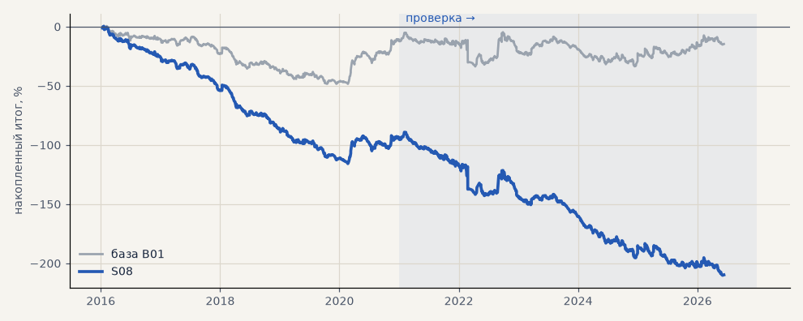

# S08. Проскальзывание 0.3% вместо 0.05%

**Семейство:** стратегия без ML (импульс) · **база:** B01 · **гипотеза:** H51 · **вердикт:** убыточно

**Что проверяли.** Проскальзывание 0.3% на входе и на выходе.

**Зачем.** Стресс-тест исполнения.

**Итог простыми словами.** Большой убыток. Без свопов безубыток был около 0.25% на сторону, со свопами — около 0.13% у металлов и меньше 0.05% у портфеля 4.

**Издержки:** профиль `base` (спред и свопы брокера)

Подробности: [results/audit.md](../../results/audit.md)

Проверка — сделки, открытые с 1 января 2021 года; выбор — до 2021. В скобках — база на тех же инструментах.

| срез | период | сделок | итог % | выигрышей | ожидание на сделку | PF | без 2 лучших | просадка | t | лет в плюсе |
|---|---|---|---|---|---|---|---|---|---|---|
| все инструменты | проверка | 1924 (1924) | -139.1 (-18.9) | 35% (41%) | -0.578% (-0.078%) | 0.69 (0.95) | -148.1 (-27.9) | -141.6 (-32.5) | -5.14 (-0.70) | 0/6 (1/6) |
| все инструменты | выбор | 1196 (1196) | -115.9 (-41.1) | 32% (39%) | -0.775% (-0.275%) | 0.52 (0.79) | -120.5 (-45.8) | -120.0 (-59.1) | -8.52 (-3.02) | 1/5 (1/5) |
| портфель 4 | проверка | 896 (896) | -114.3 (-2.3) | 35% (42%) | -0.510% (-0.010%) | 0.70 (0.99) | -129.5 (-17.7) | -121.0 (-28.9) | -3.26 (-0.07) | 0/6 (3/6) |
| портфель 4 | выбор | 665 (665) | -95.4 (-12.3) | 35% (41%) | -0.574% (-0.074%) | 0.65 (0.94) | -104.6 (-21.8) | -116.1 (-49.1) | -4.27 (-0.55) | 1/5 (1/5) |
| металлы (серебро + золото) | проверка | 506 (506) | -85.2 (+41.3) | 35% (44%) | -0.337% (+0.163%) | 0.73 (1.17) | -102.8 (+23.2) | -124.0 (-28.5) | -2.43 (1.18) | 1/6 (5/6) |
| металлы (серебро + золото) | выбор | 461 (461) | -126.7 (-11.5) | 28% (38%) | -0.550% (-0.050%) | 0.55 (0.94) | -145.2 (-30.4) | -152.3 (-55.8) | -4.51 (-0.41) | 1/5 (1/5) |
| серебро | проверка | 243 (243) | -63.4 (+58.1) | 40% (46%) | -0.261% (+0.239%) | 0.84 (1.18) | -98.6 (+21.9) | -110.5 (-51.2) | -1.03 (0.94) | 2/6 (5/6) |
| серебро | выбор | 218 (218) | -83.6 (+25.4) | 30% (37%) | -0.383% (+0.117%) | 0.72 (1.11) | -120.4 (-12.4) | -141.3 (-66.8) | -1.69 (0.52) | 1/5 (2/5) |
| золото | проверка | 263 (263) | -107.0 (+24.5) | 30% (42%) | -0.407% (+0.093%) | 0.58 (1.15) | -132.7 (-2.2) | -140.6 (-39.2) | -3.21 (0.73) | 1/6 (2/6) |
| золото | выбор | 243 (243) | -169.9 (-48.4) | 26% (40%) | -0.699% (-0.199%) | 0.36 (0.73) | -183.9 (-63.4) | -182.5 (-69.1) | -6.33 (-1.80) | 0/5 (2/5) |
| LKOH | проверка | 214 (214) | -166.3 (-59.3) | 33% (40%) | -0.777% (-0.277%) | 0.54 (0.80) | -186.9 (-80.9) | -173.0 (-89.9) | -3.45 (-1.23) | 0/6 (1/6) |
| LKOH | выбор | 132 (132) | -68.6 (-2.6) | 40% (45%) | -0.520% (-0.020%) | 0.68 (0.99) | -93.8 (-28.8) | -97.1 (-48.4) | -1.72 (-0.06) | 1/5 (2/5) |
| GAZP | проверка | 219 (219) | -132.8 (-23.3) | 38% (42%) | -0.606% (-0.106%) | 0.69 (0.94) | -191.9 (-83.4) | -170.4 (-112.1) | -1.26 (-0.22) | 2/6 (3/6) |
| GAZP | выбор | 154 (154) | -91.2 (-14.2) | 34% (40%) | -0.592% (-0.092%) | 0.63 (0.93) | -117.0 (-41.0) | -102.8 (-52.8) | -2.20 (-0.34) | 0/5 (3/5) |
| SBER | проверка | 220 (220) | -94.8 (+15.2) | 30% (37%) | -0.431% (+0.069%) | 0.70 (1.06) | -121.0 (-12.0) | -104.0 (-45.1) | -1.88 (0.30) | 2/6 (2/6) |
| SBER | выбор | 161 (161) | -138.3 (-57.8) | 38% (45%) | -0.859% (-0.359%) | 0.56 (0.79) | -161.8 (-82.3) | -164.8 (-89.8) | -2.90 (-1.21) | 0/5 (2/5) |
| MOEX | проверка | 227 (227) | -207.2 (-93.7) | 30% (37%) | -0.913% (-0.413%) | 0.48 (0.71) | -229.9 (-117.4) | -207.2 (-93.7) | -4.27 (-1.93) | 0/6 (1/6) |
| MOEX | выбор | 153 (153) | -151.9 (-75.4) | 35% (39%) | -0.993% (-0.493%) | 0.49 (0.70) | -168.6 (-93.1) | -158.5 (-102.6) | -3.60 (-1.79) | 0/5 (1/5) |
| MTSS | проверка | 196 (196) | -146.1 (-48.1) | 33% (39%) | -0.745% (-0.245%) | 0.57 (0.83) | -183.9 (-86.9) | -146.1 (-54.5) | -2.83 (-0.93) | 1/6 (2/6) |
| MTSS | выбор | 135 (135) | -223.4 (-155.9) | 27% (32%) | -1.655% (-1.155%) | 0.26 (0.39) | -237.8 (-171.3) | -223.4 (-155.9) | -6.34 (-4.42) | 0/5 (0/5) |
| ETH | проверка | 342 (342) | -195.2 (-24.2) | 40% (44%) | -0.571% (-0.071%) | 0.82 (0.98) | -252.2 (-82.2) | -214.8 (-115.3) | -1.35 (-0.17) | 1/6 (4/6) |

Журнал сделок: `trades.csv.gz` (инструмент, прогон, сторона, вход, выход, цены, результат после издержек, причина выхода).
