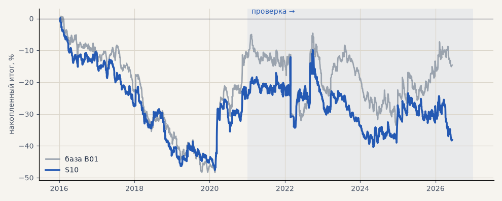

# S10. Выход при развороте тренд-фильтра

**Семейство:** стратегия без ML (импульс) · **база:** B01 · **гипотеза:** H26 · **вердикт:** хуже базы

**Что проверяли.** К базе добавлен выход по развороту тренда: сделка закрывается по закрытию часа, когда гейт C становится противоположным её направлению (тренд — только по закрытой свече). Пересчитано на всех 8 рынках с дивидендами, стопом по гэпу и издержками базы.

**Зачем.** Держать позицию, пока тренд не развернулся, и не отдавать прибыль обратно; короче удержание — меньше свопов.

**Итог простыми словами.** Хуже базы, особенно на металлах. Срезаются крупные движения, ради которых стратегия держит позицию, а экономия на свопах этого не окупает.

**Издержки:** профиль `base` (спред и свопы брокера)

Подробности: [results/trend_filter_ema.md](../../results/trend_filter_ema.md)

Проверка — сделки, открытые с 1 января 2021 года; выбор — до 2021. В скобках — база на тех же инструментах.

| срез | период | сделок | итог % | выигрышей | ожидание на сделку | PF | без 2 лучших | просадка | t | лет в плюсе |
|---|---|---|---|---|---|---|---|---|---|---|
| все инструменты | проверка | 2758 (1924) | -13.3 (-18.9) | 36% (41%) | -0.039% (-0.078%) | 0.96 (0.95) | -22.9 (-27.9) | -24.0 (-32.5) | -0.55 (-0.70) | 2/6 (1/6) |
| все инструменты | выбор | 1614 (1196) | -31.8 (-41.1) | 32% (39%) | -0.158% (-0.275%) | 0.83 (0.79) | -36.2 (-45.8) | -46.1 (-59.1) | -2.61 (-3.02) | 1/5 (1/5) |
| портфель 4 | проверка | 1259 (896) | -13.7 (-2.3) | 36% (42%) | -0.044% (-0.010%) | 0.96 (0.99) | -29.9 (-17.7) | -30.5 (-28.9) | -0.41 (-0.07) | 2/6 (3/6) |
| портфель 4 | выбор | 897 (665) | -24.4 (-12.3) | 32% (41%) | -0.109% (-0.074%) | 0.89 (0.94) | -33.2 (-21.8) | -47.8 (-49.1) | -1.19 (-0.55) | 1/5 (1/5) |
| металлы (серебро + золото) | проверка | 763 (506) | -1.2 (+41.3) | 37% (44%) | -0.003% (+0.163%) | 1.00 (1.17) | -19.9 (+23.2) | -40.8 (-28.5) | -0.04 (1.18) | 3/6 (5/6) |
| металлы (серебро + золото) | выбор | 659 (461) | -13.3 (-11.5) | 32% (38%) | -0.040% (-0.050%) | 0.93 (0.94) | -30.8 (-30.4) | -46.8 (-55.8) | -0.53 (-0.41) | 2/5 (1/5) |
| серебро | проверка | 366 (243) | -19.3 (+58.1) | 35% (46%) | -0.053% (+0.239%) | 0.95 (1.18) | -56.4 (+21.9) | -80.3 (-51.2) | -0.34 (0.94) | 3/6 (5/6) |
| серебро | выбор | 306 (218) | -3.0 (+25.4) | 30% (37%) | -0.010% (+0.117%) | 0.99 (1.11) | -38.1 (-12.4) | -67.3 (-66.8) | -0.07 (0.52) | 3/5 (2/5) |
| золото | проверка | 397 (263) | +17.0 (+24.5) | 40% (42%) | +0.043% (+0.093%) | 1.10 (1.15) | -9.7 (-2.2) | -39.8 (-39.2) | 0.54 (0.73) | 3/6 (2/6) |
| золото | выбор | 353 (243) | -23.5 (-48.4) | 33% (40%) | -0.067% (-0.199%) | 0.85 (0.73) | -38.0 (-63.4) | -45.7 (-69.1) | -1.01 (-1.80) | 1/5 (2/5) |
| LKOH | проверка | 298 (214) | -58.8 (-59.3) | 37% (40%) | -0.197% (-0.277%) | 0.79 (0.80) | -76.9 (-80.9) | -75.5 (-89.9) | -1.45 (-1.23) | 1/6 (1/6) |
| LKOH | выбор | 174 (132) | -0.8 (-2.6) | 36% (45%) | -0.004% (-0.020%) | 1.00 (0.99) | -27.0 (-28.8) | -45.7 (-48.4) | -0.02 (-0.06) | 2/5 (2/5) |
| GAZP | проверка | 294 (219) | -8.7 (-23.3) | 39% (42%) | -0.029% (-0.106%) | 0.98 (0.94) | -68.7 (-83.4) | -95.4 (-112.1) | -0.08 (-0.22) | 3/6 (3/6) |
| GAZP | выбор | 200 (154) | -37.5 (-14.2) | 32% (40%) | -0.188% (-0.092%) | 0.81 (0.93) | -64.3 (-41.0) | -42.1 (-52.8) | -1.02 (-0.34) | 1/5 (3/5) |
| SBER | проверка | 301 (220) | +32.0 (+15.2) | 35% (37%) | +0.106% (+0.069%) | 1.14 (1.06) | -3.5 (-12.0) | -42.1 (-45.1) | 0.67 (0.30) | 3/6 (2/6) |
| SBER | выбор | 217 (161) | -56.4 (-57.8) | 31% (45%) | -0.260% (-0.359%) | 0.80 (0.79) | -80.8 (-82.3) | -80.7 (-89.8) | -1.23 (-1.21) | 1/5 (2/5) |
| MOEX | проверка | 318 (227) | -72.1 (-93.7) | 32% (37%) | -0.227% (-0.413%) | 0.75 (0.71) | -90.0 (-117.4) | -72.2 (-93.7) | -1.78 (-1.93) | 1/6 (1/6) |
| MOEX | выбор | 189 (153) | -26.7 (-75.4) | 37% (39%) | -0.141% (-0.493%) | 0.87 (0.70) | -44.9 (-93.1) | -63.6 (-102.6) | -0.73 (-1.79) | 2/5 (1/5) |
| MTSS | проверка | 279 (196) | -32.5 (-48.1) | 31% (39%) | -0.116% (-0.245%) | 0.87 (0.83) | -79.1 (-86.9) | -49.6 (-54.5) | -0.62 (-0.93) | 2/6 (2/6) |
| MTSS | выбор | 175 (135) | -106.5 (-155.9) | 29% (32%) | -0.608% (-1.155%) | 0.47 (0.39) | -121.9 (-171.3) | -106.5 (-155.9) | -3.77 (-4.42) | 1/5 (0/5) |
| ETH | проверка | 505 (342) | +35.9 (-24.2) | 36% (44%) | +0.071% (-0.071%) | 1.04 (0.98) | -22.1 (-82.2) | -76.6 (-115.3) | 0.29 (-0.17) | 3/6 (4/6) |

Журнал сделок: `trades.csv.gz` (инструмент, прогон, сторона, вход, выход, цены, результат после издержек, причина выхода).
