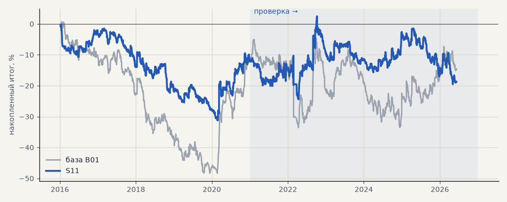

# S11. Узкий стоп и трейлинг 3 ATR

**Семейство:** стратегия без ML (импульс) · **база:** B01 · **гипотеза:** — · **вердикт:** хуже базы

**Что проверяли.** Стоп и трейлинг 3 ATR вместо 6 (трейлинг включается после +1.5 ATR), выход не позже 240 часов. Все 8 рынков, издержки базы.

**Зачем.** Ближний стоп — меньше убыток на сделку и короче удержание.

**Итог простыми словами.** Хуже базы: сделок в 1.6 раза больше, узкий стоп выбивает рынок обычным шумом, а лишние сделки платят комиссию и проскальзывание.

**Издержки:** профиль `base` (спред и свопы брокера)

Подробности: [results/patterns.md](../../results/patterns.md)

Проверка — сделки, открытые с 1 января 2021 года; выбор — до 2021. В скобках — база на тех же инструментах.

| срез | период | сделок | итог % | выигрышей | ожидание на сделку | PF | без 2 лучших | просадка | t | лет в плюсе |
|---|---|---|---|---|---|---|---|---|---|---|
| все инструменты | проверка | 3167 (1924) | -28.2 (-18.9) | 37% (41%) | -0.071% (-0.078%) | 0.91 (0.95) | -37.6 (-27.9) | -32.5 (-32.5) | -1.49 (-0.70) | 2/6 (1/6) |
| все инструменты | выбор | 1799 (1196) | -31.1 (-41.1) | 35% (39%) | -0.138% (-0.275%) | 0.81 (0.79) | -34.7 (-45.8) | -40.5 (-59.1) | -3.02 (-3.02) | 1/5 (1/5) |
| портфель 4 | проверка | 1425 (896) | -6.9 (-2.3) | 39% (42%) | -0.019% (-0.010%) | 0.97 (0.99) | -21.6 (-17.7) | -22.0 (-28.9) | -0.27 (-0.07) | 2/6 (3/6) |
| портфель 4 | выбор | 999 (665) | -11.8 (-12.3) | 37% (41%) | -0.047% (-0.074%) | 0.94 (0.94) | -18.8 (-21.8) | -31.2 (-49.1) | -0.67 (-0.55) | 1/5 (1/5) |
| металлы (серебро + золото) | проверка | 871 (506) | -29.9 (+41.3) | 36% (44%) | -0.069% (+0.163%) | 0.89 (1.17) | -42.1 (+23.2) | -38.8 (-28.5) | -1.14 (1.18) | 2/6 (5/6) |
| металлы (серебро + золото) | выбор | 731 (461) | -20.3 (-11.5) | 34% (38%) | -0.055% (-0.050%) | 0.87 (0.94) | -32.7 (-30.4) | -40.0 (-55.8) | -1.12 (-0.41) | 2/5 (1/5) |
| серебро | проверка | 412 (243) | -17.3 (+58.1) | 37% (46%) | -0.042% (+0.239%) | 0.95 (1.18) | -41.7 (+21.9) | -40.9 (-51.2) | -0.37 (0.94) | 2/6 (5/6) |
| серебро | выбор | 336 (218) | +1.5 (+25.4) | 35% (37%) | +0.004% (+0.117%) | 1.01 (1.11) | -23.5 (-12.4) | -48.5 (-66.8) | 0.05 (0.52) | 3/5 (2/5) |
| золото | проверка | 459 (263) | -42.5 (+24.5) | 35% (42%) | -0.093% (+0.093%) | 0.80 (1.15) | -57.5 (-2.2) | -54.8 (-39.2) | -1.71 (0.73) | 1/6 (2/6) |
| золото | выбор | 395 (243) | -42.0 (-48.4) | 33% (40%) | -0.106% (-0.199%) | 0.70 (0.73) | -48.9 (-63.4) | -47.2 (-69.1) | -2.58 (-1.80) | 0/5 (2/5) |
| LKOH | проверка | 333 (214) | -37.8 (-59.3) | 39% (40%) | -0.113% (-0.277%) | 0.85 (0.80) | -61.0 (-80.9) | -43.5 (-89.9) | -0.95 (-1.23) | 0/6 (1/6) |
| LKOH | выбор | 195 (132) | +17.1 (-2.6) | 42% (45%) | +0.088% (-0.020%) | 1.11 (0.99) | -7.1 (-28.8) | -40.8 (-48.4) | 0.50 (-0.06) | 2/5 (2/5) |
| GAZP | проверка | 332 (219) | +6.6 (-23.3) | 40% (42%) | +0.020% (-0.106%) | 1.02 (0.94) | -47.2 (-83.4) | -55.7 (-112.1) | 0.09 (-0.22) | 4/6 (3/6) |
| GAZP | выбор | 227 (154) | -33.4 (-14.2) | 37% (40%) | -0.147% (-0.092%) | 0.83 (0.93) | -58.5 (-41.0) | -36.2 (-52.8) | -0.98 (-0.34) | 2/5 (3/5) |
| SBER | проверка | 348 (220) | +20.9 (+15.2) | 38% (37%) | +0.060% (+0.069%) | 1.11 (1.06) | -8.4 (-12.0) | -30.2 (-45.1) | 0.57 (0.30) | 4/6 (2/6) |
| SBER | выбор | 241 (161) | -32.3 (-57.8) | 35% (45%) | -0.134% (-0.359%) | 0.86 (0.79) | -59.0 (-82.3) | -49.3 (-89.8) | -0.82 (-1.21) | 1/5 (2/5) |
| MOEX | проверка | 370 (227) | -121.2 (-93.7) | 36% (37%) | -0.328% (-0.413%) | 0.59 (0.71) | -134.3 (-117.4) | -121.2 (-93.7) | -3.72 (-1.93) | 1/6 (1/6) |
| MOEX | выбор | 216 (153) | -33.8 (-75.4) | 38% (39%) | -0.156% (-0.493%) | 0.81 (0.70) | -48.5 (-93.1) | -51.4 (-102.6) | -1.19 (-1.79) | 1/5 (1/5) |
| MTSS | проверка | 305 (196) | -50.4 (-48.1) | 32% (39%) | -0.165% (-0.245%) | 0.79 (0.83) | -90.2 (-86.9) | -61.5 (-54.5) | -1.18 (-0.93) | 2/6 (2/6) |
| MTSS | выбор | 189 (135) | -126.0 (-155.9) | 30% (32%) | -0.667% (-1.155%) | 0.43 (0.39) | -140.8 (-171.3) | -126.0 (-155.9) | -4.57 (-4.42) | 1/5 (0/5) |
| ETH | проверка | 608 (342) | +15.7 (-24.2) | 39% (44%) | +0.026% (-0.071%) | 1.02 (0.98) | -45.1 (-82.2) | -62.5 (-115.3) | 0.16 (-0.17) | 4/6 (4/6) |

Журнал сделок: `trades.csv.gz` (инструмент, прогон, сторона, вход, выход, цены, результат после издержек, причина выхода).
