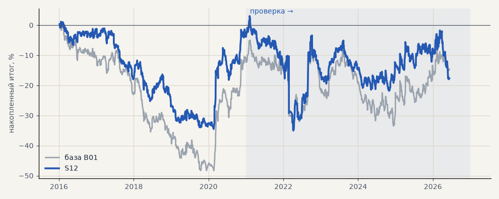

# S12. Выход не позже 120 ч (стоп 6, трейлинг 6, активация 3)

**Семейство:** стратегия без ML (импульс) · **база:** B01 · **гипотеза:** H03 · **вердикт:** не подтверждено (выбор лучше, проверка хуже)

**Что проверяли.** Выход не позже 120 часов, стоп и трейлинг 6 ATR (трейлинг после +3 ATR). Все 8 рынков, издержки базы.

**Зачем.** Вдвое короче удержание — вдвое меньше свопов (гипотеза H03).

**Итог простыми словами.** Не подтвердилось: на выборе 2016–2020 лучше базы, на проверке хуже, металлы теряют больше половины результата. Экономия на свопах меньше потери сигнала.

**Издержки:** профиль `base` (спред и свопы брокера)

Подробности: [results/costs.md](../../results/costs.md)

Проверка — сделки, открытые с 1 января 2021 года; выбор — до 2021. В скобках — база на тех же инструментах.

| срез | период | сделок | итог % | выигрышей | ожидание на сделку | PF | без 2 лучших | просадка | t | лет в плюсе |
|---|---|---|---|---|---|---|---|---|---|---|
| все инструменты | проверка | 2343 (1924) | -22.3 (-18.9) | 44% (41%) | -0.076% (-0.078%) | 0.94 (0.95) | -31.2 (-27.9) | -36.4 (-32.5) | -0.88 (-0.70) | 1/6 (1/6) |
| все инструменты | выбор | 1496 (1196) | -29.6 (-41.1) | 41% (39%) | -0.158% (-0.275%) | 0.84 (0.79) | -33.3 (-45.8) | -44.9 (-59.1) | -2.43 (-3.02) | 1/5 (1/5) |
| портфель 4 | проверка | 1103 (896) | -14.1 (-2.3) | 44% (42%) | -0.051% (-0.010%) | 0.96 (0.99) | -28.7 (-17.7) | -38.1 (-28.9) | -0.42 (-0.07) | 3/6 (3/6) |
| портфель 4 | выбор | 833 (665) | -3.6 (-12.3) | 41% (41%) | -0.017% (-0.074%) | 0.98 (0.94) | -11.1 (-21.8) | -35.7 (-49.1) | -0.18 (-0.55) | 1/5 (1/5) |
| металлы (серебро + золото) | проверка | 641 (506) | +15.2 (+41.3) | 47% (44%) | +0.048% (+0.163%) | 1.05 (1.17) | +3.9 (+23.2) | -28.3 (-28.5) | 0.47 (1.18) | 3/6 (5/6) |
| металлы (серебро + золото) | выбор | 563 (461) | -13.1 (-11.5) | 40% (38%) | -0.047% (-0.050%) | 0.93 (0.94) | -26.5 (-30.4) | -42.4 (-55.8) | -0.54 (-0.41) | 2/5 (1/5) |
| серебро | проверка | 306 (243) | +26.8 (+58.1) | 47% (46%) | +0.088% (+0.239%) | 1.07 (1.18) | +4.1 (+21.9) | -39.5 (-51.2) | 0.46 (0.94) | 5/6 (5/6) |
| серебро | выбор | 260 (218) | +20.6 (+25.4) | 40% (37%) | +0.079% (+0.117%) | 1.09 (1.11) | -6.0 (-12.4) | -52.3 (-66.8) | 0.49 (0.52) | 3/5 (2/5) |
| золото | проверка | 335 (263) | +3.7 (+24.5) | 47% (42%) | +0.011% (+0.093%) | 1.02 (1.15) | -7.9 (-2.2) | -55.3 (-39.2) | 0.14 (0.73) | 2/6 (2/6) |
| золото | выбор | 303 (243) | -46.9 (-48.4) | 40% (40%) | -0.155% (-0.199%) | 0.74 (0.73) | -58.5 (-63.4) | -58.9 (-69.1) | -2.01 (-1.80) | 0/5 (2/5) |
| LKOH | проверка | 265 (214) | -92.5 (-59.3) | 41% (40%) | -0.349% (-0.277%) | 0.71 (0.80) | -111.5 (-80.9) | -104.5 (-89.9) | -2.07 (-1.23) | 1/6 (1/6) |
| LKOH | выбор | 171 (132) | -3.9 (-2.6) | 44% (45%) | -0.023% (-0.020%) | 0.98 (0.99) | -32.3 (-28.8) | -54.9 (-48.4) | -0.10 (-0.06) | 2/5 (2/5) |
| GAZP | проверка | 267 (219) | -35.8 (-23.3) | 44% (42%) | -0.134% (-0.106%) | 0.91 (0.94) | -94.1 (-83.4) | -103.0 (-112.1) | -0.34 (-0.22) | 2/6 (3/6) |
| GAZP | выбор | 196 (154) | +7.0 (-14.2) | 42% (40%) | +0.036% (-0.092%) | 1.04 (0.93) | -17.4 (-41.0) | -32.0 (-52.8) | 0.18 (-0.34) | 2/5 (3/5) |
| SBER | проверка | 265 (220) | +45.2 (+15.2) | 43% (37%) | +0.171% (+0.069%) | 1.20 (1.06) | +22.9 (-12.0) | -30.5 (-45.1) | 1.04 (0.30) | 3/6 (2/6) |
| SBER | выбор | 206 (161) | -38.2 (-57.8) | 39% (45%) | -0.185% (-0.359%) | 0.85 (0.79) | -60.5 (-82.3) | -69.5 (-89.8) | -0.87 (-1.21) | 2/5 (2/5) |
| MOEX | проверка | 276 (227) | -104.0 (-93.7) | 39% (37%) | -0.377% (-0.413%) | 0.70 (0.71) | -122.6 (-117.4) | -104.0 (-93.7) | -2.30 (-1.93) | 1/6 (1/6) |
| MOEX | выбор | 188 (153) | -62.6 (-75.4) | 40% (39%) | -0.333% (-0.493%) | 0.74 (0.70) | -77.0 (-93.1) | -83.1 (-102.6) | -1.65 (-1.79) | 1/5 (1/5) |
| MTSS | проверка | 239 (196) | -27.5 (-48.1) | 40% (39%) | -0.115% (-0.245%) | 0.90 (0.83) | -66.2 (-86.9) | -47.7 (-54.5) | -0.55 (-0.93) | 2/6 (2/6) |
| MTSS | выбор | 172 (135) | -112.7 (-155.9) | 41% (32%) | -0.655% (-1.155%) | 0.48 (0.39) | -122.9 (-171.3) | -112.7 (-155.9) | -3.82 (-4.42) | 1/5 (0/5) |
| ETH | проверка | 390 (342) | +5.7 (-24.2) | 44% (44%) | +0.015% (-0.071%) | 1.01 (0.98) | -48.9 (-82.2) | -103.5 (-115.3) | 0.04 (-0.17) | 2/6 (4/6) |

Журнал сделок: `trades.csv.gz` (инструмент, прогон, сторона, вход, выход, цены, результат после издержек, причина выхода).
