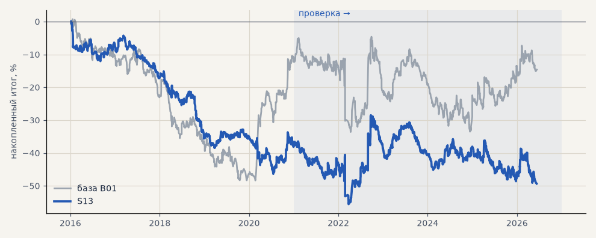

# S13. Выход не позже 48 ч (стоп 4, трейлинг 4, активация 2)

**Семейство:** стратегия без ML (импульс) · **база:** B01 · **гипотеза:** H03 · **вердикт:** хуже базы

**Что проверяли.** Выход не позже 48 часов, стоп и трейлинг 4 ATR (трейлинг после +2 ATR). Все 8 рынков, издержки базы.

**Зачем.** Короткое удержание — почти без свопов.

**Итог простыми словами.** Хуже базы в обоих периодах: импульс отрабатывает за несколько дней, короткий выход забирает лишь начало хода.

**Издержки:** профиль `base` (спред и свопы брокера)

Подробности: [results/costs.md](../../results/costs.md)

Проверка — сделки, открытые с 1 января 2021 года; выбор — до 2021. В скобках — база на тех же инструментах.

| срез | период | сделок | итог % | выигрышей | ожидание на сделку | PF | без 2 лучших | просадка | t | лет в плюсе |
|---|---|---|---|---|---|---|---|---|---|---|
| все инструменты | проверка | 3202 (1924) | -26.5 (-18.9) | 40% (41%) | -0.066% (-0.078%) | 0.92 (0.95) | -36.0 (-27.9) | -33.0 (-32.5) | -1.36 (-0.70) | 1/6 (1/6) |
| все инструменты | выбор | 1902 (1196) | -38.2 (-41.1) | 40% (39%) | -0.161% (-0.275%) | 0.76 (0.79) | -40.8 (-45.8) | -42.9 (-59.1) | -4.16 (-3.02) | 0/5 (1/5) |
| портфель 4 | проверка | 1500 (896) | -11.4 (-2.3) | 39% (42%) | -0.030% (-0.010%) | 0.96 (0.99) | -25.1 (-17.7) | -20.8 (-28.9) | -0.45 (-0.07) | 2/6 (3/6) |
| портфель 4 | выбор | 1064 (665) | -37.9 (-12.3) | 42% (41%) | -0.143% (-0.074%) | 0.81 (0.94) | -43.2 (-21.8) | -46.4 (-49.1) | -2.45 (-0.55) | 1/5 (1/5) |
| металлы (серебро + золото) | проверка | 880 (506) | -19.1 (+41.3) | 40% (44%) | -0.043% (+0.163%) | 0.93 (1.17) | -30.1 (+23.2) | -42.5 (-28.5) | -0.77 (1.18) | 1/6 (5/6) |
| металлы (серебро + золото) | выбор | 737 (461) | -46.4 (-11.5) | 36% (38%) | -0.126% (-0.050%) | 0.73 (0.94) | -53.1 (-30.4) | -57.0 (-55.8) | -2.95 (-0.41) | 1/5 (1/5) |
| серебро | проверка | 426 (243) | -5.9 (+58.1) | 39% (46%) | -0.014% (+0.239%) | 0.98 (1.18) | -27.9 (+21.9) | -44.9 (-51.2) | -0.13 (0.94) | 1/6 (5/6) |
| серебро | выбор | 337 (218) | -53.6 (+25.4) | 37% (37%) | -0.159% (+0.117%) | 0.74 (1.11) | -67.1 (-12.4) | -70.0 (-66.8) | -2.00 (0.52) | 2/5 (2/5) |
| золото | проверка | 454 (263) | -32.3 (+24.5) | 41% (42%) | -0.071% (+0.093%) | 0.84 (1.15) | -42.7 (-2.2) | -52.3 (-39.2) | -1.45 (0.73) | 2/6 (2/6) |
| золото | выбор | 400 (243) | -39.1 (-48.4) | 36% (40%) | -0.098% (-0.199%) | 0.72 (0.73) | -47.9 (-63.4) | -45.7 (-69.1) | -2.37 (-1.80) | 1/5 (2/5) |
| LKOH | проверка | 360 (214) | -60.6 (-59.3) | 40% (40%) | -0.168% (-0.277%) | 0.76 (0.80) | -76.1 (-80.9) | -69.1 (-89.9) | -1.79 (-1.23) | 1/6 (1/6) |
| LKOH | выбор | 216 (132) | +21.0 (-2.6) | 48% (45%) | +0.097% (-0.020%) | 1.16 (0.99) | +6.0 (-28.8) | -30.4 (-48.4) | 0.79 (-0.06) | 1/5 (2/5) |
| GAZP | проверка | 344 (219) | +19.5 (-23.3) | 40% (42%) | +0.057% (-0.106%) | 1.06 (0.94) | -32.3 (-83.4) | -60.7 (-112.1) | 0.25 (-0.22) | 3/6 (3/6) |
| GAZP | выбор | 250 (154) | -51.8 (-14.2) | 41% (40%) | -0.207% (-0.092%) | 0.74 (0.93) | -67.9 (-41.0) | -62.6 (-52.8) | -1.68 (-0.34) | 2/5 (3/5) |
| SBER | проверка | 370 (220) | +1.4 (+15.2) | 39% (37%) | +0.004% (+0.069%) | 1.01 (1.06) | -15.8 (-12.0) | -41.1 (-45.1) | 0.04 (0.30) | 3/6 (2/6) |
| SBER | выбор | 261 (161) | -67.3 (-57.8) | 44% (45%) | -0.258% (-0.359%) | 0.74 (0.79) | -84.8 (-82.3) | -79.2 (-89.8) | -1.77 (-1.21) | 0/5 (2/5) |
| MOEX | проверка | 377 (227) | -111.7 (-93.7) | 34% (37%) | -0.296% (-0.413%) | 0.61 (0.71) | -123.4 (-117.4) | -112.7 (-93.7) | -3.41 (-1.93) | 1/6 (1/6) |
| MOEX | выбор | 230 (153) | -32.9 (-75.4) | 43% (39%) | -0.143% (-0.493%) | 0.81 (0.70) | -43.7 (-93.1) | -48.7 (-102.6) | -1.24 (-1.79) | 0/5 (1/5) |
| MTSS | проверка | 312 (196) | -36.9 (-48.1) | 38% (39%) | -0.118% (-0.245%) | 0.85 (0.83) | -79.1 (-86.9) | -55.6 (-54.5) | -0.77 (-0.93) | 2/6 (2/6) |
| MTSS | выбор | 208 (135) | -81.8 (-155.9) | 39% (32%) | -0.393% (-1.155%) | 0.54 (0.39) | -92.6 (-171.3) | -81.8 (-155.9) | -3.39 (-4.42) | 1/5 (0/5) |
| ETH | проверка | 559 (342) | +14.5 (-24.2) | 43% (44%) | +0.026% (-0.071%) | 1.02 (0.98) | -33.2 (-82.2) | -115.9 (-115.3) | 0.14 (-0.17) | 4/6 (4/6) |

Журнал сделок: `trades.csv.gz` (инструмент, прогон, сторона, вход, выход, цены, результат после издержек, причина выхода).
