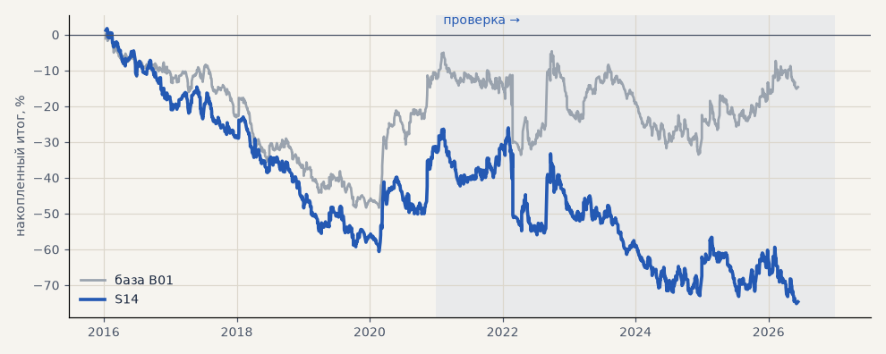

# S14. Без тренд-фильтра

**Семейство:** стратегия без ML (импульс) · **база:** B01 · **гипотеза:** — · **вердикт:** хуже базы

**Что проверяли.** Вход по любому импульсу 6 ч / 3 ATR в его сторону, без проверки тренд-гейта C. Выход как в базе, все 8 рынков.

**Зачем.** Нужен ли тренд-фильтр вообще.

**Итог простыми словами.** Заметно хуже базы — тренд-фильтр нужен, особенно на акциях.

**Издержки:** профиль `base` (спред и свопы брокера)

Подробности: [results/patterns.md](../../results/patterns.md)

Проверка — сделки, открытые с 1 января 2021 года; выбор — до 2021. В скобках — база на тех же инструментах.

| срез | период | сделок | итог % | выигрышей | ожидание на сделку | PF | без 2 лучших | просадка | t | лет в плюсе |
|---|---|---|---|---|---|---|---|---|---|---|
| все инструменты | проверка | 2204 (1924) | -39.0 (-18.9) | 40% (41%) | -0.142% (-0.078%) | 0.91 (0.95) | -49.0 (-27.9) | -48.6 (-32.5) | -1.40 (-0.70) | 1/6 (1/6) |
| все инструменты | выбор | 1353 (1196) | -54.2 (-41.1) | 38% (39%) | -0.321% (-0.275%) | 0.76 (0.79) | -59.4 (-45.8) | -65.8 (-59.1) | -3.71 (-3.02) | 1/5 (1/5) |
| портфель 4 | проверка | 1033 (896) | -41.8 (-2.3) | 41% (42%) | -0.162% (-0.010%) | 0.89 (0.99) | -57.3 (-17.7) | -49.2 (-28.9) | -1.24 (-0.07) | 1/6 (3/6) |
| портфель 4 | выбор | 757 (665) | -32.9 (-12.3) | 40% (41%) | -0.174% (-0.074%) | 0.87 (0.94) | -43.2 (-21.8) | -62.4 (-49.1) | -1.35 (-0.55) | 1/5 (1/5) |
| металлы (серебро + золото) | проверка | 579 (506) | +3.2 (+41.3) | 43% (44%) | +0.011% (+0.163%) | 1.01 (1.17) | -14.1 (+23.2) | -42.6 (-28.5) | 0.09 (1.18) | 3/6 (5/6) |
| металлы (серебро + золото) | выбор | 533 (461) | -42.6 (-11.5) | 37% (38%) | -0.160% (-0.050%) | 0.83 (0.94) | -61.1 (-30.4) | -75.4 (-55.8) | -1.43 (-0.41) | 1/5 (1/5) |
| серебро | проверка | 282 (243) | -3.6 (+58.1) | 44% (46%) | -0.013% (+0.239%) | 0.99 (1.18) | -38.3 (+21.9) | -65.5 (-51.2) | -0.05 (0.94) | 3/6 (5/6) |
| серебро | выбор | 257 (218) | -25.9 (+25.4) | 35% (37%) | -0.101% (+0.117%) | 0.91 (1.11) | -62.8 (-12.4) | -91.3 (-66.8) | -0.49 (0.52) | 2/5 (2/5) |
| золото | проверка | 297 (263) | +10.1 (+24.5) | 42% (42%) | +0.034% (+0.093%) | 1.05 (1.15) | -10.4 (-2.2) | -48.5 (-39.2) | 0.30 (0.73) | 3/6 (2/6) |
| золото | выбор | 276 (243) | -59.3 (-48.4) | 38% (40%) | -0.215% (-0.199%) | 0.70 (0.73) | -74.3 (-63.4) | -77.2 (-69.1) | -2.20 (-1.80) | 1/5 (2/5) |
| LKOH | проверка | 246 (214) | -81.3 (-59.3) | 41% (40%) | -0.330% (-0.277%) | 0.77 (0.80) | -102.8 (-80.9) | -108.4 (-89.9) | -1.40 (-1.23) | 1/6 (1/6) |
| LKOH | выбор | 148 (132) | -8.1 (-2.6) | 42% (45%) | -0.054% (-0.020%) | 0.96 (0.99) | -38.5 (-28.8) | -52.1 (-48.4) | -0.19 (-0.06) | 2/5 (2/5) |
| GAZP | проверка | 255 (219) | -41.1 (-23.3) | 42% (42%) | -0.161% (-0.106%) | 0.90 (0.94) | -101.3 (-83.4) | -115.5 (-112.1) | -0.48 (-0.22) | 2/6 (3/6) |
| GAZP | выбор | 176 (154) | -75.3 (-14.2) | 38% (40%) | -0.428% (-0.092%) | 0.73 (0.93) | -104.5 (-41.0) | -102.3 (-52.8) | -1.52 (-0.34) | 1/5 (3/5) |
| SBER | проверка | 250 (220) | -41.1 (+15.2) | 36% (37%) | -0.164% (+0.069%) | 0.87 (1.06) | -71.0 (-12.0) | -70.5 (-45.1) | -0.76 (0.30) | 2/6 (2/6) |
| SBER | выбор | 176 (161) | -22.3 (-57.8) | 47% (45%) | -0.127% (-0.359%) | 0.91 (0.79) | -53.0 (-82.3) | -68.0 (-89.8) | -0.45 (-1.21) | 2/5 (2/5) |
| MOEX | проверка | 265 (227) | -138.0 (-93.7) | 35% (37%) | -0.521% (-0.413%) | 0.65 (0.71) | -161.6 (-117.4) | -139.5 (-93.7) | -2.56 (-1.93) | 0/6 (1/6) |
| MOEX | выбор | 171 (153) | -98.9 (-75.4) | 37% (39%) | -0.579% (-0.493%) | 0.65 (0.70) | -116.6 (-93.1) | -117.3 (-102.6) | -2.25 (-1.79) | 0/5 (1/5) |
| MTSS | проверка | 226 (196) | -62.9 (-48.1) | 35% (39%) | -0.278% (-0.245%) | 0.80 (0.83) | -104.4 (-86.9) | -62.9 (-54.5) | -1.08 (-0.93) | 1/6 (2/6) |
| MTSS | выбор | 149 (135) | -144.0 (-155.9) | 33% (32%) | -0.966% (-1.155%) | 0.47 (0.39) | -160.6 (-171.3) | -144.0 (-155.9) | -3.79 (-4.42) | 1/5 (0/5) |
| ETH | проверка | 383 (342) | +45.6 (-24.2) | 45% (44%) | +0.119% (-0.071%) | 1.04 (0.98) | -19.9 (-82.2) | -105.8 (-115.3) | 0.29 (-0.17) | 3/6 (4/6) |

Журнал сделок: `trades.csv.gz` (инструмент, прогон, сторона, вход, выход, цены, результат после издержек, причина выхода).
