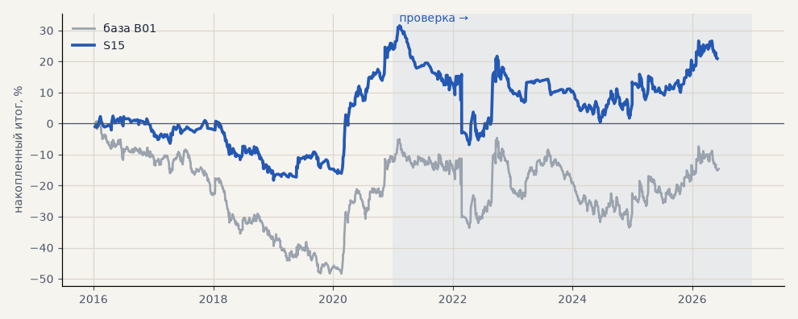

# S15. Только при высокой волатильности

**Семейство:** стратегия без ML (импульс) · **база:** B01 · **гипотеза:** — · **вердикт:** не подтверждено (выбор лучше, проверка как база)

**Что проверяли.** Входить, только если ATR сигнального часа не ниже медианы ATR обучающего периода. Выход как в базе, все 8 рынков.

**Зачем.** Преимущество должно быть больше в активном рынке; сделок вдвое меньше — меньше и свопов.

**Итог простыми словами.** Не подтвердилось: на выборе 2016–2020 заметно лучше базы, на проверке — как база, на металлах чуть хуже. Кандидат, но включать рано.

**Издержки:** профиль `base` (спред и свопы брокера)

Подробности: [results/patterns.md](../../results/patterns.md)

Проверка — сделки, открытые с 1 января 2021 года; выбор — до 2021. В скобках — база на тех же инструментах.

| срез | период | сделок | итог % | выигрышей | ожидание на сделку | PF | без 2 лучших | просадка | t | лет в плюсе |
|---|---|---|---|---|---|---|---|---|---|---|
| все инструменты | проверка | 1187 (1924) | -15.4 (-18.9) | 44% (41%) | -0.104% (-0.078%) | 0.95 (0.95) | -24.5 (-27.9) | -29.8 (-32.5) | -0.60 (-0.70) | 3/6 (1/6) |
| все инструменты | выбор | 744 (1196) | -22.2 (-41.1) | 39% (39%) | -0.239% (-0.275%) | 0.83 (0.79) | -26.8 (-45.8) | -42.5 (-59.1) | -1.83 (-3.02) | 1/5 (1/5) |
| портфель 4 | проверка | 521 (896) | -3.0 (-2.3) | 44% (42%) | -0.023% (-0.010%) | 0.99 (0.99) | -18.5 (-17.7) | -38.3 (-28.9) | -0.09 (-0.07) | 3/6 (3/6) |
| портфель 4 | выбор | 395 (665) | +24.0 (-12.3) | 43% (41%) | +0.243% (-0.074%) | 1.18 (0.94) | +14.7 (-21.8) | -20.7 (-49.1) | 1.22 (-0.55) | 3/5 (1/5) |
| металлы (серебро + золото) | проверка | 359 (506) | +34.5 (+41.3) | 46% (44%) | +0.192% (+0.163%) | 1.17 (1.17) | +16.4 (+23.2) | -26.0 (-28.5) | 1.03 (1.18) | 4/6 (5/6) |
| металлы (серебро + золото) | выбор | 328 (461) | -10.6 (-11.5) | 38% (38%) | -0.064% (-0.050%) | 0.94 (0.94) | -29.0 (-30.4) | -49.8 (-55.8) | -0.41 (-0.41) | 2/5 (1/5) |
| серебро | проверка | 164 (243) | +27.4 (+58.1) | 47% (46%) | +0.167% (+0.239%) | 1.10 (1.18) | -8.8 (+21.9) | -45.5 (-51.2) | 0.47 (0.94) | 5/6 (5/6) |
| серебро | выбор | 144 (218) | +31.4 (+25.4) | 38% (37%) | +0.218% (+0.117%) | 1.18 (1.11) | -5.5 (-12.4) | -48.3 (-66.8) | 0.69 (0.52) | 3/5 (2/5) |
| золото | проверка | 195 (263) | +41.6 (+24.5) | 45% (42%) | +0.213% (+0.093%) | 1.31 (1.15) | +14.9 (-2.2) | -15.3 (-39.2) | 1.27 (0.73) | 4/6 (2/6) |
| золото | выбор | 184 (243) | -52.5 (-48.4) | 37% (40%) | -0.286% (-0.199%) | 0.66 (0.73) | -66.4 (-63.4) | -66.7 (-69.1) | -2.13 (-1.80) | 0/5 (2/5) |
| LKOH | проверка | 125 (214) | -31.5 (-59.3) | 42% (40%) | -0.252% (-0.277%) | 0.84 (0.80) | -53.1 (-80.9) | -59.0 (-89.9) | -0.77 (-1.23) | 2/6 (1/6) |
| LKOH | выбор | 76 (132) | +34.0 (-2.6) | 50% (45%) | +0.447% (-0.020%) | 1.37 (0.99) | +11.5 (-28.8) | -21.4 (-48.4) | 1.05 (-0.06) | 2/4 (2/5) |
| GAZP | проверка | 134 (219) | -41.4 (-23.3) | 46% (42%) | -0.309% (-0.106%) | 0.87 (0.94) | -101.8 (-83.4) | -105.7 (-112.1) | -0.40 (-0.22) | 3/6 (3/6) |
| GAZP | выбор | 90 (154) | +60.7 (-14.2) | 51% (40%) | +0.675% (-0.092%) | 1.62 (0.93) | +34.0 (-41.0) | -16.0 (-52.8) | 1.69 (-0.34) | 4/5 (3/5) |
| SBER | проверка | 98 (220) | +33.5 (+15.2) | 41% (37%) | +0.341% (+0.069%) | 1.22 (1.06) | +6.9 (-12.0) | -21.6 (-45.1) | 0.74 (0.30) | 4/6 (2/6) |
| SBER | выбор | 85 (161) | -30.2 (-57.8) | 38% (45%) | -0.356% (-0.359%) | 0.81 (0.79) | -54.7 (-82.3) | -54.7 (-89.8) | -0.73 (-1.21) | 3/5 (2/5) |
| MOEX | проверка | 113 (227) | -31.2 (-93.7) | 44% (37%) | -0.276% (-0.413%) | 0.84 (0.71) | -55.5 (-117.4) | -46.5 (-93.7) | -0.72 (-1.93) | 2/6 (1/6) |
| MOEX | выбор | 88 (153) | -77.1 (-75.4) | 34% (39%) | -0.876% (-0.493%) | 0.59 (0.70) | -94.7 (-93.1) | -94.6 (-102.6) | -2.04 (-1.79) | 1/5 (1/5) |
| MTSS | проверка | 102 (196) | +12.0 (-48.1) | 42% (39%) | +0.118% (-0.245%) | 1.08 (0.83) | -26.8 (-86.9) | -29.5 (-54.5) | 0.26 (-0.93) | 5/6 (2/6) |
| MTSS | выбор | 77 (135) | -143.7 (-155.9) | 29% (32%) | -1.867% (-1.155%) | 0.25 (0.39) | -159.4 (-171.3) | -144.0 (-155.9) | -4.91 (-4.42) | 0/5 (0/5) |
| ETH | проверка | 256 (342) | -133.6 (-24.2) | 41% (44%) | -0.522% (-0.071%) | 0.85 (0.98) | -190.8 (-82.2) | -158.9 (-115.3) | -0.97 (-0.17) | 2/6 (4/6) |

Журнал сделок: `trades.csv.gz` (инструмент, прогон, сторона, вход, выход, цены, результат после издержек, причина выхода).
