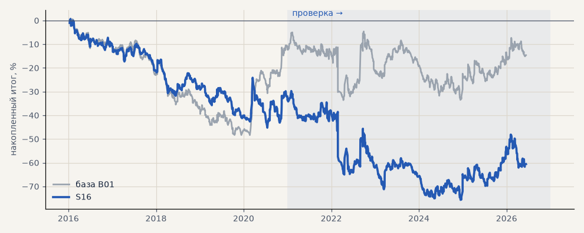

# S16. Импульс 8 ч / 3.5 ATR

**Семейство:** стратегия без ML (импульс) · **база:** B01 · **гипотеза:** — · **вердикт:** хуже базы

**Что проверяли.** Импульс — ход за 8 часов не меньше 3.5 ATR вместо 6 часов и 3 ATR. Выход как в базе, все 8 рынков.

**Зачем.** Более длинное и сильное движение может лучше продолжаться.

**Итог простыми словами.** Хуже базы в обоих периодах — 6 ч / 3 ATR остаётся.

**Издержки:** профиль `base` (спред и свопы брокера)

Подробности: [results/patterns.md](../../results/patterns.md)

Проверка — сделки, открытые с 1 января 2021 года; выбор — до 2021. В скобках — база на тех же инструментах.

| срез | период | сделок | итог % | выигрышей | ожидание на сделку | PF | без 2 лучших | просадка | t | лет в плюсе |
|---|---|---|---|---|---|---|---|---|---|---|
| все инструменты | проверка | 1793 (1924) | -21.7 (-18.9) | 41% (41%) | -0.097% (-0.078%) | 0.94 (0.95) | -31.5 (-27.9) | -37.3 (-32.5) | -0.82 (-0.70) | 2/6 (1/6) |
| все инструменты | выбор | 1134 (1196) | -45.0 (-41.1) | 39% (39%) | -0.318% (-0.275%) | 0.76 (0.79) | -50.1 (-45.8) | -49.1 (-59.1) | -3.31 (-3.02) | 1/5 (1/5) |
| портфель 4 | проверка | 836 (896) | -27.1 (-2.3) | 42% (42%) | -0.130% (-0.010%) | 0.91 (0.99) | -42.1 (-17.7) | -45.9 (-28.9) | -0.79 (-0.07) | 2/6 (3/6) |
| портфель 4 | выбор | 631 (665) | -33.5 (-12.3) | 40% (41%) | -0.212% (-0.074%) | 0.85 (0.94) | -43.6 (-21.8) | -45.9 (-49.1) | -1.48 (-0.55) | 1/5 (1/5) |
| металлы (серебро + золото) | проверка | 481 (506) | -4.6 (+41.3) | 43% (44%) | -0.019% (+0.163%) | 0.98 (1.17) | -21.0 (+23.2) | -47.3 (-28.5) | -0.13 (1.18) | 3/6 (5/6) |
| металлы (серебро + золото) | выбор | 439 (461) | -11.4 (-11.5) | 38% (38%) | -0.052% (-0.050%) | 0.94 (0.94) | -31.7 (-30.4) | -49.7 (-55.8) | -0.40 (-0.41) | 1/5 (1/5) |
| серебро | проверка | 232 (243) | -11.9 (+58.1) | 44% (46%) | -0.051% (+0.239%) | 0.97 (1.18) | -39.6 (+21.9) | -80.8 (-51.2) | -0.19 (0.94) | 3/6 (5/6) |
| серебро | выбор | 207 (218) | +7.3 (+25.4) | 37% (37%) | +0.035% (+0.117%) | 1.03 (1.11) | -33.3 (-12.4) | -66.0 (-66.8) | 0.15 (0.52) | 2/5 (2/5) |
| золото | проверка | 249 (263) | +2.8 (+24.5) | 41% (42%) | +0.011% (+0.093%) | 1.02 (1.15) | -21.3 (-2.2) | -34.9 (-39.2) | 0.09 (0.73) | 3/6 (2/6) |
| золото | выбор | 232 (243) | -30.1 (-48.4) | 38% (40%) | -0.130% (-0.199%) | 0.82 (0.73) | -45.5 (-63.4) | -53.1 (-69.1) | -1.13 (-1.80) | 2/5 (2/5) |
| LKOH | проверка | 201 (214) | -56.1 (-59.3) | 40% (40%) | -0.279% (-0.277%) | 0.79 (0.80) | -77.9 (-80.9) | -77.7 (-89.9) | -1.26 (-1.23) | 1/6 (1/6) |
| LKOH | выбор | 124 (132) | -40.6 (-2.6) | 44% (45%) | -0.327% (-0.020%) | 0.79 (0.99) | -68.9 (-28.8) | -61.1 (-48.4) | -0.98 (-0.06) | 1/5 (2/5) |
| GAZP | проверка | 199 (219) | -38.6 (-23.3) | 46% (42%) | -0.194% (-0.106%) | 0.89 (0.94) | -98.7 (-83.4) | -102.1 (-112.1) | -0.37 (-0.22) | 2/6 (3/6) |
| GAZP | выбор | 141 (154) | -31.1 (-14.2) | 40% (40%) | -0.221% (-0.092%) | 0.84 (0.93) | -56.6 (-41.0) | -44.1 (-52.8) | -0.76 (-0.34) | 2/5 (3/5) |
| SBER | проверка | 204 (220) | -1.7 (+15.2) | 39% (37%) | -0.008% (+0.069%) | 0.99 (1.06) | -31.4 (-12.0) | -44.5 (-45.1) | -0.03 (0.30) | 2/6 (2/6) |
| SBER | выбор | 159 (161) | -69.6 (-57.8) | 39% (45%) | -0.438% (-0.359%) | 0.75 (0.79) | -96.7 (-82.3) | -93.2 (-89.8) | -1.42 (-1.21) | 0/5 (2/5) |
| MOEX | проверка | 196 (227) | -35.5 (-93.7) | 38% (37%) | -0.181% (-0.413%) | 0.87 (0.71) | -60.7 (-117.4) | -46.2 (-93.7) | -0.73 (-1.93) | 2/6 (1/6) |
| MOEX | выбор | 151 (153) | -82.9 (-75.4) | 38% (39%) | -0.549% (-0.493%) | 0.67 (0.70) | -99.5 (-93.1) | -95.4 (-102.6) | -2.05 (-1.79) | 0/5 (1/5) |
| MTSS | проверка | 188 (196) | -26.5 (-48.1) | 38% (39%) | -0.141% (-0.245%) | 0.89 (0.83) | -65.0 (-86.9) | -42.5 (-54.5) | -0.54 (-0.93) | 2/6 (2/6) |
| MTSS | выбор | 120 (135) | -113.3 (-155.9) | 33% (32%) | -0.944% (-1.155%) | 0.48 (0.39) | -128.0 (-171.3) | -113.3 (-155.9) | -3.25 (-4.42) | 0/5 (0/5) |
| ETH | проверка | 324 (342) | -5.6 (-24.2) | 43% (44%) | -0.017% (-0.071%) | 0.99 (0.98) | -69.2 (-82.2) | -102.4 (-115.3) | -0.04 (-0.17) | 2/6 (4/6) |

Журнал сделок: `trades.csv.gz` (инструмент, прогон, сторона, вход, выход, цены, результат после издержек, причина выхода).
