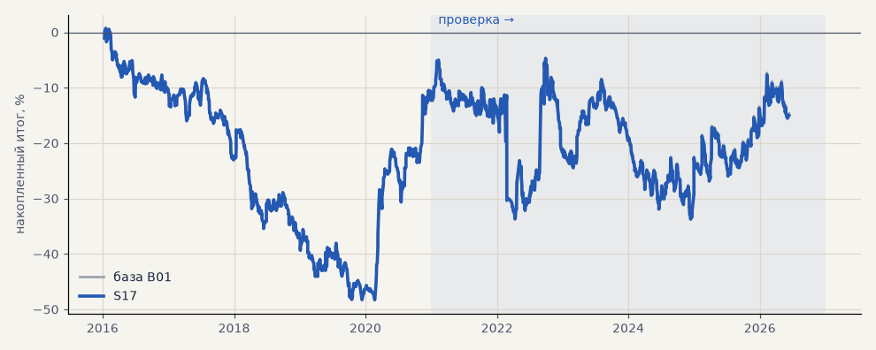

# S17. Издержки Альфа-Форекс (CFD), серебро с шагом 0.001

**Семейство:** стратегия без ML (импульс) · **база:** B01 · **гипотеза:** H02 · **вердикт:** как база; металлы лучше (+61%)

**Что проверяли.** Сделки S03 с издержками брокера Альфа-Форекс: спред вместо комиссии и проскальзывания (серебро 90 пунктов ≈ 0.12% при шаге цены 0.001, акции 0.15%, эфир 0.09%, золото 0.01%) и те же свопы, что в базе.

**Зачем.** Сколько стоит исполнение у конкретного брокера по сравнению с заложенными в базу 0.04% + 2 × 0.05%.

**Итог простыми словами.** Портфель 4 — как база: спред акций 0.15% почти равен заложенным 0.14%. Металлы лучше базы — у золота спред брокера всего 0.01%.

**Издержки:** профиль `alfaforex` (спред и свопы брокера)

Подробности: [results/costs.md](../../results/costs.md)

Проверка — сделки, открытые с 1 января 2021 года; выбор — до 2021. В скобках — база на тех же инструментах.

| срез | период | сделок | итог % | выигрышей | ожидание на сделку | PF | без 2 лучших | просадка | t | лет в плюсе |
|---|---|---|---|---|---|---|---|---|---|---|
| все инструменты | проверка | 1924 (1924) | -13.2 (-18.9) | 42% (41%) | -0.055% (-0.078%) | 0.96 (0.95) | -22.2 (-27.9) | -31.1 (-32.5) | -0.49 (-0.70) | 5/6 (1/6) |
| все инструменты | выбор | 1196 (1196) | -37.5 (-41.1) | 40% (39%) | -0.251% (-0.275%) | 0.81 (0.79) | -42.3 (-45.8) | -56.0 (-59.1) | -2.76 (-3.02) | 1/5 (1/5) |
| портфель 4 | проверка | 896 (896) | -2.7 (-2.3) | 42% (42%) | -0.012% (-0.010%) | 0.99 (0.99) | -18.1 (-17.7) | -29.0 (-28.9) | -0.08 (-0.07) | 3/6 (3/6) |
| портфель 4 | выбор | 665 (665) | -12.3 (-12.3) | 41% (41%) | -0.074% (-0.074%) | 0.94 (0.94) | -21.8 (-21.8) | -49.0 (-49.1) | -0.55 (-0.55) | 1/5 (1/5) |
| металлы (серебро + золото) | проверка | 506 (506) | +60.9 (+41.3) | 46% (44%) | +0.241% (+0.163%) | 1.26 (1.17) | +42.7 (+23.2) | -19.7 (-28.5) | 1.74 (1.18) | 5/6 (5/6) |
| металлы (серебро + золото) | выбор | 461 (461) | +6.5 (-11.5) | 40% (38%) | +0.028% (-0.050%) | 1.03 (0.94) | -12.4 (-30.4) | -42.0 (-55.8) | 0.23 (-0.41) | 1/5 (1/5) |
| серебро | проверка | 243 (243) | +63.1 (+58.1) | 46% (46%) | +0.260% (+0.239%) | 1.20 (1.18) | +26.8 (+21.9) | -49.4 (-51.2) | 1.02 (0.94) | 5/6 (5/6) |
| серебро | выбор | 218 (218) | +29.9 (+25.4) | 37% (37%) | +0.137% (+0.117%) | 1.14 (1.11) | -8.0 (-12.4) | -63.8 (-66.8) | 0.61 (0.52) | 2/5 (2/5) |
| золото | проверка | 263 (263) | +58.7 (+24.5) | 46% (42%) | +0.223% (+0.093%) | 1.39 (1.15) | +31.8 (-2.2) | -26.1 (-39.2) | 1.76 (0.73) | 4/6 (2/6) |
| золото | выбор | 243 (243) | -16.8 (-48.4) | 42% (40%) | -0.069% (-0.199%) | 0.90 (0.73) | -32.0 (-63.4) | -42.8 (-69.1) | -0.63 (-1.80) | 2/5 (2/5) |
| LKOH | проверка | 214 (214) | -61.4 (-59.3) | 40% (40%) | -0.287% (-0.277%) | 0.79 (0.80) | -83.0 (-80.9) | -90.8 (-89.9) | -1.27 (-1.23) | 1/6 (1/6) |
| LKOH | выбор | 132 (132) | -3.9 (-2.6) | 45% (45%) | -0.030% (-0.020%) | 0.98 (0.99) | -30.1 (-28.8) | -49.4 (-48.4) | -0.10 (-0.06) | 2/5 (2/5) |
| GAZP | проверка | 219 (219) | -25.5 (-23.3) | 42% (42%) | -0.116% (-0.106%) | 0.93 (0.94) | -85.5 (-83.4) | -113.1 (-112.1) | -0.24 (-0.22) | 3/6 (3/6) |
| GAZP | выбор | 154 (154) | -15.7 (-14.2) | 40% (40%) | -0.102% (-0.092%) | 0.92 (0.93) | -42.5 (-41.0) | -53.8 (-52.8) | -0.38 (-0.34) | 3/5 (3/5) |
| SBER | проверка | 220 (220) | +13.0 (+15.2) | 37% (37%) | +0.059% (+0.069%) | 1.05 (1.06) | -14.2 (-12.0) | -45.7 (-45.1) | 0.26 (0.30) | 2/6 (2/6) |
| SBER | выбор | 161 (161) | -59.4 (-57.8) | 45% (45%) | -0.369% (-0.359%) | 0.78 (0.79) | -83.9 (-82.3) | -91.3 (-89.8) | -1.25 (-1.21) | 2/5 (2/5) |
| MOEX | проверка | 227 (227) | -96.0 (-93.7) | 37% (37%) | -0.423% (-0.413%) | 0.71 (0.71) | -119.6 (-117.4) | -96.0 (-93.7) | -1.98 (-1.93) | 1/6 (1/6) |
| MOEX | выбор | 153 (153) | -77.0 (-75.4) | 39% (39%) | -0.503% (-0.493%) | 0.69 (0.70) | -94.6 (-93.1) | -103.5 (-102.6) | -1.83 (-1.79) | 1/5 (1/5) |
| MTSS | проверка | 196 (196) | -50.0 (-48.1) | 39% (39%) | -0.255% (-0.245%) | 0.82 (0.83) | -88.8 (-86.9) | -55.9 (-54.5) | -0.97 (-0.93) | 2/6 (2/6) |
| MTSS | выбор | 135 (135) | -157.2 (-155.9) | 32% (32%) | -1.165% (-1.155%) | 0.39 (0.39) | -172.6 (-171.3) | -157.2 (-155.9) | -4.46 (-4.42) | 0/5 (0/5) |
| ETH | проверка | 342 (342) | -7.1 (-24.2) | 44% (44%) | -0.021% (-0.071%) | 0.99 (0.98) | -65.2 (-82.2) | -112.4 (-115.3) | -0.05 (-0.17) | 4/6 (4/6) |

Журнал сделок: `trades.csv.gz` (инструмент, прогон, сторона, вход, выход, цены, результат после издержек, причина выхода).
