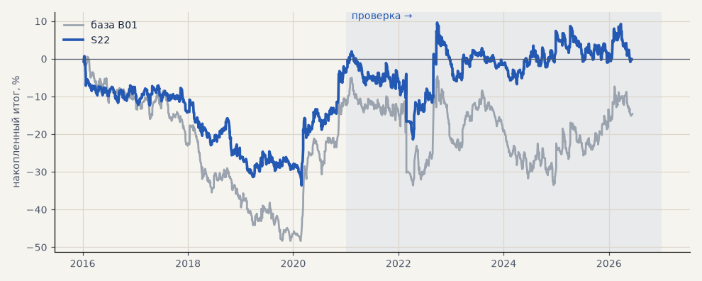

# S22. Выход 168 ч / 4 ATR

**Семейство:** стратегия без ML (импульс) · **база:** B01 · **гипотеза:** H03 · **вердикт:** не помогло (в пределах шума)

**Что проверяли.** Выход не позже 168 часов, стоп и трейлинг 4 ATR (трейлинг после +2 ATR) при издержках базы.

**Зачем.** Короче удержание — меньше свопов; этот выход был лучшим по сетке на 2016–2020 под условиями брокера.

**Итог простыми словами.** Портфель 4 чуть выше базы — в пределах шума, металлы заметно хуже. Не помогло.

**Издержки:** профиль `base` (спред и свопы брокера)

Подробности: [results/costs.md](../../results/costs.md)

Проверка — сделки, открытые с 1 января 2021 года; выбор — до 2021. В скобках — база на тех же инструментах.

| срез | период | сделок | итог % | выигрышей | ожидание на сделку | PF | без 2 лучших | просадка | t | лет в плюсе |
|---|---|---|---|---|---|---|---|---|---|---|
| все инструменты | проверка | 2701 (1924) | -13.9 (-18.9) | 39% (41%) | -0.041% (-0.078%) | 0.96 (0.95) | -22.5 (-27.9) | -30.8 (-32.5) | -0.64 (-0.70) | 2/6 (1/6) |
| все инструменты | выбор | 1589 (1196) | -24.7 (-41.1) | 38% (39%) | -0.124% (-0.275%) | 0.86 (0.79) | -28.4 (-45.8) | -40.9 (-59.1) | -2.08 (-3.02) | 1/5 (1/5) |
| портфель 4 | проверка | 1236 (896) | +2.5 (-2.3) | 40% (42%) | +0.008% (-0.010%) | 1.01 (0.99) | -11.3 (-17.7) | -23.4 (-28.9) | 0.09 (-0.07) | 3/6 (3/6) |
| портфель 4 | выбор | 879 (665) | -2.6 (-12.3) | 40% (41%) | -0.012% (-0.074%) | 0.99 (0.94) | -10.0 (-21.8) | -34.3 (-49.1) | -0.13 (-0.55) | 1/5 (1/5) |
| металлы (серебро + золото) | проверка | 747 (506) | -11.6 (+41.3) | 38% (44%) | -0.031% (+0.163%) | 0.96 (1.17) | -23.9 (+23.2) | -36.4 (-28.5) | -0.39 (1.18) | 1/6 (5/6) |
| металлы (серебро + золото) | выбор | 644 (461) | -28.4 (-11.5) | 36% (38%) | -0.088% (-0.050%) | 0.85 (0.94) | -39.1 (-30.4) | -48.0 (-55.8) | -1.41 (-0.41) | 1/5 (1/5) |
| серебро | проверка | 357 (243) | -26.9 (+58.1) | 37% (46%) | -0.075% (+0.239%) | 0.93 (1.18) | -51.5 (+21.9) | -55.9 (-51.2) | -0.52 (0.94) | 2/6 (5/6) |
| серебро | выбор | 299 (218) | -19.2 (+25.4) | 36% (37%) | -0.064% (+0.117%) | 0.91 (1.11) | -40.5 (-12.4) | -60.9 (-66.8) | -0.55 (0.52) | 2/5 (2/5) |
| золото | проверка | 390 (263) | +3.8 (+24.5) | 40% (42%) | +0.010% (+0.093%) | 1.02 (1.15) | -13.7 (-2.2) | -41.5 (-39.2) | 0.13 (0.73) | 2/6 (2/6) |
| золото | выбор | 345 (243) | -37.7 (-48.4) | 35% (40%) | -0.109% (-0.199%) | 0.76 (0.73) | -46.5 (-63.4) | -46.8 (-69.1) | -1.89 (-1.80) | 1/5 (2/5) |
| LKOH | проверка | 301 (214) | -62.1 (-59.3) | 38% (40%) | -0.206% (-0.277%) | 0.79 (0.80) | -84.2 (-80.9) | -67.9 (-89.9) | -1.48 (-1.23) | 0/6 (1/6) |
| LKOH | выбор | 173 (132) | +29.4 (-2.6) | 45% (45%) | +0.170% (-0.020%) | 1.18 (0.99) | +9.6 (-28.8) | -40.9 (-48.4) | 0.83 (-0.06) | 1/5 (2/5) |
| GAZP | проверка | 284 (219) | +49.5 (-23.3) | 44% (42%) | +0.174% (-0.106%) | 1.16 (0.94) | -4.9 (-83.4) | -59.2 (-112.1) | 0.60 (-0.22) | 5/6 (3/6) |
| GAZP | выбор | 199 (154) | +5.8 (-14.2) | 43% (40%) | +0.029% (-0.092%) | 1.03 (0.93) | -23.9 (-41.0) | -34.4 (-52.8) | 0.14 (-0.34) | 2/5 (3/5) |
| SBER | проверка | 294 (220) | +49.4 (+15.2) | 40% (37%) | +0.168% (+0.069%) | 1.23 (1.06) | +27.5 (-12.0) | -25.6 (-45.1) | 1.20 (0.30) | 3/6 (2/6) |
| SBER | выбор | 208 (161) | -26.5 (-57.8) | 38% (45%) | -0.127% (-0.359%) | 0.90 (0.79) | -53.2 (-82.3) | -66.1 (-89.8) | -0.56 (-1.21) | 2/5 (2/5) |
| MOEX | проверка | 313 (227) | -100.2 (-93.7) | 37% (37%) | -0.320% (-0.413%) | 0.68 (0.71) | -117.8 (-117.4) | -100.2 (-93.7) | -2.48 (-1.93) | 1/6 (1/6) |
| MOEX | выбор | 191 (153) | -35.1 (-75.4) | 37% (39%) | -0.184% (-0.493%) | 0.83 (0.70) | -51.9 (-93.1) | -70.3 (-102.6) | -1.00 (-1.79) | 1/5 (1/5) |
| MTSS | проверка | 262 (196) | -62.0 (-48.1) | 34% (39%) | -0.236% (-0.245%) | 0.76 (0.83) | -97.5 (-86.9) | -62.1 (-54.5) | -1.37 (-0.93) | 2/6 (2/6) |
| MTSS | выбор | 174 (135) | -114.5 (-155.9) | 34% (32%) | -0.658% (-1.155%) | 0.48 (0.39) | -127.6 (-171.3) | -114.5 (-155.9) | -3.86 (-4.42) | 1/5 (0/5) |
| ETH | проверка | 500 (342) | +37.6 (-24.2) | 43% (44%) | +0.075% (-0.071%) | 1.04 (0.98) | -13.9 (-82.2) | -101.4 (-115.3) | 0.34 (-0.17) | 4/6 (4/6) |

Журнал сделок: `trades.csv.gz` (инструмент, прогон, сторона, вход, выход, цены, результат после издержек, причина выхода).
