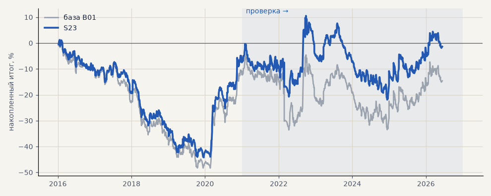

# S23. Ранний стоп 3 ATR первые 12 часов

**Семейство:** стратегия без ML (импульс) · **база:** B01 · **гипотеза:** H32 · **вердикт:** не помогло (на выборе хуже базы, металлы хуже и на проверке)

**Что проверяли.** Пока трейлинг не включился, первые 12 часов после входа стоп стоит в 3 ATR от входа вместо 6, потом — обычный. Исполнение по гэпу, как у обычного стопа. Перебрали стоп 2, 3, 4 ATR и срок 12, 24, 48 часов на всех 8 рынках; этот вариант — лучший по выбору 2016–2020.

**Зачем.** Тимур заметил, что хорошие сделки почти не уходят в минус. Это подтвердилось: за первые 24 часа против позиции медиана 1.35 ATR у выигрышных и 2.76 ATR у убыточных. Ранний выход должен резать убыточные сделки раньше.

**Итог простыми словами.** Не помогло. На выборе ни один вариант не лучше базы; на металлах ранний стоп хуже и на проверке — он срезает и те сделки, что потом отыгрываются, а среди них крупные выигрыши. На акциях слабый плюс за счёт экономии свопов, но акции через CFD убыточны и так.

**Издержки:** профиль `base` (спред и свопы брокера)

Подробности: [results/strategy_week_1012.md](../../results/strategy_week_1012.md)

Проверка — сделки, открытые с 1 января 2021 года; выбор — до 2021. В скобках — база на тех же инструментах.

| срез | период | сделок | итог % | выигрышей | ожидание на сделку | PF | без 2 лучших | просадка | t | лет в плюсе |
|---|---|---|---|---|---|---|---|---|---|---|
| все инструменты | проверка | 2036 (1924) | -22.5 (-18.9) | 38% (41%) | -0.088% (-0.078%) | 0.94 (0.95) | -31.6 (-27.9) | -33.9 (-32.5) | -0.89 (-0.70) | 2/6 (1/6) |
| все инструменты | выбор | 1231 (1196) | -37.3 (-41.1) | 38% (39%) | -0.242% (-0.275%) | 0.80 (0.79) | -42.0 (-45.8) | -54.4 (-59.1) | -2.79 (-3.02) | 1/5 (1/5) |
| портфель 4 | проверка | 935 (896) | +6.0 (-2.3) | 39% (42%) | +0.026% (-0.010%) | 1.02 (0.99) | -9.4 (-17.7) | -32.4 (-28.9) | 0.20 (-0.07) | 3/6 (3/6) |
| портфель 4 | выбор | 678 (665) | -7.4 (-12.3) | 40% (41%) | -0.044% (-0.074%) | 0.96 (0.94) | -16.9 (-21.8) | -45.5 (-49.1) | -0.34 (-0.55) | 1/5 (1/5) |
| металлы (серебро + золото) | проверка | 546 (506) | +6.3 (+41.3) | 38% (44%) | +0.023% (+0.163%) | 1.02 (1.17) | -11.8 (+23.2) | -52.1 (-28.5) | 0.18 (1.18) | 3/6 (5/6) |
| металлы (серебро + золото) | выбор | 484 (461) | -18.2 (-11.5) | 35% (38%) | -0.075% (-0.050%) | 0.91 (0.94) | -37.2 (-30.4) | -54.8 (-55.8) | -0.66 (-0.41) | 1/5 (1/5) |
| серебро | проверка | 254 (243) | +34.8 (+58.1) | 42% (46%) | +0.137% (+0.239%) | 1.11 (1.18) | -1.4 (+21.9) | -69.2 (-51.2) | 0.58 (0.94) | 5/6 (5/6) |
| серебро | выбор | 229 (218) | +14.2 (+25.4) | 34% (37%) | +0.062% (+0.117%) | 1.06 (1.11) | -23.7 (-12.4) | -70.8 (-66.8) | 0.29 (0.52) | 2/5 (2/5) |
| золото | проверка | 292 (263) | -22.2 (+24.5) | 36% (42%) | -0.076% (+0.093%) | 0.89 (1.15) | -48.8 (-2.2) | -60.1 (-39.2) | -0.66 (0.73) | 2/6 (2/6) |
| золото | выбор | 255 (243) | -50.7 (-48.4) | 37% (40%) | -0.199% (-0.199%) | 0.71 (0.73) | -64.9 (-63.4) | -64.2 (-69.1) | -1.98 (-1.80) | 1/5 (2/5) |
| LKOH | проверка | 224 (214) | -40.4 (-59.3) | 39% (40%) | -0.180% (-0.277%) | 0.86 (0.80) | -61.9 (-80.9) | -81.3 (-89.9) | -0.85 (-1.23) | 2/6 (1/6) |
| LKOH | выбор | 132 (132) | +2.7 (-2.6) | 44% (45%) | +0.020% (-0.020%) | 1.02 (0.99) | -23.6 (-28.8) | -44.4 (-48.4) | 0.07 (-0.06) | 2/5 (2/5) |
| GAZP | проверка | 227 (219) | +13.7 (-23.3) | 41% (42%) | +0.060% (-0.106%) | 1.04 (0.94) | -46.3 (-83.4) | -78.7 (-112.1) | 0.17 (-0.22) | 3/6 (3/6) |
| GAZP | выбор | 154 (154) | -15.5 (-14.2) | 39% (40%) | -0.101% (-0.092%) | 0.92 (0.93) | -42.3 (-41.0) | -58.1 (-52.8) | -0.38 (-0.34) | 2/5 (3/5) |
| SBER | проверка | 230 (220) | +16.0 (+15.2) | 36% (37%) | +0.070% (+0.069%) | 1.07 (1.06) | -11.2 (-12.0) | -42.1 (-45.1) | 0.32 (0.30) | 3/6 (2/6) |
| SBER | выбор | 163 (161) | -31.0 (-57.8) | 45% (45%) | -0.190% (-0.359%) | 0.88 (0.79) | -55.5 (-82.3) | -72.7 (-89.8) | -0.67 (-1.21) | 2/5 (2/5) |
| MOEX | проверка | 239 (227) | -114.5 (-93.7) | 33% (37%) | -0.479% (-0.413%) | 0.66 (0.71) | -138.9 (-117.4) | -114.5 (-93.7) | -2.36 (-1.93) | 1/6 (1/6) |
| MOEX | выбор | 158 (153) | -54.3 (-75.4) | 41% (39%) | -0.344% (-0.493%) | 0.77 (0.70) | -71.9 (-93.1) | -86.8 (-102.6) | -1.33 (-1.79) | 1/5 (1/5) |
| MTSS | проверка | 204 (196) | -38.0 (-48.1) | 36% (39%) | -0.186% (-0.245%) | 0.86 (0.83) | -76.8 (-86.9) | -45.3 (-54.5) | -0.76 (-0.93) | 2/6 (2/6) |
| MTSS | выбор | 140 (135) | -163.6 (-155.9) | 31% (32%) | -1.169% (-1.155%) | 0.37 (0.39) | -179.0 (-171.3) | -163.6 (-155.9) | -4.70 (-4.42) | 0/5 (0/5) |
| ETH | проверка | 366 (342) | -29.6 (-24.2) | 41% (44%) | -0.081% (-0.071%) | 0.97 (0.98) | -87.6 (-82.2) | -97.4 (-115.3) | -0.21 (-0.17) | 2/6 (4/6) |

Журнал сделок: `trades.csv.gz` (инструмент, прогон, сторона, вход, выход, цены, результат после издержек, причина выхода).
