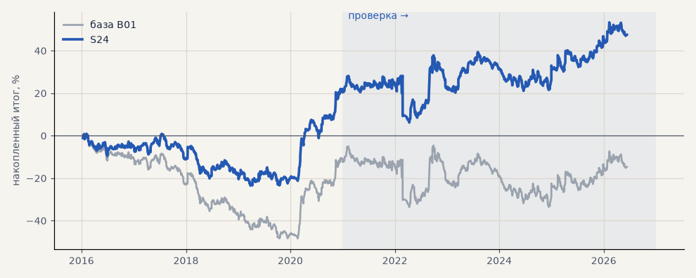

# S24. Акции на бирже, шорт 0.05% в день

**Семейство:** стратегия без ML (импульс) · **база:** B01 · **гипотеза:** H04 · **вердикт:** лучше базы, если шорт ≤ 0.08% в день (ставку уточнить)

**Что проверяли.** Сделки базы, но акции торгуются на Мосбирже, а не через CFD: лонг своими деньгами не платит за перенос, шорт платит брокеру 0.05% цены за каждую календарную ночь (ставка — допущение), комиссия брокера и биржи 0.1% за круг, проскальзывание как в базе. Металлы и эфир — как в базе.

**Зачем.** Через CFD акции убыточны из-за платы за перенос 0.068% в день в обе стороны (гипотеза H04).

**Итог простыми словами.** Портфель 4 из минуса уходит в плюс: на бирже переносят бесплатно лонги. Но шорты по акциям убыточны сами по себе (акции растут и платят дивиденды), поэтому результат сильно зависит от ставки шорта: безубыток около 0.08–0.12% в день.

**Издержки:** профиль `exchange` (спред и свопы брокера)

Подробности: [results/exchange.md](../../results/exchange.md)

Проверка — сделки, открытые с 1 января 2021 года; выбор — до 2021. В скобках — база на тех же инструментах.

| срез | период | сделок | итог % | выигрышей | ожидание на сделку | PF | без 2 лучших | просадка | t | лет в плюсе |
|---|---|---|---|---|---|---|---|---|---|---|
| все инструменты | проверка | 1924 (1924) | +5.3 (-18.9) | 43% (41%) | +0.022% (-0.078%) | 1.01 (0.95) | -3.8 (-27.9) | -27.2 (-32.5) | 0.19 (-0.70) | 5/6 (1/6) |
| все инструменты | выбор | 1196 (1196) | -15.3 (-41.1) | 42% (39%) | -0.102% (-0.275%) | 0.92 (0.79) | -20.0 (-45.8) | -39.5 (-59.1) | -1.11 (-3.02) | 1/5 (1/5) |
| портфель 4 | проверка | 896 (896) | +27.0 (-2.3) | 44% (42%) | +0.120% (-0.010%) | 1.09 (0.99) | +11.6 (-17.7) | -22.0 (-28.9) | 0.76 (-0.07) | 5/6 (3/6) |
| портфель 4 | выбор | 665 (665) | +20.6 (-12.3) | 43% (41%) | +0.124% (-0.074%) | 1.10 (0.94) | +11.1 (-21.8) | -24.4 (-49.1) | 0.91 (-0.55) | 2/5 (1/5) |
| металлы (серебро + золото) | проверка | 506 (506) | +41.3 (+41.3) | 44% (44%) | +0.163% (+0.163%) | 1.17 (1.17) | +23.2 (+23.2) | -28.5 (-28.5) | 1.18 (1.18) | 5/6 (5/6) |
| металлы (серебро + золото) | выбор | 461 (461) | -11.5 (-11.5) | 38% (38%) | -0.050% (-0.050%) | 0.94 (0.94) | -30.4 (-30.4) | -55.8 (-55.8) | -0.41 (-0.41) | 1/5 (1/5) |
| серебро | проверка | 243 (243) | +58.1 (+58.1) | 46% (46%) | +0.239% (+0.239%) | 1.18 (1.18) | +21.9 (+21.9) | -51.2 (-51.2) | 0.94 (0.94) | 5/6 (5/6) |
| серебро | выбор | 218 (218) | +25.4 (+25.4) | 37% (37%) | +0.117% (+0.117%) | 1.11 (1.11) | -12.4 (-12.4) | -66.8 (-66.8) | 0.52 (0.52) | 2/5 (2/5) |
| золото | проверка | 263 (263) | +24.5 (+24.5) | 42% (42%) | +0.093% (+0.093%) | 1.15 (1.15) | -2.2 (-2.2) | -39.2 (-39.2) | 0.73 (0.73) | 2/6 (2/6) |
| золото | выбор | 243 (243) | -48.4 (-48.4) | 40% (40%) | -0.199% (-0.199%) | 0.73 (0.73) | -63.4 (-63.4) | -69.1 (-69.1) | -1.80 (-1.80) | 2/5 (2/5) |
| LKOH | проверка | 214 (214) | -18.5 (-59.3) | 43% (40%) | -0.087% (-0.277%) | 0.93 (0.80) | -40.9 (-80.9) | -72.3 (-89.9) | -0.38 (-1.23) | 2/6 (1/6) |
| LKOH | выбор | 132 (132) | +37.5 (-2.6) | 49% (45%) | +0.284% (-0.020%) | 1.23 (0.99) | +10.0 (-28.8) | -37.7 (-48.4) | 0.92 (-0.06) | 2/5 (2/5) |
| GAZP | проверка | 219 (219) | +16.9 (-23.3) | 47% (42%) | +0.077% (-0.106%) | 1.05 (0.94) | -43.7 (-83.4) | -93.1 (-112.1) | 0.16 (-0.22) | 4/6 (3/6) |
| GAZP | выбор | 154 (154) | +33.1 (-14.2) | 44% (40%) | +0.215% (-0.092%) | 1.19 (0.93) | +5.3 (-41.0) | -25.2 (-52.8) | 0.78 (-0.34) | 3/5 (3/5) |
| SBER | проверка | 220 (220) | +51.4 (+15.2) | 40% (37%) | +0.234% (+0.069%) | 1.22 (1.06) | +23.7 (-12.0) | -39.7 (-45.1) | 1.00 (0.30) | 3/6 (2/6) |
| SBER | выбор | 161 (161) | -13.7 (-57.8) | 47% (45%) | -0.085% (-0.359%) | 0.95 (0.79) | -38.7 (-82.3) | -58.2 (-89.8) | -0.28 (-1.21) | 2/5 (2/5) |
| MOEX | проверка | 227 (227) | -56.7 (-93.7) | 39% (37%) | -0.250% (-0.413%) | 0.82 (0.71) | -81.4 (-117.4) | -56.7 (-93.7) | -1.15 (-1.93) | 2/6 (1/6) |
| MOEX | выбор | 153 (153) | -38.4 (-75.4) | 43% (39%) | -0.251% (-0.493%) | 0.84 (0.70) | -57.4 (-93.1) | -83.2 (-102.6) | -0.89 (-1.79) | 1/5 (1/5) |
| MTSS | проверка | 196 (196) | -9.3 (-48.1) | 41% (39%) | -0.048% (-0.245%) | 0.96 (0.83) | -48.0 (-86.9) | -36.3 (-54.5) | -0.18 (-0.93) | 2/6 (2/6) |
| MTSS | выбор | 135 (135) | -117.5 (-155.9) | 36% (32%) | -0.871% (-1.155%) | 0.50 (0.39) | -134.0 (-171.3) | -117.5 (-155.9) | -3.26 (-4.42) | 1/5 (0/5) |
| ETH | проверка | 342 (342) | -24.2 (-24.2) | 44% (44%) | -0.071% (-0.071%) | 0.98 (0.98) | -82.2 (-82.2) | -115.3 (-115.3) | -0.17 (-0.17) | 4/6 (4/6) |

Журнал сделок: `trades.csv.gz` (инструмент, прогон, сторона, вход, выход, цены, результат после издержек, причина выхода).
