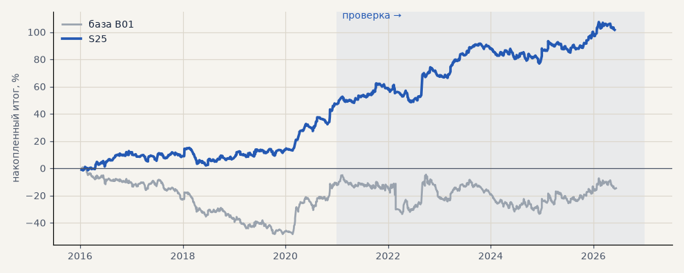

# S25. Акции на бирже, только лонг

**Семейство:** стратегия без ML (импульс) · **база:** B01 · **гипотеза:** H04 · **вердикт:** лучше базы: портфель 4 +54% (PF 1.32), подтверждается на выборе

**Что проверяли.** То же, что S24, но по акциям открываются только лонги — шорт не используется (дорог или недоступен). Металлы и эфир — в обе стороны, как в базе.

**Зачем.** Шорт по акциям проигрывает даже без платы за перенос: на выборе 2016–2020 и на проверке шорты акций в минусе.

**Итог простыми словами.** Лучший результат на честных издержках: портфель 4 +54% на проверке (PF 1.32, 5 лет из 6 в плюсе) и +47% на выборе. Газпром, Сбербанк и Лукойл в плюсе в обоих периодах; Мосбиржа — около нуля. Налог 13% с дивидендов не учтён — он стоит 1–3 п.п.

**Издержки:** профиль `exchange` (спред и свопы брокера)

Подробности: [results/exchange.md](../../results/exchange.md)

Проверка — сделки, открытые с 1 января 2021 года; выбор — до 2021. В скобках — база на тех же инструментах.

| срез | период | сделок | итог % | выигрышей | ожидание на сделку | PF | без 2 лучших | просадка | t | лет в плюсе |
|---|---|---|---|---|---|---|---|---|---|---|
| все инструменты | проверка | 1404 (1924) | +29.9 (-18.9) | 44% (41%) | +0.170% (-0.078%) | 1.11 (0.95) | +20.8 (-27.9) | -18.2 (-32.5) | 1.28 (-0.70) | 5/6 (1/6) |
| все инструменты | выбор | 859 (1196) | +19.2 (-41.1) | 43% (39%) | +0.179% (-0.275%) | 1.18 (0.79) | +14.5 (-45.8) | -10.9 (-59.1) | 1.69 (-3.02) | 3/5 (1/5) |
| портфель 4 | проверка | 580 (896) | +54.4 (-2.3) | 46% (42%) | +0.375% (-0.010%) | 1.32 (0.99) | +38.9 (-17.7) | -14.7 (-28.9) | 2.18 (-0.07) | 5/6 (3/6) |
| портфель 4 | выбор | 460 (665) | +47.3 (-12.3) | 45% (41%) | +0.411% (-0.074%) | 1.39 (0.94) | +37.8 (-21.8) | -13.0 (-49.1) | 2.47 (-0.55) | 3/5 (1/5) |
| металлы (серебро + золото) | проверка | 506 (506) | +41.3 (+41.3) | 44% (44%) | +0.163% (+0.163%) | 1.17 (1.17) | +23.2 (+23.2) | -28.5 (-28.5) | 1.18 (1.18) | 5/6 (5/6) |
| металлы (серебро + золото) | выбор | 461 (461) | -11.5 (-11.5) | 38% (38%) | -0.050% (-0.050%) | 0.94 (0.94) | -30.4 (-30.4) | -55.8 (-55.8) | -0.41 (-0.41) | 1/5 (1/5) |
| серебро | проверка | 243 (243) | +58.1 (+58.1) | 46% (46%) | +0.239% (+0.239%) | 1.18 (1.18) | +21.9 (+21.9) | -51.2 (-51.2) | 0.94 (0.94) | 5/6 (5/6) |
| серебро | выбор | 218 (218) | +25.4 (+25.4) | 37% (37%) | +0.117% (+0.117%) | 1.11 (1.11) | -12.4 (-12.4) | -66.8 (-66.8) | 0.52 (0.52) | 2/5 (2/5) |
| золото | проверка | 263 (263) | +24.5 (+24.5) | 42% (42%) | +0.093% (+0.093%) | 1.15 (1.15) | -2.2 (-2.2) | -39.2 (-39.2) | 0.73 (0.73) | 2/6 (2/6) |
| золото | выбор | 243 (243) | -48.4 (-48.4) | 40% (40%) | -0.199% (-0.199%) | 0.73 (0.73) | -63.4 (-63.4) | -69.1 (-69.1) | -1.80 (-1.80) | 2/5 (2/5) |
| LKOH | проверка | 109 (214) | +29.3 (-59.3) | 44% (40%) | +0.268% (-0.277%) | 1.23 (0.80) | +7.1 (-80.9) | -29.3 (-89.9) | 0.81 (-1.23) | 4/6 (1/6) |
| LKOH | выбор | 71 (132) | +55.3 (-2.6) | 55% (45%) | +0.778% (-0.020%) | 1.74 (0.99) | +27.8 (-28.8) | -19.2 (-48.4) | 1.71 (-0.06) | 3/5 (2/5) |
| GAZP | проверка | 115 (219) | +69.5 (-23.3) | 45% (42%) | +0.605% (-0.106%) | 1.51 (0.94) | +8.9 (-83.4) | -23.4 (-112.1) | 1.18 (-0.22) | 5/6 (3/6) |
| GAZP | выбор | 83 (154) | +54.7 (-14.2) | 47% (40%) | +0.659% (-0.092%) | 1.68 (0.93) | +27.0 (-41.0) | -16.8 (-52.8) | 1.65 (-0.34) | 4/5 (3/5) |
| SBER | проверка | 113 (220) | +60.5 (+15.2) | 47% (37%) | +0.535% (+0.069%) | 1.56 (1.06) | +32.9 (-12.0) | -27.0 (-45.1) | 1.58 (0.30) | 4/6 (2/6) |
| SBER | выбор | 88 (161) | +53.8 (-57.8) | 55% (45%) | +0.611% (-0.359%) | 1.50 (0.79) | +31.4 (-82.3) | -24.9 (-89.8) | 1.48 (-1.21) | 4/5 (2/5) |
| MOEX | проверка | 116 (227) | -1.8 (-93.7) | 43% (37%) | -0.015% (-0.413%) | 0.99 (0.71) | -21.8 (-117.4) | -45.0 (-93.7) | -0.05 (-1.93) | 1/6 (1/6) |
| MOEX | выбор | 84 (153) | +21.5 (-75.4) | 46% (39%) | +0.256% (-0.493%) | 1.22 (0.70) | +2.5 (-93.1) | -38.7 (-102.6) | 0.69 (-1.79) | 3/5 (1/5) |
| MTSS | проверка | 103 (196) | +23.2 (-48.1) | 44% (39%) | +0.225% (-0.245%) | 1.19 (0.83) | -14.2 (-86.9) | -23.6 (-54.5) | 0.57 (-0.93) | 4/6 (2/6) |
| MTSS | выбор | 72 (135) | -8.5 (-155.9) | 42% (32%) | -0.118% (-1.155%) | 0.91 (0.39) | -25.0 (-171.3) | -22.2 (-155.9) | -0.32 (-4.42) | 2/5 (0/5) |
| ETH | проверка | 342 (342) | -24.2 (-24.2) | 44% (44%) | -0.071% (-0.071%) | 0.98 (0.98) | -82.2 (-82.2) | -115.3 (-115.3) | -0.17 (-0.17) | 4/6 (4/6) |

Журнал сделок: `trades.csv.gz` (инструмент, прогон, сторона, вход, выход, цены, результат после издержек, причина выхода).
