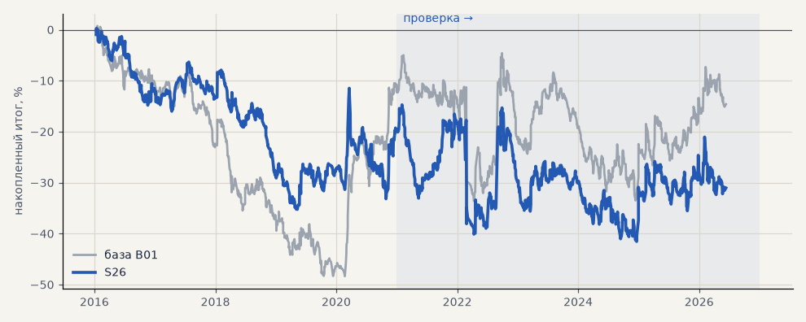

# S26. Трёхслойный тренд-фильтр по ТЗ

**Семейство:** стратегия без ML (импульс) · **база:** B01 · **гипотеза:** H44 · **вердикт:** хуже базы

**Что проверяли.** Гейт C заменён трёхслойным фильтром из ТЗ 15.10 без подгонки: медленный слой — знак цены против EMA200, быстрый — средний скор трёх пар EMA (8/32, 16/64, 32/128) в волатильностях бара, против режима ослабляется вдвое; шок (доходность часа больше 2.8σ) задаёт направление сразу; гистерезис — вход при скоре > 0.3, выход при < 0.

**Зачем.** ТЗ: фильтр из трёх слоёв должен реже ошибаться на разворотах и меньше «пилить», чем один индикатор.

**Итог простыми словами.** Пилит в 3 раза реже гейта C (1 ложное переключение на ногу тренда против 2.7), но замечает разворот позже (22 ч против 16) — и для импульса хуже: металлы на проверке +11% против +41%, портфель 4 −11% против −2%.

**Издержки:** профиль `base` (спред и свопы брокера)

Подробности: [results/trend_filter_tz.md](../../results/trend_filter_tz.md)

Проверка — сделки, открытые с 1 января 2021 года; выбор — до 2021. В скобках — база на тех же инструментах.

| срез | период | сделок | итог % | выигрышей | ожидание на сделку | PF | без 2 лучших | просадка | t | лет в плюсе |
|---|---|---|---|---|---|---|---|---|---|---|
| все инструменты | проверка | 1853 (1924) | -30.7 (-18.9) | 41% (41%) | -0.132% (-0.078%) | 0.92 (0.95) | -39.7 (-27.9) | -40.0 (-32.5) | -1.16 (-0.70) | 2/6 (1/6) |
| все инструменты | выбор | 1123 (1196) | -32.6 (-41.1) | 40% (39%) | -0.232% (-0.275%) | 0.82 (0.79) | -37.7 (-45.8) | -40.7 (-59.1) | -2.40 (-3.02) | 1/5 (1/5) |
| портфель 4 | проверка | 862 (896) | -11.0 (-2.3) | 41% (42%) | -0.051% (-0.010%) | 0.96 (0.99) | -27.2 (-17.7) | -26.8 (-28.9) | -0.34 (-0.07) | 2/6 (3/6) |
| портфель 4 | выбор | 627 (665) | -20.1 (-12.3) | 41% (41%) | -0.128% (-0.074%) | 0.91 (0.94) | -30.3 (-21.8) | -35.5 (-49.1) | -0.87 (-0.55) | 2/5 (1/5) |
| металлы (серебро + золото) | проверка | 487 (506) | +11.1 (+41.3) | 44% (44%) | +0.046% (+0.163%) | 1.04 (1.17) | -9.4 (+23.2) | -32.4 (-28.5) | 0.32 (1.18) | 4/6 (5/6) |
| металлы (серебро + золото) | выбор | 459 (461) | -40.0 (-11.5) | 39% (38%) | -0.174% (-0.050%) | 0.82 (0.94) | -58.5 (-30.4) | -53.3 (-55.8) | -1.34 (-0.41) | 2/5 (1/5) |
| серебро | проверка | 241 (243) | +7.7 (+58.1) | 44% (46%) | +0.032% (+0.239%) | 1.02 (1.18) | -33.3 (+21.9) | -52.7 (-51.2) | 0.12 (0.94) | 4/6 (5/6) |
| серебро | выбор | 220 (218) | -37.8 (+25.4) | 38% (37%) | -0.172% (+0.117%) | 0.86 (1.11) | -74.8 (-12.4) | -70.2 (-66.8) | -0.70 (0.52) | 2/5 (2/5) |
| золото | проверка | 246 (263) | +14.6 (+24.5) | 44% (42%) | +0.059% (+0.093%) | 1.09 (1.15) | -3.6 (-2.2) | -28.6 (-39.2) | 0.46 (0.73) | 4/6 (2/6) |
| золото | выбор | 239 (243) | -42.3 (-48.4) | 40% (40%) | -0.177% (-0.199%) | 0.75 (0.73) | -57.2 (-63.4) | -56.0 (-69.1) | -1.64 (-1.80) | 2/5 (2/5) |
| LKOH | проверка | 202 (214) | -29.3 (-59.3) | 45% (40%) | -0.145% (-0.277%) | 0.89 (0.80) | -51.4 (-80.9) | -65.5 (-89.9) | -0.55 (-1.23) | 2/6 (1/6) |
| LKOH | выбор | 120 (132) | -17.5 (-2.6) | 40% (45%) | -0.146% (-0.020%) | 0.90 (0.99) | -43.8 (-28.8) | -48.7 (-48.4) | -0.46 (-0.06) | 2/5 (2/5) |
| GAZP | проверка | 212 (219) | -39.4 (-23.3) | 40% (42%) | -0.186% (-0.106%) | 0.89 (0.94) | -99.9 (-83.4) | -92.4 (-112.1) | -0.47 (-0.22) | 2/6 (3/6) |
| GAZP | выбор | 134 (154) | +5.3 (-14.2) | 40% (40%) | +0.040% (-0.092%) | 1.03 (0.93) | -27.8 (-41.0) | -34.0 (-52.8) | 0.12 (-0.34) | 2/5 (3/5) |
| SBER | проверка | 207 (220) | +17.1 (+15.2) | 37% (37%) | +0.083% (+0.069%) | 1.07 (1.06) | -10.8 (-12.0) | -42.6 (-45.1) | 0.32 (0.30) | 2/6 (2/6) |
| SBER | выбор | 153 (161) | -30.3 (-57.8) | 46% (45%) | -0.198% (-0.359%) | 0.87 (0.79) | -54.8 (-82.3) | -62.1 (-89.8) | -0.64 (-1.21) | 3/5 (2/5) |
| MOEX | проверка | 207 (227) | -99.9 (-93.7) | 37% (37%) | -0.483% (-0.413%) | 0.68 (0.71) | -123.2 (-117.4) | -106.2 (-93.7) | -2.00 (-1.93) | 1/6 (1/6) |
| MOEX | выбор | 136 (153) | -48.5 (-75.4) | 40% (39%) | -0.356% (-0.493%) | 0.77 (0.70) | -66.7 (-93.1) | -79.4 (-102.6) | -1.24 (-1.79) | 1/5 (1/5) |
| MTSS | проверка | 187 (196) | -55.7 (-48.1) | 35% (39%) | -0.298% (-0.245%) | 0.80 (0.83) | -97.1 (-86.9) | -55.7 (-54.5) | -0.99 (-0.93) | 2/6 (2/6) |
| MTSS | выбор | 121 (135) | -89.9 (-155.9) | 37% (32%) | -0.743% (-1.155%) | 0.55 (0.39) | -105.1 (-171.3) | -91.3 (-155.9) | -2.65 (-4.42) | 0/5 (0/5) |
| ETH | проверка | 351 (342) | -60.6 (-24.2) | 42% (44%) | -0.173% (-0.071%) | 0.94 (0.98) | -118.6 (-82.2) | -136.2 (-115.3) | -0.41 (-0.17) | 3/6 (4/6) |

Журнал сделок: `trades.csv.gz` (инструмент, прогон, сторона, вход, выход, цены, результат после издержек, причина выхода).
