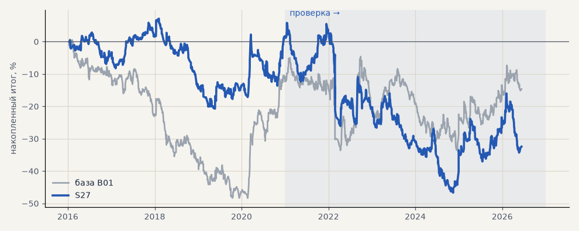

# S27. Трёхслойный фильтр, лучший на выборе

**Семейство:** стратегия без ML (импульс) · **база:** B01 · **гипотеза:** H44 · **вердикт:** хуже базы (выбор не переносится на проверку)

**Что проверяли.** Из 14 вариантов трёхслойного фильтра (режим по 4 ч / дням, удержание, KAMA, окна от волатильности, Дончиан как шок, масштаб пар, пороги) взят лучший по 2016–2020 — пары EMA в 4 раза длиннее.

**Зачем.** Проверить, даёт ли подбор вариантов по прошлому преимущество на будущем.

**Итог простыми словами.** На выборе лучше базы, на проверке хуже: металлы −23% против +41%. Выбор по прошлому не переносится.

**Издержки:** профиль `base` (спред и свопы брокера)

Подробности: [results/trend_filter_tz.md](../../results/trend_filter_tz.md)

Проверка — сделки, открытые с 1 января 2021 года; выбор — до 2021. В скобках — база на тех же инструментах.

| срез | период | сделок | итог % | выигрышей | ожидание на сделку | PF | без 2 лучших | просадка | t | лет в плюсе |
|---|---|---|---|---|---|---|---|---|---|---|
| все инструменты | проверка | 1699 (1924) | -24.9 (-18.9) | 42% (41%) | -0.117% (-0.078%) | 0.93 (0.95) | -34.5 (-27.9) | -40.8 (-32.5) | -0.99 (-0.70) | 3/6 (1/6) |
| все инструменты | выбор | 1010 (1196) | -23.0 (-41.1) | 41% (39%) | -0.182% (-0.275%) | 0.85 (0.79) | -28.2 (-45.8) | -31.1 (-59.1) | -1.80 (-3.02) | 1/5 (1/5) |
| портфель 4 | проверка | 802 (896) | -33.6 (-2.3) | 40% (42%) | -0.168% (-0.010%) | 0.89 (0.99) | -48.9 (-17.7) | -52.5 (-28.9) | -1.10 (-0.07) | 2/6 (3/6) |
| портфель 4 | выбор | 558 (665) | +1.2 (-12.3) | 42% (41%) | +0.009% (-0.074%) | 1.01 (0.94) | -9.1 (-21.8) | -27.8 (-49.1) | 0.06 (-0.55) | 3/5 (1/5) |
| металлы (серебро + золото) | проверка | 455 (506) | -23.2 (+41.3) | 43% (44%) | -0.102% (+0.163%) | 0.91 (1.17) | -43.7 (+23.2) | -54.4 (-28.5) | -0.67 (1.18) | 2/6 (5/6) |
| металлы (серебро + золото) | выбор | 414 (461) | -0.5 (-11.5) | 41% (38%) | -0.003% (-0.050%) | 1.00 (0.94) | -19.0 (-30.4) | -34.1 (-55.8) | -0.02 (-0.41) | 2/5 (1/5) |
| серебро | проверка | 227 (243) | -75.1 (+58.1) | 41% (46%) | -0.331% (+0.239%) | 0.79 (1.18) | -116.2 (+21.9) | -104.1 (-51.2) | -1.23 (0.94) | 2/6 (5/6) |
| серебро | выбор | 197 (218) | +11.7 (+25.4) | 39% (37%) | +0.059% (+0.117%) | 1.06 (1.11) | -25.3 (-12.4) | -53.4 (-66.8) | 0.24 (0.52) | 2/5 (2/5) |
| золото | проверка | 228 (263) | +28.8 (+24.5) | 45% (42%) | +0.126% (+0.093%) | 1.20 (1.15) | +5.1 (-2.2) | -18.7 (-39.2) | 0.90 (0.73) | 3/6 (2/6) |
| золото | выбор | 217 (243) | -12.7 (-48.4) | 43% (40%) | -0.059% (-0.199%) | 0.91 (0.73) | -27.0 (-63.4) | -25.7 (-69.1) | -0.51 (-1.80) | 1/5 (2/5) |
| LKOH | проверка | 187 (214) | -29.4 (-59.3) | 44% (40%) | -0.157% (-0.277%) | 0.89 (0.80) | -50.3 (-80.9) | -67.9 (-89.9) | -0.55 (-1.23) | 2/6 (1/6) |
| LKOH | выбор | 109 (132) | +0.0 (-2.6) | 43% (45%) | +0.000% (-0.020%) | 1.00 (0.99) | -22.5 (-28.8) | -30.1 (-48.4) | 0.00 (-0.06) | 2/5 (2/5) |
| GAZP | проверка | 193 (219) | -36.5 (-23.3) | 39% (42%) | -0.189% (-0.106%) | 0.89 (0.94) | -93.3 (-83.4) | -107.7 (-112.1) | -0.47 (-0.22) | 3/6 (3/6) |
| GAZP | выбор | 123 (154) | -11.1 (-14.2) | 39% (40%) | -0.090% (-0.092%) | 0.94 (0.93) | -44.2 (-41.0) | -38.8 (-52.8) | -0.25 (-0.34) | 2/5 (3/5) |
| SBER | проверка | 195 (220) | +6.6 (+15.2) | 37% (37%) | +0.034% (+0.069%) | 1.03 (1.06) | -24.0 (-12.0) | -44.4 (-45.1) | 0.13 (0.30) | 2/6 (2/6) |
| SBER | выбор | 129 (161) | +4.1 (-57.8) | 50% (45%) | +0.032% (-0.359%) | 1.02 (0.79) | -19.6 (-82.3) | -52.8 (-89.8) | 0.10 (-1.21) | 3/5 (2/5) |
| MOEX | проверка | 190 (227) | -114.7 (-93.7) | 39% (37%) | -0.604% (-0.413%) | 0.63 (0.71) | -133.7 (-117.4) | -115.9 (-93.7) | -2.41 (-1.93) | 1/6 (1/6) |
| MOEX | выбор | 130 (153) | -85.3 (-75.4) | 40% (39%) | -0.656% (-0.493%) | 0.62 (0.70) | -101.0 (-93.1) | -91.2 (-102.6) | -2.21 (-1.79) | 0/5 (1/5) |
| MTSS | проверка | 165 (196) | -52.5 (-48.1) | 38% (39%) | -0.318% (-0.245%) | 0.79 (0.83) | -80.9 (-86.9) | -61.3 (-54.5) | -1.06 (-0.93) | 1/6 (2/6) |
| MTSS | выбор | 105 (135) | -91.1 (-155.9) | 36% (32%) | -0.867% (-1.155%) | 0.52 (0.39) | -107.0 (-171.3) | -91.1 (-155.9) | -2.80 (-4.42) | 1/5 (0/5) |
| ETH | проверка | 314 (342) | +73.7 (-24.2) | 46% (44%) | +0.235% (-0.071%) | 1.09 (0.98) | +5.9 (-82.2) | -82.3 (-115.3) | 0.52 (-0.17) | 4/6 (4/6) |

Журнал сделок: `trades.csv.gz` (инструмент, прогон, сторона, вход, выход, цены, результат после издержек, причина выхода).
