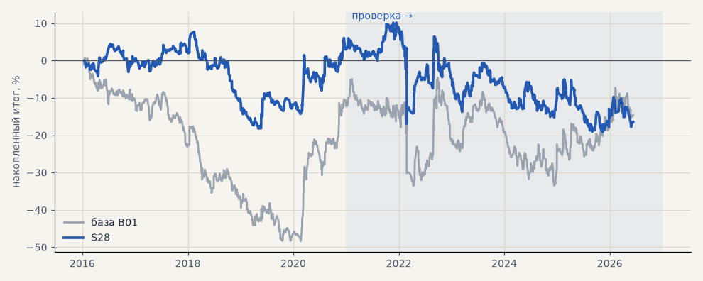

# S28. Тренд-фильтр Дончиан 55/20 на 4 ч

**Семейство:** стратегия без ML (импульс) · **база:** B01 · **гипотеза:** H45 · **вердикт:** хуже базы (выбор не переносится на проверку)

**Что проверяли.** Перебор 111 классических фильтров из списка параметров (одиночная EMA 9–200, наклон, пары 9/21 … 50/200 и Фибоначчи, MACD четырёх настроек × три вида сигнала, Supertrend, Дончиан 20/10 и 55/20, Кельтнер, Боллинджер, ADX > 20/25, KAMA) на 1 ч, 4 ч и днях; здесь — лучший по 2016–2020: Дончиан 55/20 на 4-часовых свечах.

**Зачем.** Найти классический фильтр направления лучше гейта C.

**Итог простыми словами.** Связь выбор → проверка по всем 111 нулевая (по PF 0.01, на металлах −0.3); лучший на выборе на проверке хуже базы. Гейт C на проверке — 2-й из 129 на металлах и 5-й на всех рынках, хотя на выборе 90-й: его преимущество — удача периода, а не умение.

**Издержки:** профиль `base` (спред и свопы брокера)

Подробности: [results/trend_filter_tz.md](../../results/trend_filter_tz.md)

Проверка — сделки, открытые с 1 января 2021 года; выбор — до 2021. В скобках — база на тех же инструментах.

| срез | период | сделок | итог % | выигрышей | ожидание на сделку | PF | без 2 лучших | просадка | t | лет в плюсе |
|---|---|---|---|---|---|---|---|---|---|---|
| все инструменты | проверка | 1318 (1924) | -8.0 (-18.9) | 42% (41%) | -0.049% (-0.078%) | 0.97 (0.95) | -17.6 (-27.9) | -17.6 (-32.5) | -0.36 (-0.70) | 3/6 (1/6) |
| все инструменты | выбор | 776 (1196) | -8.7 (-41.1) | 41% (39%) | -0.090% (-0.275%) | 0.93 (0.79) | -13.8 (-45.8) | -23.2 (-59.1) | -0.74 (-3.02) | 1/5 (1/5) |
| портфель 4 | проверка | 629 (896) | -19.6 (-2.3) | 43% (42%) | -0.125% (-0.010%) | 0.92 (0.99) | -34.4 (-17.7) | -29.3 (-28.9) | -0.71 (-0.07) | 1/6 (3/6) |
| портфель 4 | выбор | 445 (665) | +3.2 (-12.3) | 41% (41%) | +0.029% (-0.074%) | 1.02 (0.94) | -7.0 (-21.8) | -25.9 (-49.1) | 0.16 (-0.55) | 4/5 (1/5) |
| металлы (серебро + золото) | проверка | 372 (506) | -6.6 (+41.3) | 46% (44%) | -0.036% (+0.163%) | 0.97 (1.17) | -24.1 (+23.2) | -40.9 (-28.5) | -0.22 (1.18) | 3/6 (5/6) |
| металлы (серебро + золото) | выбор | 315 (461) | +9.4 (-11.5) | 41% (38%) | +0.060% (-0.050%) | 1.07 (0.94) | -10.9 (-30.4) | -31.8 (-55.8) | 0.37 (-0.41) | 2/5 (1/5) |
| серебро | проверка | 184 (243) | -27.2 (+58.1) | 45% (46%) | -0.148% (+0.239%) | 0.90 (1.18) | -62.2 (+21.9) | -77.9 (-51.2) | -0.50 (0.94) | 3/6 (5/6) |
| серебро | выбор | 159 (218) | +9.8 (+25.4) | 39% (37%) | +0.062% (+0.117%) | 1.06 (1.11) | -30.8 (-12.4) | -49.4 (-66.8) | 0.21 (0.52) | 2/5 (2/5) |
| золото | проверка | 188 (263) | +14.0 (+24.5) | 47% (42%) | +0.074% (+0.093%) | 1.11 (1.15) | -3.2 (-2.2) | -17.1 (-39.2) | 0.51 (0.73) | 4/6 (2/6) |
| золото | выбор | 156 (243) | +9.0 (-48.4) | 42% (40%) | +0.058% (-0.199%) | 1.10 (0.73) | -5.1 (-63.4) | -21.5 (-69.1) | 0.43 (-1.80) | 3/5 (2/5) |
| LKOH | проверка | 140 (214) | -12.4 (-59.3) | 46% (40%) | -0.088% (-0.277%) | 0.94 (0.80) | -33.3 (-80.9) | -52.1 (-89.9) | -0.25 (-1.23) | 4/6 (1/6) |
| LKOH | выбор | 87 (132) | +0.7 (-2.6) | 40% (45%) | +0.008% (-0.020%) | 1.01 (0.99) | -23.8 (-28.8) | -32.3 (-48.4) | 0.02 (-0.06) | 1/5 (2/5) |
| GAZP | проверка | 152 (219) | -77.2 (-23.3) | 39% (42%) | -0.508% (-0.106%) | 0.73 (0.94) | -126.3 (-83.4) | -101.9 (-112.1) | -1.09 (-0.22) | 1/6 (3/6) |
| GAZP | выбор | 89 (154) | +10.0 (-14.2) | 42% (40%) | +0.112% (-0.092%) | 1.08 (0.93) | -23.1 (-41.0) | -37.1 (-52.8) | 0.25 (-0.34) | 2/5 (3/5) |
| SBER | проверка | 153 (220) | +38.3 (+15.2) | 40% (37%) | +0.251% (+0.069%) | 1.23 (1.06) | +7.8 (-12.0) | -40.7 (-45.1) | 0.86 (0.30) | 4/6 (2/6) |
| SBER | выбор | 110 (161) | -7.7 (-57.8) | 45% (45%) | -0.070% (-0.359%) | 0.95 (0.79) | -29.6 (-82.3) | -47.9 (-89.8) | -0.19 (-1.21) | 3/5 (2/5) |
| MOEX | проверка | 147 (227) | -27.4 (-93.7) | 40% (37%) | -0.186% (-0.413%) | 0.87 (0.71) | -63.7 (-117.4) | -65.0 (-93.7) | -0.58 (-1.93) | 2/6 (1/6) |
| MOEX | выбор | 93 (153) | -31.1 (-75.4) | 42% (39%) | -0.334% (-0.493%) | 0.78 (0.70) | -46.5 (-93.1) | -58.1 (-102.6) | -0.96 (-1.79) | 1/5 (1/5) |
| MTSS | проверка | 128 (196) | -25.0 (-48.1) | 37% (39%) | -0.195% (-0.245%) | 0.88 (0.83) | -61.2 (-86.9) | -50.0 (-54.5) | -0.49 (-0.93) | 2/6 (2/6) |
| MTSS | выбор | 82 (135) | -60.3 (-155.9) | 39% (32%) | -0.735% (-1.155%) | 0.57 (0.39) | -74.8 (-171.3) | -62.4 (-155.9) | -2.08 (-4.42) | 0/5 (0/5) |
| ETH | проверка | 226 (342) | +52.8 (-24.2) | 42% (44%) | +0.234% (-0.071%) | 1.09 (0.98) | -11.9 (-82.2) | -82.2 (-115.3) | 0.45 (-0.17) | 4/6 (4/6) |

Журнал сделок: `trades.csv.gz` (инструмент, прогон, сторона, вход, выход, цены, результат после издержек, причина выхода).
