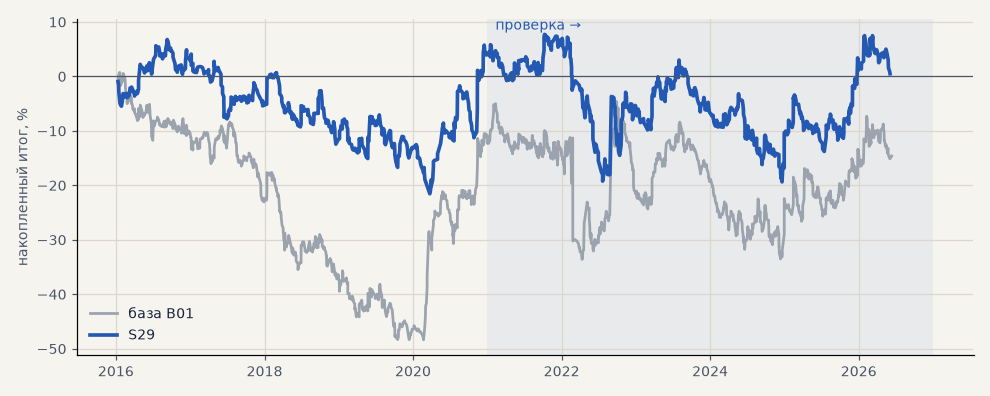

# S29. Импульс без фильтра направления, только лонг

**Семейство:** стратегия без ML (импульс) · **база:** B01 · **гипотеза:** H45 · **вердикт:** хуже базы на металлах, на портфеле 4 как база

**Что проверяли.** Импульс без тренд-фильтра и только в лонг на всех рынках — эталон «всегда лонг» из перебора.

**Зачем.** Планка для любого фильтра направления: если фильтр не лучше «всегда лонг», он не определяет направление.

**Итог простыми словами.** На выборе лучше всех 128 фильтров, включая гейт C; на проверке металлы +18% против +41% у базы, портфель 4 −4% против −2%.

**Издержки:** профиль `base` (спред и свопы брокера)

Подробности: [results/trend_filter_tz.md](../../results/trend_filter_tz.md)

Проверка — сделки, открытые с 1 января 2021 года; выбор — до 2021. В скобках — база на тех же инструментах.

| срез | период | сделок | итог % | выигрышей | ожидание на сделку | PF | без 2 лучших | просадка | t | лет в плюсе |
|---|---|---|---|---|---|---|---|---|---|---|
| все инструменты | проверка | 1471 (1924) | -2.7 (-18.9) | 39% (41%) | -0.015% (-0.078%) | 0.99 (0.95) | -12.7 (-27.9) | -16.9 (-32.5) | -0.13 (-0.70) | 3/6 (1/6) |
| все инструменты | выбор | 913 (1196) | +3.2 (-41.1) | 42% (39%) | +0.028% (-0.275%) | 1.03 (0.79) | -1.4 (-45.8) | -21.0 (-59.1) | 0.27 (-3.02) | 2/5 (1/5) |
| портфель 4 | проверка | 678 (896) | -3.6 (-2.3) | 39% (42%) | -0.021% (-0.010%) | 0.98 (0.99) | -19.3 (-17.7) | -27.1 (-28.9) | -0.14 (-0.07) | 2/6 (3/6) |
| портфель 4 | выбор | 517 (665) | +4.1 (-12.3) | 41% (41%) | +0.032% (-0.074%) | 1.03 (0.94) | -5.1 (-21.8) | -28.3 (-49.1) | 0.20 (-0.55) | 2/5 (1/5) |
| металлы (серебро + золото) | проверка | 403 (506) | +18.2 (+41.3) | 43% (44%) | +0.090% (+0.163%) | 1.09 (1.17) | -0.3 (+23.2) | -36.8 (-28.5) | 0.56 (1.18) | 3/6 (5/6) |
| металлы (серебро + золото) | выбор | 366 (461) | +3.3 (-11.5) | 40% (38%) | +0.018% (-0.050%) | 1.02 (0.94) | -12.4 (-30.4) | -44.1 (-55.8) | 0.15 (-0.41) | 1/5 (1/5) |
| серебро | проверка | 190 (243) | +11.1 (+58.1) | 42% (46%) | +0.058% (+0.239%) | 1.04 (1.18) | -23.9 (+21.9) | -47.8 (-51.2) | 0.19 (0.94) | 3/6 (5/6) |
| серебро | выбор | 172 (218) | +1.7 (+25.4) | 37% (37%) | +0.010% (+0.117%) | 1.01 (1.11) | -29.8 (-12.4) | -56.9 (-66.8) | 0.04 (0.52) | 1/5 (2/5) |
| золото | проверка | 213 (263) | +25.4 (+24.5) | 45% (42%) | +0.119% (+0.093%) | 1.17 (1.15) | -1.4 (-2.2) | -31.3 (-39.2) | 0.78 (0.73) | 3/6 (2/6) |
| золото | выбор | 194 (243) | +4.9 (-48.4) | 42% (40%) | +0.025% (-0.199%) | 1.04 (0.73) | -9.3 (-63.4) | -35.4 (-69.1) | 0.22 (-1.80) | 3/5 (2/5) |
| LKOH | проверка | 157 (214) | +7.3 (-59.3) | 39% (40%) | +0.046% (-0.277%) | 1.04 (0.80) | -13.5 (-80.9) | -36.4 (-89.9) | 0.17 (-1.23) | 2/6 (1/6) |
| LKOH | выбор | 105 (132) | +0.9 (-2.6) | 39% (45%) | +0.008% (-0.020%) | 1.01 (0.99) | -29.6 (-28.8) | -37.3 (-48.4) | 0.02 (-0.06) | 3/5 (2/5) |
| GAZP | проверка | 166 (219) | -10.6 (-23.3) | 37% (42%) | -0.064% (-0.106%) | 0.96 (0.94) | -70.8 (-83.4) | -62.7 (-112.1) | -0.16 (-0.22) | 2/6 (3/6) |
| GAZP | выбор | 112 (154) | +12.2 (-14.2) | 41% (40%) | +0.109% (-0.092%) | 1.08 (0.93) | -20.9 (-41.0) | -33.4 (-52.8) | 0.30 (-0.34) | 2/5 (3/5) |
| SBER | проверка | 165 (220) | -22.3 (+15.2) | 39% (37%) | -0.135% (+0.069%) | 0.89 (1.06) | -50.1 (-12.0) | -53.6 (-45.1) | -0.51 (0.30) | 1/6 (2/6) |
| SBER | выбор | 128 (161) | +1.7 (-57.8) | 48% (45%) | +0.013% (-0.359%) | 1.01 (0.79) | -28.4 (-82.3) | -48.5 (-89.8) | 0.04 (-1.21) | 2/5 (2/5) |
| MOEX | проверка | 173 (227) | -57.3 (-93.7) | 36% (37%) | -0.331% (-0.413%) | 0.76 (0.71) | -76.8 (-117.4) | -75.5 (-93.7) | -1.38 (-1.93) | 2/6 (1/6) |
| MOEX | выбор | 105 (153) | +25.3 (-75.4) | 47% (39%) | +0.241% (-0.493%) | 1.21 (0.70) | +7.7 (-93.1) | -36.3 (-102.6) | 0.76 (-1.79) | 3/5 (1/5) |
| MTSS | проверка | 152 (196) | -38.1 (-48.1) | 33% (39%) | -0.251% (-0.245%) | 0.80 (0.83) | -86.5 (-86.9) | -53.4 (-54.5) | -0.78 (-0.93) | 3/6 (2/6) |
| MTSS | выбор | 97 (135) | -21.4 (-155.9) | 42% (32%) | -0.221% (-1.155%) | 0.84 (0.39) | -38.0 (-171.3) | -27.0 (-155.9) | -0.70 (-4.42) | 1/5 (0/5) |
| ETH | проверка | 255 (342) | +63.1 (-24.2) | 41% (44%) | +0.247% (-0.071%) | 1.11 (0.98) | -0.8 (-82.2) | -64.6 (-115.3) | 0.57 (-0.17) | 3/6 (4/6) |

Журнал сделок: `trades.csv.gz` (инструмент, прогон, сторона, вход, выход, цены, результат после издержек, причина выхода).
