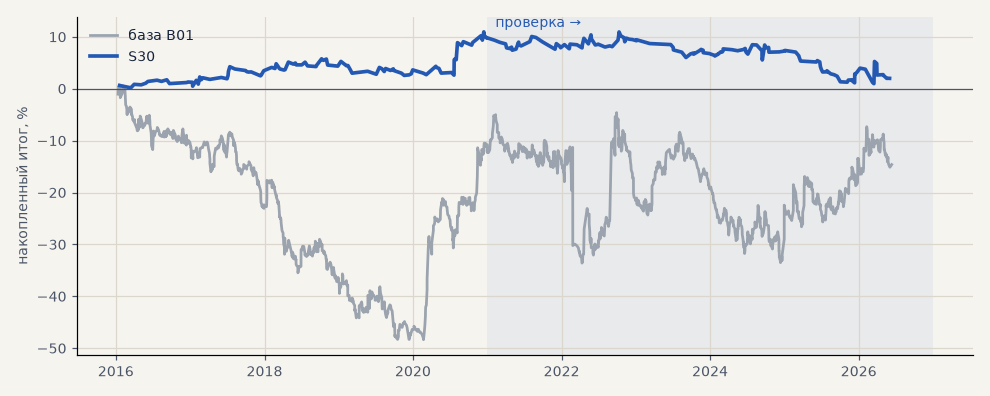

# S30. Вход по сжатию: NR7 + inside bar

**Семейство:** стратегия без ML (импульс) · **база:** B01 · **гипотеза:** H46 · **вердикт:** хуже базы

**Что проверяли.** Новый вход: вчерашний день — самый узкий за 7 дней (NR7) и целиком внутри позавчерашнего (inside bar); на следующий день первое закрытие часа выше его максимума — лонг, ниже минимума — шорт, по гейту C. Дневные свечи, а не часовые — чтобы не ловить тихие азиатские часы. Выход как у базы.

**Зачем.** Сжатие диапазона (Крабел) часто предшествует направленному движению.

**Итог простыми словами.** Лучший из 8 вариантов сжатия на выборе (NR7, NR4, inside bar, NR7 + inside bar, с гейтом и без), на проверке хуже базы: металлы −12% против +41%. Остальные варианты сжатия хуже.

**Издержки:** профиль `base` (спред и свопы брокера)

Подробности: [results/trend_filter_tz.md](../../results/trend_filter_tz.md)

Проверка — сделки, открытые с 1 января 2021 года; выбор — до 2021. В скобках — база на тех же инструментах.

| срез | период | сделок | итог % | выигрышей | ожидание на сделку | PF | без 2 лучших | просадка | t | лет в плюсе |
|---|---|---|---|---|---|---|---|---|---|---|
| все инструменты | проверка | 324 (1924) | -9.6 (-18.9) | 36% (41%) | -0.237% (-0.078%) | 0.80 (0.95) | -13.4 (-27.9) | -10.9 (-32.5) | -1.35 (-0.70) | 0/6 (1/6) |
| все инструменты | выбор | 194 (1196) | +4.9 (-41.1) | 46% (39%) | +0.202% (-0.275%) | 1.22 (0.79) | +1.8 (-45.8) | -4.2 (-59.1) | 1.02 (-3.02) | 3/5 (1/5) |
| портфель 4 | проверка | 133 (896) | -7.8 (-2.3) | 38% (42%) | -0.235% (-0.010%) | 0.80 (0.99) | -15.0 (-17.7) | -10.0 (-28.9) | -0.85 (-0.07) | 2/6 (3/6) |
| портфель 4 | выбор | 96 (665) | +9.8 (-12.3) | 49% (41%) | +0.410% (-0.074%) | 1.45 (0.94) | +3.6 (-21.8) | -3.2 (-49.1) | 1.31 (-0.55) | 4/5 (1/5) |
| металлы (серебро + золото) | проверка | 77 (506) | -11.9 (+41.3) | 38% (44%) | -0.310% (+0.163%) | 0.71 (1.17) | -23.9 (+23.2) | -12.6 (-28.5) | -0.86 (1.18) | 1/6 (5/6) |
| металлы (серебро + золото) | выбор | 79 (461) | +12.4 (-11.5) | 42% (38%) | +0.315% (-0.050%) | 1.50 (0.94) | -0.1 (-30.4) | -8.3 (-55.8) | 1.07 (-0.41) | 2/5 (1/5) |
| серебро | проверка | 31 (243) | -8.1 (+58.1) | 35% (46%) | -0.261% (+0.239%) | 0.83 (1.18) | -32.0 (+21.9) | -16.6 (-51.2) | -0.31 (0.94) | 2/6 (5/6) |
| серебро | выбор | 38 (218) | +19.2 (+25.4) | 45% (37%) | +0.505% (+0.117%) | 1.62 (1.11) | -5.8 (-12.4) | -10.1 (-66.8) | 0.91 (0.52) | 4/5 (2/5) |
| золото | проверка | 46 (263) | -15.8 (+24.5) | 39% (42%) | -0.343% (+0.093%) | 0.55 (1.15) | -23.0 (-2.2) | -16.3 (-39.2) | -1.52 (0.73) | 2/6 (2/6) |
| золото | выбор | 41 (243) | +5.7 (-48.4) | 39% (40%) | +0.138% (-0.199%) | 1.30 (0.73) | -4.0 (-63.4) | -9.7 (-69.1) | 0.57 (-1.80) | 2/5 (2/5) |
| LKOH | проверка | 36 (214) | -12.7 (-59.3) | 36% (40%) | -0.354% (-0.277%) | 0.64 (0.80) | -25.0 (-80.9) | -19.8 (-89.9) | -0.95 (-1.23) | 2/6 (1/6) |
| LKOH | выбор | 15 (132) | -13.6 (-2.6) | 27% (45%) | -0.908% (-0.020%) | 0.41 (0.99) | -22.1 (-28.8) | -19.9 (-48.4) | -1.34 (-0.06) | 1/5 (2/5) |
| GAZP | проверка | 35 (219) | -10.3 (-23.3) | 37% (42%) | -0.294% (-0.106%) | 0.77 (0.94) | -29.0 (-83.4) | -15.6 (-112.1) | -0.54 (-0.22) | 2/6 (3/6) |
| GAZP | выбор | 26 (154) | +11.4 (-14.2) | 58% (40%) | +0.438% (-0.092%) | 1.58 (0.93) | +0.6 (-41.0) | -6.3 (-52.8) | 0.87 (-0.34) | 3/5 (3/5) |
| SBER | проверка | 31 (220) | -0.2 (+15.2) | 42% (37%) | -0.006% (+0.069%) | 0.99 (1.06) | -10.9 (-12.0) | -14.0 (-45.1) | -0.01 (0.30) | 2/6 (2/6) |
| SBER | выбор | 17 (161) | +22.4 (-57.8) | 65% (45%) | +1.315% (-0.359%) | 2.63 (0.79) | +10.2 (-82.3) | -5.5 (-89.8) | 1.71 (-1.21) | 4/4 (2/5) |
| MOEX | проверка | 43 (227) | -33.5 (-93.7) | 26% (37%) | -0.780% (-0.413%) | 0.42 (0.71) | -42.1 (-117.4) | -37.3 (-93.7) | -2.26 (-1.93) | 1/6 (1/6) |
| MOEX | выбор | 27 (153) | -9.1 (-75.4) | 37% (39%) | -0.337% (-0.493%) | 0.76 (0.70) | -23.2 (-93.1) | -13.1 (-102.6) | -0.55 (-1.79) | 1/5 (1/5) |
| MTSS | проверка | 40 (196) | +1.7 (-48.1) | 28% (39%) | +0.043% (-0.245%) | 1.05 (0.83) | -14.6 (-86.9) | -19.5 (-54.5) | 0.10 (-0.93) | 1/5 (2/6) |
| MTSS | выбор | 30 (135) | +3.4 (-155.9) | 53% (32%) | +0.113% (-1.155%) | 1.11 (0.39) | -8.7 (-171.3) | -20.1 (-155.9) | 0.22 (-4.42) | 3/5 (0/5) |
| ETH | проверка | 62 (342) | +2.2 (-24.2) | 44% (44%) | +0.036% (-0.071%) | 1.02 (0.98) | -24.5 (-82.2) | -44.7 (-115.3) | 0.06 (-0.17) | 3/6 (4/6) |

Журнал сделок: `trades.csv.gz` (инструмент, прогон, сторона, вход, выход, цены, результат после издержек, причина выхода).
